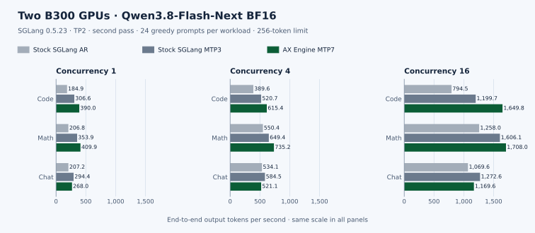

# AX Engine for SGLang

**AX Engine's Linux CUDA edition for NVIDIA GPUs on amd64 and arm64.**

`ax-engine-sglang` brings AX Engine's inference acceleration approach to
SGLang as a Python add-on. SGLang runs the server, schedules requests and
executes the model on CUDA. The add-on extends speculative decoding, state
verification and model-specific attention behavior.

The Apple Silicon edition runs on MLX. The two editions share speculative
acceptance rules and benchmark evidence contracts, with serving paths and
checkpoint formats specific to each runtime.
[Documentation](docs/README.md) · [Benchmarks](docs/performance.md) · [AX Engine](https://github.com/defai-digital/ax-engine)

## How it speeds up decoding

AX aims to emit more tokens per target-model pass while keeping the target in
charge of what gets emitted. On dense Qwen models, it can verify multiple
candidate continuations as a tree for one active request and use linear
chains when requests are batched. On Flash Next, it fixes the sparse
attention state so SGLang's multi-token prediction (MTP) can verify longer
drafts. Each route pays off when it saves more time in target passes than it
adds in drafting and verification.
[How it works and why we chose this design](docs/design.md)

## Quick start

Use Python 3.12 on Linux with an NVIDIA GPU and a CUDA 13-compatible driver.
Install the v0.4.0 GitHub release wheel in a fresh virtual environment.

```bash
python3.12 -m venv .venv
source .venv/bin/activate
python -m pip install https://github.com/defai-digital/ax-engine-sglang/releases/download/v0.4.0/ax_engine_sglang-0.4.0-py3-none-any.whl
```

Use `python -m pip install ./ax-engine-sglang` from the repository root for a
source checkout. If you already have a working SGLang 0.5.23 environment, add
`--no-deps` to install only the add-on.
[Installation and release status](docs/README.md#installation-and-release-status)

The `serve` command activates the AX plugin automatically and accepts SGLang
server flags. Use a GPU with enough memory for the target and the drafter.

```bash
ax-engine-sglang serve RadixArk/Qwen3.8-27B-NVFP4 \
  --speculative-algorithm FC1_DFLASH_TREE \
  --speculative-draft-model-path incoai/Qwen3.8-27B-DFlash2 \
  --speculative-num-draft-tokens 16
```

The 0.2.1 wheel served this target and drafter on Jetson Thor. A single greedy
request returned 32 tokens and the trace contained six DFlash2 tree rounds.
[Thor smoke test and flags](docs/README.md#021-installed-wheel-smoke-on-jetson-thor) · [Launch defaults and multi-user settings](ax-engine-sglang/README.md#launch-defaults)

## Changes in v0.4.0

- Add opt-in accepted-prefix GDN replay for stock width-eight DFlash2
  chains to reduce speculative state memory on a single GPU.
- Use one recurrent GDN verification launch per layer in the NVFP4 parity
  profile and support 64-candidate trees with eight request slots on RTX PRO 6000.
- Add Qwen3.8-27B NVFP4 speed and replay charts for GeForce RTX 5090.

[Release notes](https://github.com/defai-digital/ax-engine-sglang/releases/tag/v0.4.0) · [RTX 5090 benchmarks](#geforce-rtx-5090--qwen38-27b-nvfp4)

## Supported platforms

| Host | NVIDIA configurations with recorded runs |
|---|---|
| Linux amd64 (x86_64) | B300, B200, RTX PRO 6000, and GeForce RTX 5090 |
| Linux arm64 (aarch64) | Jetson Thor |

SGLang 0.5.23 is the reference runtime. Use a CUDA-enabled SGLang environment
with NVIDIA drivers and wheels or a container built for your host
architecture. Model, precision, memory and kernel requirements vary by
configuration. [Platform and model records](docs/README.md#platforms)

## SGLang compatibility and accelerated models

Use the standard SGLang server, client API and model loader. Stock AR, MTP
and DFlash are available for the models and configurations supported by
SGLang. The table lists the routes accelerated by this add-on.

| Model family | Measured target precision | What the add-on accelerates |
|---|---|---|
| Qwen3.5-9B | BF16 | DFlash v1 tree verification on eligible requests |
| Qwen3.8-27B dense | BF16 and NVFP4 | DFlash2 tree verification for eligible single requests and chain verification for grouped requests |
| Qwen3.8-Flash-Next (Qwen4-Exp) | BF16 and NVFP4 | SGLang MTP with the QSA pending-ring fix. DFlash2 tree serving remains unavailable |

For NVFP4, load an existing SGLang-compatible NVFP4 checkpoint with the
GPU kernels required by that checkpoint. Dense 27B and Flash Next were
verified on separate serving routes. [Model routes and precision support](docs/README.md#model-routes)

## Measured throughput

[Qwen3.8-27B](#qwen38-27b) · [Qwen3.8-Flash-Next](#qwen38-flash-next)

### Qwen3.8-27B

#### B200 · Qwen3.8-27B NVFP4

Greedy runs used 64 prompts per family, a 1,024-token output limit and 64
server slots. Each rate averages two passes. Values are output tok/s in
code / math / chat order.


| Concurrency | Stock SGLang + DFlash2 block 8 | SGLang + ax-engine-sglang |
|---|---:|---:|
| 1 | 816 / 733 / 401 | **1,160 / 971 / 458** (tree 16) |
| 16 | 3,628 / 4,670 / 2,980 | **4,379.5 / 4,989 / 3,110** (chain 8) |

[Full B200 27B benchmark and launch settings](docs/performance.md#b200--qwen38-27b)

##### Experimental recurrent GDN replay

The benchmark overlay used width-8 stock DFlash2 on one B200 with SGLang
0.5.23 and 32 request slots. Both timed runs used the same 64 greedy NVFP4
chat prompts at concurrency 16 and a 1,024-token output limit.


| DFlash2 configuration | Output tok/s | Median decode tok/s per request | Median time to first token |
|---|---:|---:|---:|
| Stock GDN snapshots | 2,685.6 | 190.2 | 130 ms |
| Recurrent GDN replay overlay | **2,957.3** | **210.5** | 129 ms |

Replay raised aggregate throughput by **10.1%**. A separate 256-token
check matched all **64 of 64** stock greedy sequences.
[Benchmark data and reproduction](docs/decisions/2026-11-16-dual-attention-backend.md#recurrent-verification-with-accepted-prefix-replay-2026-11-20)

#### RTX PRO 6000 · Qwen3.8-27B NVFP4

All three routes used SGLang 0.5.23, the same target checkpoint, frozen
inputs and fixed 128-token greedy outputs.
Rates are end-to-end output tok/s pooled over two passes in speed mode.


| Concurrency and requests per pass | Stock SGLang AR | Stock SGLang + DFlash2 | SGLang + ax-engine-sglang |
|---|---:|---:|---:|
| 1, 10 requests | 54.41 | 124.50 (block 8) | **156.87** (tree 64) |
| 8, 40 requests | 388.29 | **489.86** (block 8) | 484.78 (tree 32, chain width 8) |

At concurrency one, tree 64 delivered **2.88×** stock AR and **1.26×**
stock DFlash2. At concurrency eight, stock DFlash2 and the add-on traded
the lead between passes and finished within about 1% of each other.
[Full RTX benchmark and launch settings](results/rtx_27b_nvfp4_speed/REPORT.md)

Fast tree 64 matched packed AR on one of ten complete sequences per pass.
The opt-in parity profile (`AX_NVFP4_VERIFY_PARITY=1`) gives AR decode and
verification the same projection kernels. Its tree and chain routes matched
its own AR reference on all ten complete sequences, and AR and tree passed
all 28 sampled distribution checks.

| Parity profile, 10 requests of exactly 128 tokens | C1 tok/s | C8 tok/s |
|---|---:|---:|
| Parity AR | 51.82 | 241.60 |
| Parity DFlash2 chain, width 8 | 115.43 | 474.94 |
| Parity DFlash2 tree, 16 nodes | 128.53 | 466.20 |
| Parity DFlash2 tree, 32 nodes | **131.58** | **538.61** |
| Parity DFlash2 tree, 64 nodes, `AX_SSM_POSITIONS=8` | 114.10 | 411.01 |

Every lane equalled parity AR on all ten inputs, and at concurrency eight
every request equalled the same request alone. The two C8 passes of one lane
differed by up to 45%, so compare C1. On the same pod, speed-profile tree 16
reached 126.59 tok/s at C1, and no speed-profile lane kept its outputs at
concurrency eight. The parity AR reference differs from packed AR.
[RTX parity results and limits](docs/reports/2026-11-20-rtx-nvfp4-parity-forced-128.md)

Those comparisons cover 128 tokens. With 1,024-token outputs, AR and chain 8
still equalled the AR reference on every sequence at concurrency 1, 2 and 8,
but the tree route differed on two of ten prompts, from output tokens 329 and
492. `AX_QUALITY_PROFILE=verified` applies the measured parity settings and
starts only on a route with exact-output evidence: AR, or the chain route
(`AX_TREE=0`, draft block 8) at 109–113 tok/s alone and 489–561 tok/s at
concurrency eight. It refuses the tree route. `ax-engine-sglang doctor` checks
a launch against these rules without loading the model.
[Verified profile gate](docs/reports/2026-11-21-verified-profile-gate.md) · [Profile settings](ax-engine-sglang/README.md#launch-check-quality-profile-and-adaptive-chain-width)

#### GeForce RTX 5090 · Qwen3.8-27B NVFP4

One 32 GB RTX 5090 ran SGLang 0.5.23 with two GPU request slots. Each
request generated 128 greedy tokens from the same frozen inputs used on
the RTX PRO 6000. Rates pool two passes and include prefill and local HTTP
overhead.


| Concurrency and requests per pass | Stock SGLang AR | Stock SGLang + DFlash2, block 8 | SGLang + ax-engine-sglang |
|---|---:|---:|---:|
| 1, 10 requests | 57.64 | 125.01 | **135.18** (tree 32) |
| 2, 40 requests | 101.77 | **182.38** | 181.36 (tree 32, chain width 8) |

At concurrency one, AX Engine delivered **2.35×** stock AR and **8.1%**
more throughput than stock DFlash2. At concurrency two, the speculative
routes were within **0.6%** of each other. These are speed-profile runs
with verification parity disabled. Both speculative routes matched packed
AR on 0 of 10 complete outputs per pass at concurrency one.
[Full RTX 5090 benchmark and launch settings](results/rtx_5090_27b_nvfp4/REPORT.md)

The optional FP8 parity retest used the same prompts and 128-token outputs.
AR, tree 16 and chain 8 each matched all 100 sequences from the serialized
AR reference across concurrency one and two.
[RTX 5090 parity results](results/rtx_5090_27b_nvfp4/REPORT.md#fp8-parity-retest)

##### Experimental recurrent GDN replay

The width-eight DFlash2 follow-up used the same checkpoint, inputs, and
fixed 128-token outputs. The C1 and C2 rates pool four passes per route
with two server slots. The C8 run used eight slots and two passes.


| Concurrency | Stock DFlash2 output tok/s | AX GDN replay output tok/s |
|---:|---:|---:|
| 1 | 123.21 | 124.39 |
| 2 | 178.67 | 181.19 |
| 8 | GPU memory limit | **389.63** |

At two slots, replay replaced **3.38 GiB** of speculative state snapshots
with about **0.017 GiB** of replay buffers. The two-slot runs matched all
**200 of 200** complete stock DFlash2 outputs. The eight-slot replay run
also passed cancellation and slot reuse checks.
[Replay benchmark and validation](results/rtx_5090_27b_nvfp4/REPORT.md#accepted-prefix-gdn-replay-follow-up)

#### Jetson Thor · Qwen3.8-27B

Single-request SGLang 0.5.23 runs on arm64 with FlashInfer. Each row gives
code / math / chat output tok/s. NVFP4 used a 512-token output limit and
BF16 used a 384-token limit.


| Target precision | Stock SGLang AR | Stock SGLang + DFlash2 chain 16 | SGLang + ax-engine-sglang tree 32 |
|---|---:|---:|---:|
| NVFP4 | 13.4 / 13.5 / 13.5 | 93.0 / 73.5 / 30.6 | **106.1 / 92.1 / 43.1** |
| BF16 | 4.6 / 4.6 / 4.6 | 43.1 / 29.6 / 12.5 | **47.5 / 37.6 / 18.3** |

[Thor workload details and launch settings](docs/performance.md#jetson-thor--qwen38-27b)

### Qwen3.8-Flash-Next

#### Two B300 GPUs · Qwen3.8-Flash-Next BF16

SGLang 0.5.23 ran the BF16 checkpoint with TP2 and an on-GPU BF16 KV cache.
The table and chart show end-to-end output tok/s from the second pass, with
24 greedy prompts per family and a 256-token output limit.



| Workload | Concurrency | Stock SGLang AR | Stock SGLang MTP3 | AX Engine MTP7 |
|---|---:|---:|---:|---:|
| Code | 1 | 184.9 | 306.6 | **390.0** |
| Code | 4 | 389.6 | 520.7 | **615.4** |
| Code | 16 | 794.5 | 1,199.7 | **1,649.8** |
| Math | 1 | 206.8 | 353.9 | **409.9** |
| Math | 4 | 550.4 | 649.4 | **735.2** |
| Math | 16 | 1,258.0 | 1,606.1 | **1,708.0** |
| Chat | 1 | 207.2 | **294.4** | 268.0 |
| Chat | 4 | 534.1 | **584.5** | 521.1 |
| Chat | 16 | 1,069.6 | **1,272.6** | 1,169.6 |

MTP7 beat stock MTP3 by **18–38% on code** and **6–16% on math**.
Stock MTP3 led on chat. Both MTP routes matched AR on six of seven greedy
references. AR and MTP7 passed all 28 sampled distribution checks.
[Full B300 benchmark and launch settings](results/b300-flash-next-bf16/REPORT.md)

#### Qwen3.8-Flash-Next NVFP4 · MTP

These single-request results use SGLang 0.5.23. The B200 figures come from
the second benchmark pass with a 256-token output limit. The Thor figures use
two arm64 hosts with pipeline parallelism over 2.5 GbE. Each cell gives
code / math / chat output tok/s.


| Platform | Stock SGLang AR | Stock SGLang MTP3 | MTP7 + ax-engine-sglang QSA fix |
|---|---:|---:|---:|
| One B200 | 204.9 / 212.5 / 211.7 | 435.2 / 432.3 / 334.4 | **547.9 / 487.7** / 296.8 |
| Two Jetson Thor hosts | 18.3 / 19.0 / 19.2 | 32.0 / 32.4 / 24.8 | **43.1 / 37.5** / 22.8 |

On both platforms, MTP7 with the QSA fix led on code and math. Stock MTP3
was faster than MTP7 on chat. The Thor study also measured MTP3 with the QSA
fix at **25.7 tok/s** on chat.
[Flash Next benchmark conditions and all routes](docs/performance.md#qwen38-flash-next-nvfp4--mtp)

## Documentation and repository layout

| Path | Use |
|---|---|
| [docs/](docs/) | Architecture, supported routes and validation records |
| [docs/performance.md](docs/performance.md) | Stock AR, stock speculation and add-on comparisons |
| [ax-engine-sglang/](ax-engine-sglang/) | Installable add-on and operational reference |
| [benchmarks/sglang/](benchmarks/sglang/) | Serving benchmarks and correctness checks |
| [benchmarks/baselines/](benchmarks/baselines/) | Shared prompts, speed and quality evaluation, and the vLLM baseline |
| [contracts/](contracts/) | Pinned benchmark evidence and speculative acceptance contracts |
| [results/](results/) | Benchmark reports |

This project grew out of Next-Concept Model experiments before moving to
target-verified speculative decoding. [Research history](docs/results-history.md)

## License

Apache License, Version 2.0. [License text](LICENSE) · [Third-party notices](ax-engine-sglang/NOTICE)
