# AX Engine for SGLang

**AX Engine's Linux CUDA edition for NVIDIA GPUs on amd64 and arm64.**

`ax-engine-sglang` brings AX Engine's inference acceleration approach to
SGLang as a Python add-on. SGLang runs the server, schedules requests and
executes the model on CUDA. The add-on extends speculative decoding, state
verification and model-specific attention behavior.

The Apple Silicon edition runs on MLX. The two editions share speculative
acceptance rules and benchmark evidence contracts, with serving paths and
checkpoint formats specific to each runtime.
[Documentation](docs/README.md) · [Benchmarks](docs/performance.md) · [AX Engine](https://github.com/defai-digital/ax-engine)

## How it speeds up decoding

AX aims to emit more tokens per target-model pass while keeping the target in
charge of what gets emitted. On dense Qwen models, it can verify multiple
candidate continuations as a tree for one active request and use linear
chains when requests are batched. On Flash Next, it fixes the sparse
attention state so SGLang's multi-token prediction (MTP) can verify longer
drafts. Each route pays off when it saves more time in target passes than it
adds in drafting and verification.
[How it works and why we chose this design](docs/design.md)

## Quick start

Use Python 3.12 on Linux with an NVIDIA GPU and a CUDA 13-compatible driver.
Install the v0.5.1 GitHub release wheel in a fresh virtual environment.

```bash
python3.12 -m venv .venv
source .venv/bin/activate
python -m pip install https://github.com/defai-digital/ax-engine-sglang/releases/download/v0.5.1/ax_engine_sglang-0.5.1-py3-none-any.whl
```

Use `python -m pip install ./ax-engine-sglang` from the repository root for a
source checkout. If you already have a working SGLang 0.5.23 environment, add
`--no-deps` to install only the add-on.
[Installation and release status](docs/README.md#installation-and-release-status)

The `serve` command activates the AX plugin automatically and accepts SGLang
server flags. Use a GPU with enough memory for the target and the drafter.

```bash
ax-engine-sglang serve RadixArk/Qwen3.8-27B-NVFP4 \
  --speculative-algorithm FC1_DFLASH_TREE \
  --speculative-draft-model-path incoai/Qwen3.8-27B-DFlash2 \
  --speculative-num-draft-tokens 16
```

Eligible single requests use the DFlash2 tree. Grouped requests use chain
verification. The same target and drafter are the measured dense NVFP4 route
on B200, RTX PRO 6000, RTX 5090, and Jetson Thor.
[Launch defaults](ax-engine-sglang/README.md#launch-defaults) · [Measured throughput](#measured-throughput)

## Changes in v0.5.1

Document the RTX PRO 6000 verification priorities for Qwen3.8-27B NVFP4,
including live FP8 tactic validation and verify-row sweeps informed by the
sibling AX engines. [Performance review](docs/decisions/2026-11-21-dflash-hotpath.md#rtx-pro-6000-target-verification-priorities)

## Changes in v0.5.0

- Add `ax-engine-sglang doctor` and a verified launch profile for AR and
  width-eight DFlash2 chain decoding.
- Add experimental chain width selection by live batch size and validate
  recurrent state capacity before loading weights.
- Measure accepted-prefix GDN replay on RTX PRO 6000, with live batch
  counters, cancellation checks, and Nsight phase timings.

[Release notes](https://github.com/defai-digital/ax-engine-sglang/releases/tag/v0.5.0) · [RTX PRO 6000 hot-path validation](results/rtx_pro_6000_hotpath_validation/REPORT.md)

## Supported platforms

| Host | NVIDIA configurations with recorded runs |
|---|---|
| Linux amd64 (x86_64) | B300, B200, RTX PRO 6000, and GeForce RTX 5090 |
| Linux arm64 (aarch64) | Jetson Thor |

SGLang 0.5.23 is the reference runtime. Use a CUDA-enabled SGLang environment
with NVIDIA drivers and wheels or a container built for your host
architecture. Model, precision, memory and kernel requirements vary by
configuration. [Platform and model records](docs/README.md#platforms)

## SGLang compatibility and accelerated models

Use the standard SGLang server, client API and model loader. Stock AR, MTP
and DFlash are available for the models and configurations supported by
SGLang. The table lists the routes accelerated by this add-on.

| Model family | Measured target precision | What the add-on accelerates |
|---|---|---|
| Qwen3.5-9B | BF16 | DFlash v1 tree verification on eligible requests |
| Qwen3.8-27B dense | BF16 and NVFP4 | DFlash2 tree verification for eligible single requests and chain verification for grouped requests |
| Qwen3.8-Flash-Next (Qwen4-Exp) | BF16 and NVFP4 | SGLang MTP with the QSA pending-ring fix. DFlash2 tree serving remains unavailable |

For NVFP4, load an existing SGLang-compatible NVFP4 checkpoint with the
GPU kernels required by that checkpoint. Dense 27B and Flash Next were
verified on separate serving routes. [Model routes and precision support](docs/README.md#model-routes)

## Measured throughput

[B300](#b300) · [B200](#b200) · [RTX PRO 6000](#rtx-pro-6000) · [GeForce RTX 5090](#geforce-rtx-5090) · [Jetson Thor](#jetson-thor)

Results are grouped by GPU, then by model (Qwen3.8-27B, then Qwen3.8-Flash-Next).

Rates are output tokens per second. A cell written as three numbers is
code / math / chat. The B200, RTX PRO 6000, and Flash Next serving retests
share one protocol: SGLang 0.5.23, eight request slots, 128 greedy output
tokens, and two streamed passes on the same prompt corpus. The Jetson,
RTX 5090, B300, and 1,024-token studies use the budgets named in their
headings. Compare rates inside one table. Launch commands and per-pass
results are in [Serving performance](docs/performance.md).

### B300

#### Two B300 GPUs · Qwen3.8-Flash-Next BF16

SGLang 0.5.23 ran the BF16 checkpoint with TP2 and an on-GPU BF16 KV cache.
The table and chart show end-to-end output tok/s from the second pass, with
24 greedy prompts per family and a 256-token output limit.


| Workload | Concurrency | Stock SGLang AR | Stock SGLang MTP3 | AX Engine MTP7 |
|---|---:|---:|---:|---:|
| Code | 1 | 184.9 | 306.6 | **390.0** |
| Code | 4 | 389.6 | 520.7 | **615.4** |
| Code | 16 | 794.5 | 1,199.7 | **1,649.8** |
| Math | 1 | 206.8 | 353.9 | **409.9** |
| Math | 4 | 550.4 | 649.4 | **735.2** |
| Math | 16 | 1,258.0 | 1,606.1 | **1,708.0** |
| Chat | 1 | 207.2 | **294.4** | 268.0 |
| Chat | 4 | 534.1 | **584.5** | 521.1 |
| Chat | 16 | 1,069.6 | **1,272.6** | 1,169.6 |

MTP7 beat stock MTP3 by **18–38% on code** and **6–16% on math**.
Stock MTP3 led on chat. Both MTP routes matched AR on six of seven greedy
references. AR and MTP7 passed all 28 sampled distribution checks.
[Full B300 benchmark and launch settings](results/b300-flash-next-bf16/REPORT.md)

### B200

#### B200 · Qwen3.8-27B NVFP4 serving retest

The add-on used a 32-node tree for one eligible request and a width-eight
chain when requests were grouped. GDN replay is the experimental
accepted-prefix path on width-eight DFlash2.

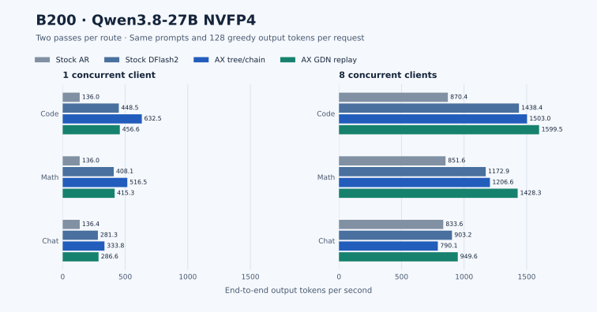

| Clients | Stock AR | Stock DFlash2 | AX tree/chain | AX GDN replay |
|---:|---:|---:|---:|---:|
| 1 | 136.0 / 136.0 / 136.4 | 448.5 / 408.1 / 281.3 | **632.5** / **516.5** / **333.8** | 456.6 / 415.3 / 286.6 |
| 8 | 870.4 / 851.6 / 833.6 | 1,438.4 / 1,172.9 / 903.2 | 1,503.0 / 1,206.6 / 790.1 | **1,599.5** / **1,428.3** / **949.6** |

At one client the tree led all three workloads. At eight clients, GDN
replay led stock DFlash2 by **11.2% / 21.8% / 5.1%**. A warmed AR check
after checkpoint staging reached 953.0 tok/s on chat, close to replay on
this short workload. These are speed-profile runs.
[Per-pass results](results/blackwell_nvfp4_serving_retest/REPORT.md#b200-qwen38-27b-nvfp4)

##### Earlier 1,024-token study

Sixty-four prompts per family, a 1,024-token limit, and 64 server slots.
Each rate is the mean of two passes. This study also records the
TensorRT-LLM 1.4 comparison.

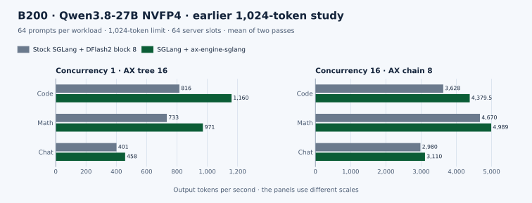

| Concurrency | Stock SGLang + DFlash2 block 8 | SGLang + ax-engine-sglang |
|---|---:|---:|
| 1 | 816 / 733 / 401 | **1,160 / 971 / 458** (tree 16) |
| 16 | 3,628 / 4,670 / 2,980 | **4,379.5 / 4,989 / 3,110** (chain 8) |

The add-on was **1.14×–1.42×** stock DFlash2 at one request and
**1.04×–1.21×** at concurrency 16.
[Full study](docs/performance.md#earlier-1024-token-study)

A separate overlay, with 32 slots and the same 64 chat prompts at
concurrency 16, replaced GDN snapshots with accepted-prefix replay.

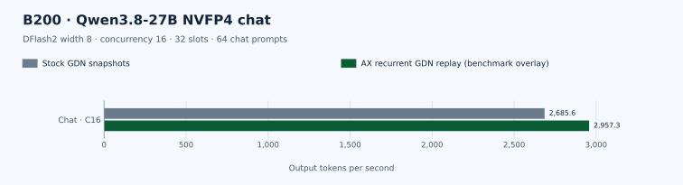

| DFlash2 configuration | Output tok/s | Median decode tok/s per request | Median time to first token |
|---|---:|---:|---:|
| Stock GDN snapshots | 2,685.6 | 190.2 | 130 ms |
| Recurrent GDN replay overlay | **2,957.3** | **210.5** | 129 ms |

Replay raised chat throughput by **10.1%**. A 256-token check matched all
**64 of 64** stock greedy sequences.
[Reproduction](docs/decisions/2026-11-16-dual-attention-backend.md#recurrent-verification-with-accepted-prefix-replay-2026-11-20)

#### B200 · Qwen3.8-Flash-Next NVFP4

The B200 served the same prompts with the same 128-token output budget.
Values are code / math / chat output tok/s pooled over two passes.

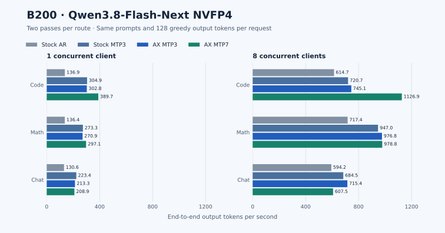

| Clients | Stock AR | Stock MTP3 | AX MTP3 | AX MTP7 |
|---:|---:|---:|---:|---:|
| 1 | 136.9 / 136.4 / 130.6 | 304.9 / 273.3 / **223.4** | 302.8 / 270.9 / 213.3 | **389.7** / **297.1** / 208.9 |
| 8 | 614.7 / 717.4 / 594.2 | 720.7 / 947.0 / 684.5 | 745.1 / 976.8 / **715.4** | **1,126.9** / **978.8** / 607.5 |

At eight clients, AX MTP7 led code and AX MTP3 led chat.
[B200 setup and per-pass results](docs/performance.md#b200-flash-next-serving-retest)

##### Earlier single-request MTP study

This study predates the 128-token serving retest above. It uses SGLang
0.5.23 and is the second pass with a 256-token output limit. Each cell
gives code / math / chat output tok/s.

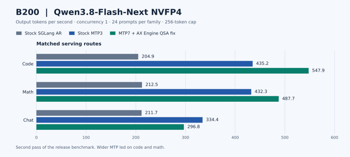

| Platform | Stock SGLang AR | Stock SGLang MTP3 | MTP7 + ax-engine-sglang QSA fix |
|---|---:|---:|---:|
| One B200 | 204.9 / 212.5 / 211.7 | 435.2 / 432.3 / 334.4 | **547.9 / 487.7** / 296.8 |

MTP7 with the QSA fix led on code and math. Stock MTP3 was faster than
MTP7 on chat.

[Flash Next benchmark conditions and all routes](docs/performance.md#qwen38-flash-next-nvfp4--mtp)

### RTX PRO 6000

#### RTX PRO 6000 · Qwen3.8-27B BF16 and NVFP4

Two passes per route used 128-token greedy outputs. Cells give end-to-end
output tok/s in code / math / chat order.

##### BF16


| Clients | Stock AR | Stock DFlash2 | AX tree / chain |
|---:|---:|---:|---:|
| 1 | 27.1 / 27.2 / 27.2 | 132.0 / 120.9 / 70.5 | **184.3** / **163.2** / **94.1** |
| 8 | 199.4 / 200.5 / 202.4 | 487.5 / 567.6 / 333.7 | **510.8** / **572.0** / **335.1** |

##### NVFP4

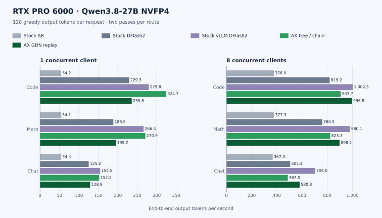

| Clients | Stock AR | Stock DFlash2 | AX tree / chain | AX GDN replay |
|---:|---:|---:|---:|---:|
| 1 | 54.2 / 54.1 / 54.4 | 229.3 / 188.5 / 125.2 | **324.7** / **270.9** / **152.2** | 235.8 / 195.2 / 128.9 |
| 8 | 376.0 / 377.3 / 367.0 | 819.2 / 760.5 / 505.3 | 907.7 / 823.3 / 487.0 | **996.8** / **898.1** / **580.8** |

At eight clients, BF16 tree/chain chat reached 335.1 tok/s and stock
DFlash2 reached 333.7. On NVFP4, GDN replay raised chat from 505.3 to
**580.8 tok/s (+14.9%)** and matched stock on all 48 greedy chat outputs.
The reverse-order run measured an 11.2% gain and matched 38 of 48 stock
outputs. The launch default is this 32-node tree.
[Retest, latency, and checkpoints](results/rtx_pro_6000_retest/REPORT.md)

The later hot-path run used the verified width-eight chain. It matched
serialized AR on all 40 outputs of 1,024 tokens, at **2.05×** AR throughput
at one client and **1.81×** at two and eight clients. On a warmed 512-token
chat set, accepted-prefix replay improved native DFlash2 by **16–18% at
eight clients** and **26–27% at 16 clients** in both launch orders.
[Cancellation and Nsight results](results/rtx_pro_6000_hotpath_validation/REPORT.md)

##### RTX PRO 6000 · FP8 verification tactics

At eight concurrent clients, both launch orders used 64 chat prompts
with exactly 512 greedy output tokens per request. The candidate cuBLAS
tactics improved throughput by **1.95–2.61%** and matched **57 of 64**
complete outputs in each order. The tactics remain experimental.

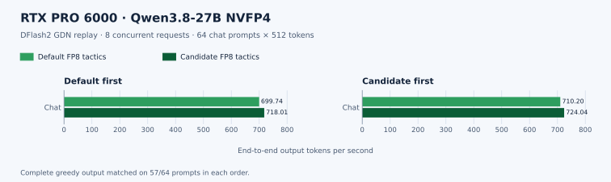

| First lane | Default (output tok/s) | Candidate (output tok/s) | Change | Exact outputs |
|---|---:|---:|---:|---:|
| Default | 699.74 | 718.01 | +2.61% | 57/64 |
| Candidate | 710.20 | 724.04 | +1.95% | 57/64 |

[RTX PRO 6000 operands and serving results](results/fp8_verify_tactics/REPORT.md#rtx-pro-6000-live-qwen38-27b-nvfp4) · [RTX 5090 serving results](#rtx-5090--fp8-verification-tactics) · [Thor-01 projection results](#thor-01--fp8-verification-projections)

With GDN replay already enabled, a separate draft KV graph added 0.8%
to eight-client streamed chat throughput and reduced throughput on the
frozen prompt set by 3.8%. [Draft KV graph measurements](results/rtx_pro_6000_kv_graph/REPORT.md)

[Streamed chat comparison for stock SGLang, ax-engine-sglang, and vLLM](results/rtx_pro_6000_plan_reuse/REPORT.md#sglang-ax-engine-sglang-and-vllm-on-rtx-pro-6000)

##### Earlier pooled speed sweep

Ten frozen prompts, 128-token outputs, and rates pooled across families.
This sweep is the source of the 64-node tree result. The serving retest
above splits code, math, and chat and uses the 32-node default.

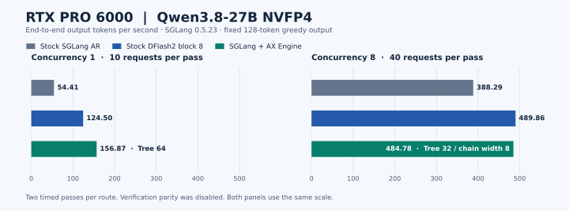

| Concurrency and requests per pass | Stock SGLang AR | Stock SGLang + DFlash2 | SGLang + ax-engine-sglang |
|---|---:|---:|---:|
| 1, 10 requests | 54.41 | 124.50 (block 8) | **156.87** (tree 64) |
| 8, 40 requests | 388.29 | **489.86** (block 8) | 484.78 (tree 32, chain width 8) |

Tree 64 delivered **2.88×** stock AR and **1.26×** stock DFlash2 at one
request. At eight requests the two speculative routes finished within
about 1%. Tree 64 matched packed AR on one of ten complete sequences per
pass. [Launch commands](results/rtx_27b_nvfp4_speed/REPORT.md)

##### Exact outputs

`AX_QUALITY_PROFILE=verified` turns on the parity numerics and refuses any
route that lacks a recorded match to serialized AR. On RTX PRO 6000, AR and
the width-eight chain matched at concurrency 1, 2, and 8: 1,000 of 1,000
sequences at 128 tokens, and 120 of 120 at 1,024 tokens. The 16-node tree
matched at 128 tokens and diverged on two of ten prompts at 1,024 tokens.
The first differences were output tokens 330 and 493. The profile refuses
the tree. In the verified-profile launch, the chain ran at 109–113 tok/s
alone and 489–561 tok/s at eight clients.

`ax-engine-sglang doctor` checks a planned launch against these rules
before any weights load. The speed-profile tables above do not carry this
match. The parity iterations that produced the profile, including the
faster value-tile timings, are in the performance notes.
[Verified profile gate](docs/reports/2026-11-21-verified-profile-gate.md) · [Parity history](docs/performance.md#rtx-speed-and-parity-profiles) · [Launch settings](ax-engine-sglang/README.md#launch-check-quality-profile-and-adaptive-chain-width)

##### Batched lattice trees and tree-shape tuning

One DFlash2 lattice tree per request for two to four greedy requests
(`AX_BTREE=4`, fused GDN kernels), with the tree temperature found by
offline Optuna tuning (`AX_TREE_TEMP=1.55`). 200 prompts, 256 output tokens,
NVFP4, output tok/s:

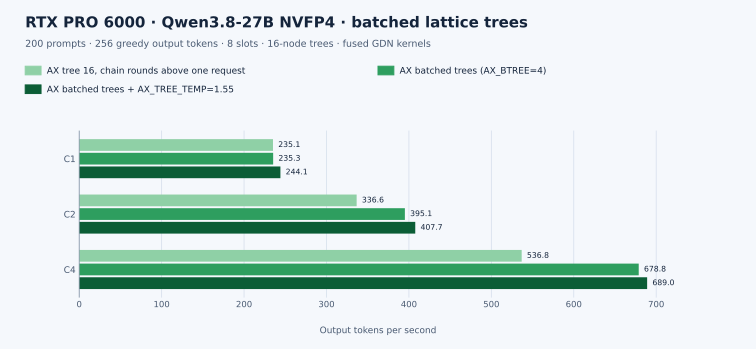

| Route | C1 | C2 | C4 |
|---|---:|---:|---:|
| Tree 16, chain rounds above one request | 235.1 | 336.6 | 536.8 |
| Batched trees (`AX_BTREE=4`) | 235.3 | 395.1 | 678.8 |
| Batched trees + `AX_TREE_TEMP=1.55` | **244.1** | **407.7** | **689.0** |

Experimental and off by default. With SGLang's native GDN kernels the
batched trees gained 0-2%.

[Benchmark report](results/rtx_pro_6000_tree_width/REPORT.md)

#### RTX PRO 6000 · Qwen3.8-Flash-Next NVFP4

One GPU served Flash Next with pinned-host FP8 PLE and 128 greedy output
tokens per request. Values pool two passes and show code / math / chat
output tok/s.

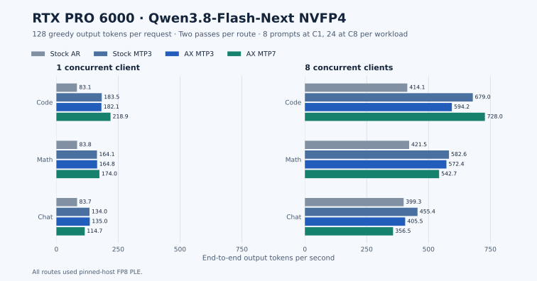

| Clients | Stock AR | Stock MTP3 | AX MTP3 | AX MTP7 |
|---:|---:|---:|---:|---:|
| 1 | 83.1 / 83.8 / 83.7 | 183.5 / 164.1 / 134.0 | 182.1 / 164.8 / **135.0** | **218.9** / **174.0** / 114.7 |
| 8 | 414.1 / 421.5 / 399.3 | 679.0 / **582.6** / **455.4** | 594.2 / 572.4 / 405.5 | **728.0** / 542.7 / 356.5 |

At eight clients, AX MTP7 led code at **728.0 tok/s**, and stock MTP3
led chat at **455.4 tok/s**. The first AX MTP3 chat pass was slower than
its repeat (363.7 vs. 458.2 tok/s).
[RTX PRO 6000 Flash Next retest](results/blackwell_nvfp4_serving_retest/REPORT.md#rtx-pro-6000-qwen38-flash-next-nvfp4)

### GeForce RTX 5090

#### GeForce RTX 5090 · Qwen3.8-27B NVFP4

One 32 GB RTX 5090 ran SGLang 0.5.23 with two GPU request slots. Each
request generated 128 greedy tokens from the same frozen inputs used on
the RTX PRO 6000. Rates pool two passes and include prefill and local HTTP
overhead.


| Concurrency and requests per pass | Stock SGLang AR | Stock SGLang + DFlash2, block 8 | SGLang + ax-engine-sglang |
|---|---:|---:|---:|
| 1, 10 requests | 57.64 | 125.01 | **135.18** (tree 32) |
| 2, 40 requests | 101.77 | **182.38** | 181.36 (tree 32, chain width 8) |

At concurrency one, AX Engine delivered **2.35×** stock AR and **8.1%**
more throughput than stock DFlash2. At concurrency two, the speculative
routes were within **0.6%** of each other. These are speed-profile runs
with verification parity disabled. Both speculative routes matched packed
AR on 0 of 10 complete outputs per pass at concurrency one.
[Full RTX 5090 benchmark and launch settings](results/rtx_5090_27b_nvfp4/REPORT.md)

The optional FP8 parity retest used the same prompts and 128-token outputs.
AR, tree 16 and chain 8 each matched all 100 sequences from the serialized
AR reference across concurrency one and two.
[RTX 5090 parity results](results/rtx_5090_27b_nvfp4/REPORT.md#fp8-parity-retest)

##### Experimental recurrent GDN replay

The width-eight DFlash2 follow-up used the same checkpoint, inputs, and
fixed 128-token outputs. The C1 and C2 rates pool four passes per route
with two server slots. The C8 run used eight slots and two passes.

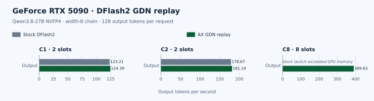

| Concurrency | Stock DFlash2 output tok/s | AX GDN replay output tok/s |
|---:|---:|---:|
| 1 | 123.21 | 124.39 |
| 2 | 178.67 | 181.19 |
| 8 | GPU memory limit | **389.63** |

At two slots, replay replaced **3.38 GiB** of speculative state snapshots
with about **0.017 GiB** of replay buffers. The two-slot runs matched all
**200 of 200** complete stock DFlash2 outputs. The eight-slot replay run
also passed cancellation and slot reuse checks.
[Replay benchmark and validation](results/rtx_5090_27b_nvfp4/REPORT.md#accepted-prefix-gdn-replay-follow-up)

##### RTX 5090 · FP8 verification tactics

The cuDNN candidate raised end-to-end throughput by **2.08–2.70%** on
Qwen3.8-27B NVFP4 at eight concurrent clients. It matched the default
cuBLAS lane on **10 of 64** complete greedy outputs in each launch order.

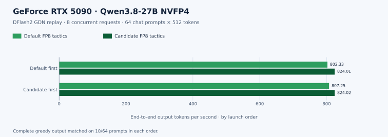

| First lane | Default (output tok/s) | Candidate (output tok/s) | Change | Exact outputs |
|---|---:|---:|---:|---:|
| Default | 802.33 | 824.01 | +2.70% | 10/64 |
| Candidate | 807.25 | 824.02 | +2.08% | 10/64 |

[Latency, graph coverage, and output checks](results/fp8_verify_tactics/REPORT.md#paired-serving-comparison)

### Jetson Thor

#### Jetson Thor · Qwen3.8-27B

Single-request runs on arm64: SGLang 0.5.23 with FlashInfer, and TensorRT
Edge-LLM 0.12.0 (`trtedge serve`) on the same checkpoint, drafter and
prompts. Each row gives code / math / chat output tok/s. NVFP4 used a
512-token output limit and BF16 used a 384-token limit.

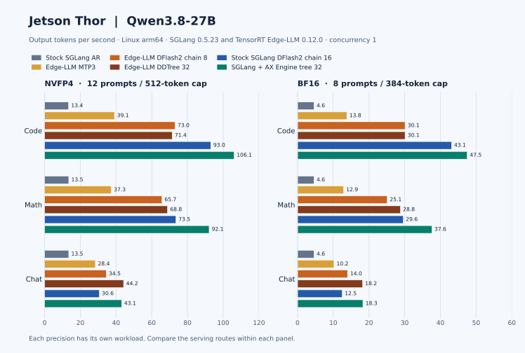

| Route | NVFP4 | BF16 |
|---|---:|---:|
| Stock SGLang AR | 13.4 / 13.5 / 13.5 | 4.6 / 4.6 / 4.6 |
| Edge-LLM AR | 13.3 / 13.3 / 13.3 | 4.7 / 4.7 / 4.7 |
| Stock SGLang MTP3 | 36.2 / 35.2 / 27.0 | 13.5 / 12.9 / 9.9 |
| Edge-LLM MTP3 | 39.1 / 37.3 / 28.4 | 13.8 / 12.9 / 10.2 |
| Edge-LLM DFlash2 chain 8 | 73.0 / 65.7 / 34.5 | 30.1 / 25.1 / 14.0 |
| Edge-LLM DDTree 32 | 71.4 / 68.8 / **44.2** | 30.1 / 28.8 / 18.2 |
| Stock SGLang + DFlash2 chain 16 | 93.0 / 73.5 / 30.6 | 43.1 / 29.6 / 12.5 |
| SGLang + ax-engine-sglang tree 32 | **106.1 / 92.1** / 43.1 | **47.5 / 37.6 / 18.3** |

The add-on's tree 32 ran 1.31–1.58 times as fast as Edge-LLM's DDTree 32
on code and math and tied it on chat. Edge-LLM's chain verifies the
drafter's block of 8 tokens.
[Edge-LLM setup, all lanes and failed runs](results/edgellm_thor/REPORT.md)

[Thor workload details and launch settings](docs/performance.md#jetson-thor--qwen38-27b)

##### DFlash2 draft vocabulary on Thor and Blackwell

The experimental draft vocabulary subset (`AX_DFLASH_DRAFT_VOCAB=1`,
148,736 of 248,320 rows) cut isolated projection and top-k time by
**39.8–40.5%** on Thor-01. Inside the server, it saved 46–90 µs per
B200 draft graph and 583–860 µs per Thor-01 draft graph, at every live
batch size tested. That saving is below 1% of a decode round, and
end-to-end throughput did not improve.

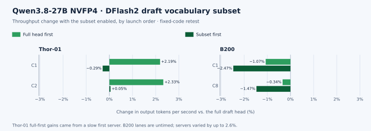

| GPU | Live requests | Draft graph saving | Share of round | Throughput change, warm servers |
|---|---:|---:|---:|---:|
| Thor-01 | 1 | 812–860 µs | 0.8–0.9% | −0.29% |
| Thor-01 | 2 | 583–595 µs | 0.6% | +0.05% |
| B200 | 1 | 56–59 µs | 0.4% | −2.47% to −0.46% |
| B200 | 8 | 46–90 µs | 0.3–0.7% | −1.47% to +0.26% |

The subset head cannot propose an excluded token, so tokens per verify
fell 0.29–0.60% at one and two requests. At eight requests, one
excluded token in any request sends the batch to the full head; B200
used the subset in 70 of 315 such rounds. The excluded range contains
35,568 ASCII tokens, including Markdown tokens such as `**.` and `):**`.
All outputs matched the full head. Throughput varied by up to 2.6%
between server launches, and the first server on each host ran slower.
The earlier +6.52% B200 C1 result came from a first full-head server.
The flag stays off by default.

[Graph timing, launch orders and analysis](results/dflash_draft_vocab/REPORT.md#fixed-code-retest-with-graph-timing) · [Earlier slot-refill and fixed-group results](results/dflash_draft_vocab/REPORT.md#serving-validation)

##### Thor-01 · FP8 verification projections

The fastest bit-exact tactics reduced 64-row projection time by **4.49%**
for GDN QKVZ and **5.88%** for attention QKV versus default cuBLAS. The
test timed individual projections on synthetic CUDA inputs.

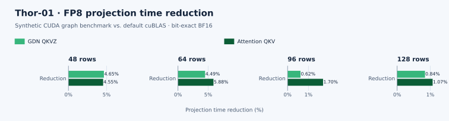

| Verification rows | GDN QKVZ time reduction | Attention QKV time reduction |
|---:|---:|---:|
| 48 | 4.65% | 4.55% |
| 64 | **4.49%** | **5.88%** |
| 96 | 0.62% | 1.70% |
| 128 | 0.84% | 1.07% |

[Before and after timings](docs/performance.md#fp8-verification-projections) · [Benchmark report](results/fp8_verify_tactics/REPORT.md)

#### One Jetson Thor · Qwen3.8-Flash-Next NVFP4

One Thor served Flash Next with the PLE table on local NVMe. Each row
gives output tok/s at one and four concurrent requests from the same 48
greedy prompts per workload, with a 256-token limit.

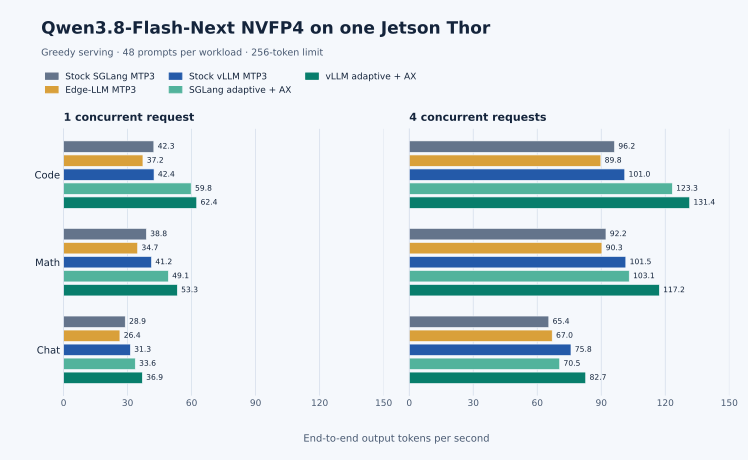

| Configuration | Code C1 / C4 | Math C1 / C4 | Chat C1 / C4 |
|---|---:|---:|---:|
| Edge-LLM 0.12.0 MTP3 | 37.2 / 89.8 | 34.7 / 90.3 | 26.4 / 67.0 |
| Stock SGLang MTP3 | 42.3 / 96.2 | 38.8 / 92.2 | 28.9 / 65.4 |
| Stock vLLM MTP3 | 42.4 / 101.0 | 41.2 / 101.5 | 31.3 / 75.8 |
| AX SGLang adaptive MTP + 64K draft vocabulary | 59.8 / 123.3 | 49.1 / 103.1 | 33.6 / 70.5 |
| AX vLLM adaptive MTP + NVFP4 draft head | **62.4 / 131.4** | **53.3 / 117.2** | **36.9 / 82.7** |

AX SGLang's adaptive configuration improved throughput across all six
levels over stock SGLang MTP3. The AX vLLM configuration led the measured
comparison. Edge-LLM served NVIDIA's NVFP4 checkpoint because the RadixArk
checkpoint used by the other rows failed to load. Its MTP3 geomean was 6%
below stock SGLang MTP3.
[Edge-LLM lanes](results/edgellm_thor/REPORT.md#qwen38-flash-next-nvfp4-concurrency-1-and-4)
[Single-Thor setup, tuning, and answer quality](docs/reports/2026-11-21-flash-next-single-thor.md)

##### Earlier two-host MTP study

This study predates the single-Thor runs above. It uses SGLang 0.5.23, two
arm64 hosts and pipeline parallelism over 2.5 GbE. Each cell gives code /
math / chat output tok/s.

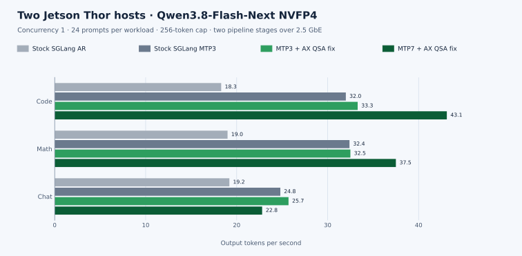

| Platform | Stock SGLang AR | Stock SGLang MTP3 | MTP7 + ax-engine-sglang QSA fix |
|---|---:|---:|---:|
| Two Jetson Thor hosts | 18.3 / 19.0 / 19.2 | 32.0 / 32.4 / 24.8 | **43.1 / 37.5** / 22.8 |

MTP7 with the QSA fix led on code and math. Stock MTP3 was faster than
MTP7 on chat; MTP3 with the QSA fix reached **25.7 tok/s** on chat.

[Flash Next benchmark conditions and all routes](docs/performance.md#qwen38-flash-next-nvfp4--mtp)

## Documentation and repository layout

| Path | Use |
|---|---|
| [docs/](docs/) | Architecture, supported routes and validation records |
| [docs/performance.md](docs/performance.md) | Stock AR, stock speculation and add-on comparisons |
| [ax-engine-sglang/](ax-engine-sglang/) | Installable add-on and operational reference |
| [benchmarks/sglang/](benchmarks/sglang/) | Serving benchmarks and correctness checks |
| [benchmarks/baselines/](benchmarks/baselines/) | Shared prompts, speed and quality evaluation, and the vLLM baseline |
| [contracts/](contracts/) | Pinned benchmark evidence and speculative acceptance contracts |
| [results/](results/) | Benchmark reports |

This project grew out of Next-Concept Model experiments before moving to
target-verified speculative decoding. [Research history](docs/results-history.md)

## License

Apache License, Version 2.0. [License text](LICENSE) · [Third-party notices](ax-engine-sglang/NOTICE)
