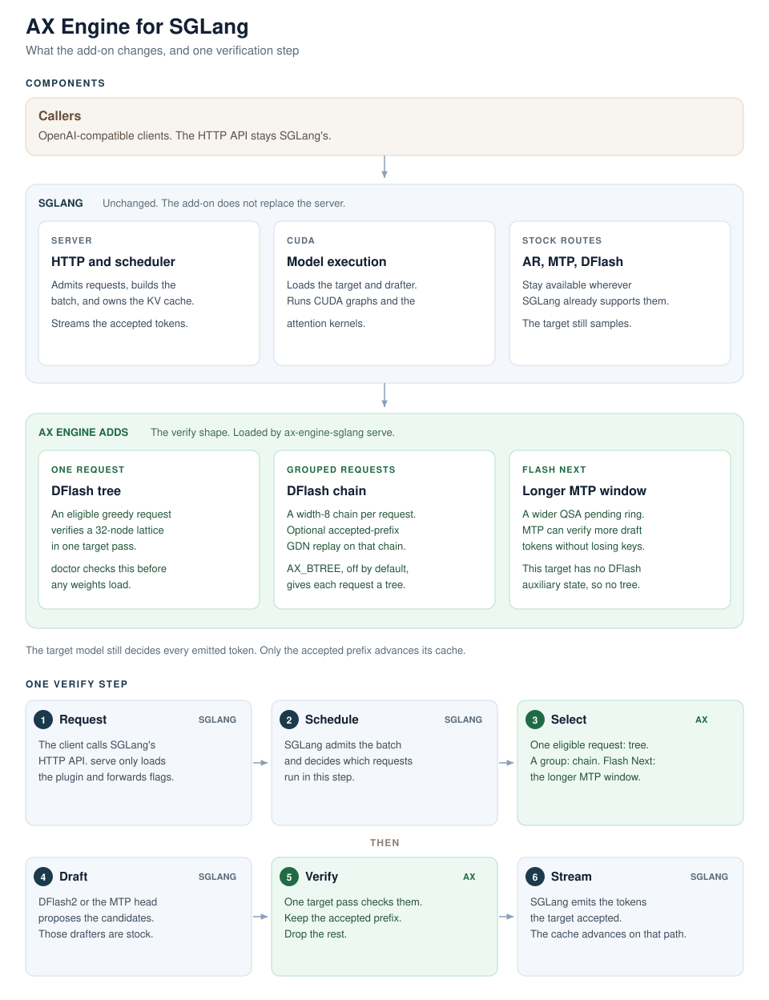
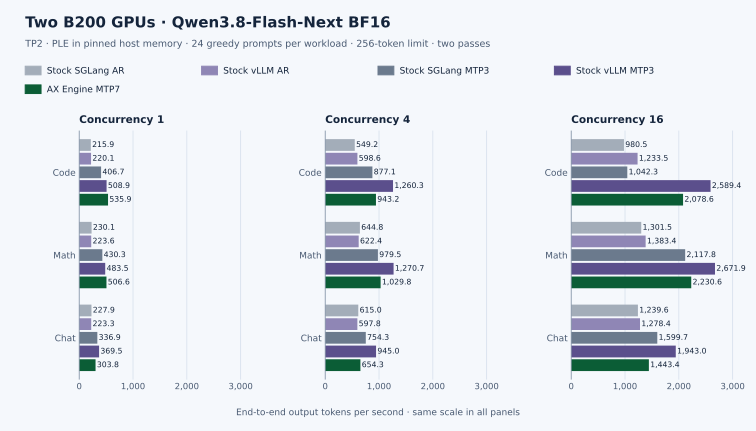
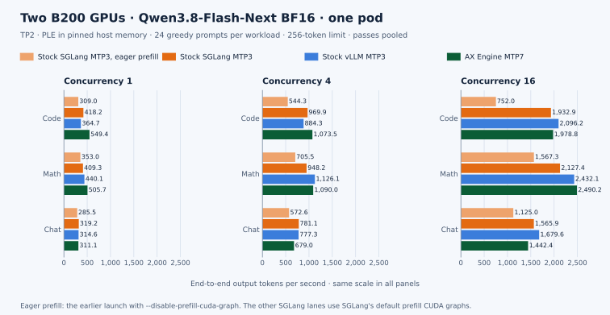
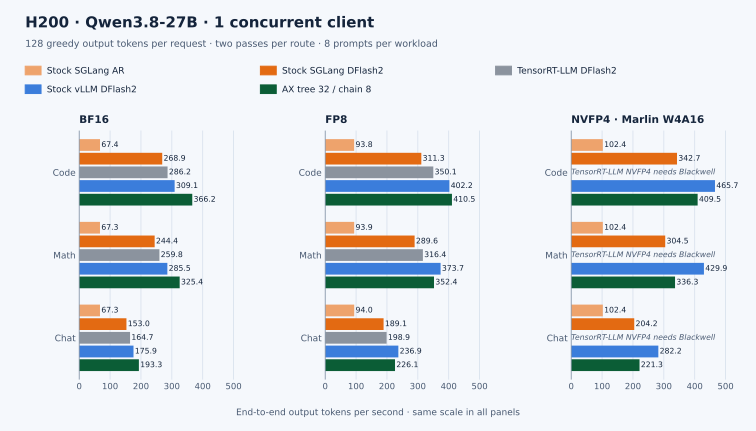
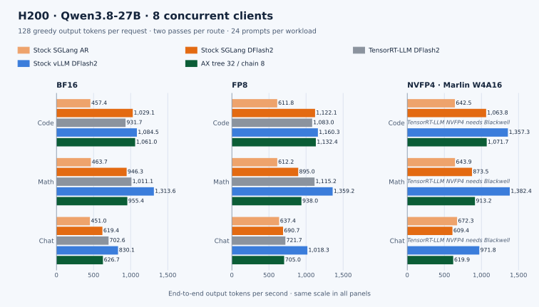
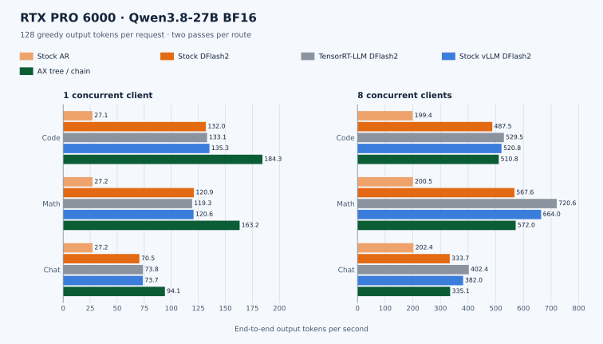
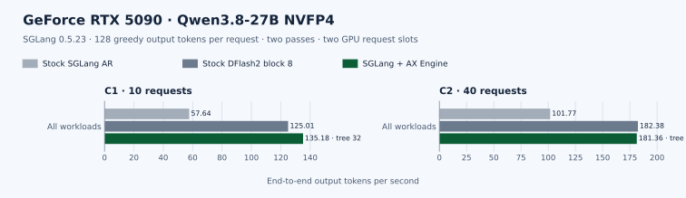

<div align="center">


# AX Engine for SGLang

[](https://github.com/defai-digital/ax-engine-sglang/actions/workflows/ci.yml)
[](https://pypi.org/project/ax-engine-sglang/)
[](#supported-platforms)
[](#quick-start)
[](LICENSE)

</div>

**AX Engine's Linux CUDA edition for NVIDIA Hopper, NVIDIA Blackwell, and the NVIDIA Jetson series.**

`ax-engine-sglang` is a Python add-on for SGLang. SGLang runs the server,
schedules requests, and executes the model on CUDA. The add-on changes
speculative verification: a DFlash tree for one eligible request, chain
verification when requests are grouped, and a QSA pending-ring fix so
Flash Next multi-token prediction can verify a longer draft. The target
model still decides every emitted token.

The Apple Silicon edition runs on MLX. The editions share acceptance rules
and the benchmark record schema. Serving paths and checkpoints stay
specific to each runtime.
[Documentation](docs/README.md) · [How it works](docs/design.md) · [Benchmarks](docs/performance.md) · [AX Engine](https://github.com/defai-digital/ax-engine)

## Contents

- [Components and workflow](#components-and-workflow)
- [Quick start](#quick-start)
- [What it accelerates](#what-it-accelerates)
- [Supported platforms](#supported-platforms)
- [Measured throughput](#measured-throughput): [B200](#b200) · [H200](#h200) · [RTX PRO 6000](#rtx-pro-6000) · [RTX 5090](#rtx-5090) · [Jetson Thor](#jetson-thor) · [Exact outputs](#exact-outputs)
- [Repository](#repository)
- [Contributing](#contributing)
- [License](#license)

## Components and workflow



Callers use SGLang's HTTP API. An OpenAI-compatible client, or SGLang's own
client, is the supported caller. This edition does not ship a client SDK.
`ax-engine-sglang serve` loads the plugin into that server and forwards its
flags. SGLang keeps the scheduler, CUDA execution, and the stock
autoregressive, MTP, and DFlash routes. The plugin adds the verify shape:
a DFlash tree for one eligible greedy request, a chain when requests are
grouped, and a wider QSA ring so Flash Next MTP can check a longer draft.
The target model still decides every emitted token.
[How it works](docs/design.md)

## Quick start

Use Python 3.11 or 3.12 on Linux with a Hopper, Blackwell, or Jetson GPU
and a CUDA 13-compatible driver. SGLang 0.5.23 is the reference runtime. Install the
v0.5.1 wheel in a fresh virtual environment:

```bash
python3.12 -m venv .venv
source .venv/bin/activate
python -m pip install https://github.com/defai-digital/ax-engine-sglang/releases/download/v0.5.1/ax_engine_sglang-0.5.1-py3-none-any.whl
```

From a source checkout, use `python -m pip install ./ax-engine-sglang`.
If SGLang 0.5.23 is already installed, add `--no-deps`.
[Install matrix](docs/README.md#installation-and-release-status) · [Release notes](https://github.com/defai-digital/ax-engine-sglang/releases)

`serve` loads the AX plugin and forwards SGLang server flags. The target
and drafter below are the measured dense NVFP4 route on B200, RTX PRO
6000, RTX 5090, and Jetson Thor. The GPU needs memory for both checkpoints.

```bash
ax-engine-sglang serve RadixArk/Qwen3.8-27B-NVFP4 \
  --speculative-algorithm FC1_DFLASH_TREE \
  --speculative-draft-model-path incoai/Qwen3.8-27B-DFlash2 \
  --speculative-num-draft-tokens 16
```

On SGLang 0.5.23 the launcher fills the measured tree settings: 32 nodes,
a DFlash2 lattice, and fused verification. One eligible greedy request
uses that tree. Grouped requests use a DFlash2 chain.
`ax-engine-sglang doctor` checks a planned launch against the same rules
and does not load weights.
[Launch defaults](ax-engine-sglang/README.md#launch-defaults)

## What it accelerates

Stock autoregressive decoding, MTP, and DFlash stay available wherever
SGLang supports them. The add-on adds these routes.

| Model | Measured precision | Add-on route |
|---|---|---|
| Qwen3.5-9B | BF16 | DFlash v1 tree on an eligible request |
| Qwen3.8-27B dense | BF16 and NVFP4 | DFlash2 tree for one eligible request, and chain verification when requests are grouped. Accepted-prefix GDN replay is an experimental chain option. `AX_BTREE` (off by default) gives each request in a batch of 2–8 its own tree in one target pass |
| Qwen3.8-Flash-Next (Qwen4-Exp) | BF16 and NVFP4 | SGLang MTP plus a QSA pending-ring fix. This target does not expose the auxiliary states DFlash2 reads, so the tree is unavailable. BF16 needs two GPUs |

A route is faster when the tokens accepted per target pass save more time
than drafting and verification add.
[Model routes](docs/README.md#model-routes) · [Design](docs/design.md)

## Supported platforms

Support follows the CUDA compute capability. The measured board is the
run recorded in this repository. Another product on the same capability
uses the same kernels; it is not a second report. On Linux amd64 that is
NVIDIA Hopper and NVIDIA Blackwell. On Linux arm64 it is NVIDIA Jetson at
SM110, which is Jetson Thor.

Hopper at SM90 covers H100 and H200. Package 0.5.1 ran the 27B tree
and chain routes on one H200 for BF16, FP8 and NVFP4 (through Marlin
W4A16). The NVFP4 verify and GDN recurrent kernels are SM12-only and stay
off there.
[H200 retest](#h200) · [Earlier H200 baselines](results/track_a_stage0_h200/REPORT.md)

| Platform | Host | Capability | Measured board |
|---|---|---|---|
| NVIDIA Hopper | Linux amd64 (x86_64) | SM90 | H200 |
| NVIDIA Blackwell | Linux amd64 (x86_64) | SM100 | B200 |
| | | SM120 | RTX PRO 6000 Blackwell Server Edition |
| | | SM120 | GeForce RTX 5090 |
| NVIDIA Jetson | Linux arm64 (aarch64) | SM110 | Jetson Thor |

The plugin also accepts SGLang 0.5.22 when its source anchors match. On
0.5.22, supply the launch settings yourself. `AX_AUTO_DEFAULTS` fills them
on 0.5.23.
[Platform records](docs/README.md#platforms)

## Measured throughput

Compare numbers inside one study. The current cross-route comparison is
the serving retest: SGLang 0.5.23, 128 greedy output tokens, eight request
slots, two streamed passes, and the same prompt corpus. Cells are code /
math / chat output tokens per second. Studies with 256, 512, or 1,024
tokens, a different slot count, or a pooled prompt mix do not substitute
for these rates. Sections run by GPU, then model (Flash Next before 27B),
then precision (BF16 before NVFP4). Full tables, the TensorRT-LLM
comparison, and the kernel ablations are in
[Serving performance](docs/performance.md).

### B200

#### Qwen3.8-Flash-Next BF16

BF16 weights are about 360 GB, so this checkpoint does not fit one B200.
Two B200s served it with tensor parallelism of 2 and the PLE table in
pinned host memory. The greedy limit was 256 tokens at concurrency 1, 4,
and 16. AX MTP7 led code and math at one client. Stock vLLM MTP3 led chat
there, and led every workload at 4 and 16 clients. TensorRT-LLM 1.4.0rc3
failed in its first decode step.



[Two-B200 study](docs/performance.md#qwen38-flash-next-bf16-mtp)

Those SGLang lanes ran with `--disable-prefill-cuda-graph`. Eager prefills
took two to three times as long as vLLM's, and each one stalled the
running decode batch. A rerun on one pod used SGLang's default prefill CUDA
graphs and stock vLLM MTP3 as the reference. Stock SGLang MTP3 rose 34–78%
at four clients and 36–157% at sixteen, to within 16% of vLLM in every
cell. AX MTP7 then led code at one and four clients (549.4 and 1,073.5
tok/s against 364.7 and 884.3), was level on math, and trailed vLLM on
chat by up to 14%. That pod was slower than the first for both engines.



[Prefill-graph rerun](results/b200x2_flash_next_prefill_graph/REPORT.md)

#### Qwen3.8-Flash-Next NVFP4

The 128-token retest on one B200. AX MTP7 led code at both concurrencies.
Chat stayed with a three-step MTP window.


| Clients | Stock MTP3 | AX MTP7 | Chat leader |
|---:|---:|---:|---|
| 1 | 304.9 / 273.3 / 223.4 | 389.7 / 297.1 / 208.9 | stock MTP3, 223.4 |
| 8 | 720.7 / 947.0 / 684.5 | 1,126.9 / 978.8 / 607.5 | AX MTP3, 715.4 |

[B200 Flash Next tables](docs/performance.md#b200-flash-next-serving-retest)

#### Qwen3.8-27B NVFP4

The add-on used a 32-node tree at one client and a width-eight chain when
requests were grouped. GDN replay is the experimental accepted-prefix path
on that chain. These are speed-profile runs with package 0.5.1.


| Clients | Stock DFlash2 | AX tree/chain | AX GDN replay |
|---:|---:|---:|---:|
| 1 | 448.5 / 408.1 / 281.3 | **632.5 / 516.5 / 333.8** | 456.6 / 415.3 / 286.6 |
| 8 | 1,438.4 / 1,172.9 / 903.2 | 1,503.0 / 1,206.6 / 790.1 | **1,599.5 / 1,428.3 / 949.6** |

At one client the tree led. At eight clients, GDN replay led stock
DFlash2 by 11.2% / 21.8% / 5.1%.
[B200 per-pass results](docs/performance.md#b200-qwen38-27b)

### H200

#### Qwen3.8-Flash-Next NVFP4

Only stock vLLM served it on one H200, through its FP4 Marlin fallback
with MTP3. SGLang 0.5.23 ran out of memory while repacking the 512
experts for Marlin (138 GB allocated, PLE table already on the host), so
the SGLang and AX lanes did not run.

| Clients | Stock vLLM MTP3 | Tokens per verify |
|---:|---:|---:|
| 1 | 259.9 / 247.1 / 246.1 | 3.84 / 3.42 / 2.68 |
| 8 | 846.4 / 727.1 / 710.0 | 3.83 / 3.42 / 2.61 |

The second sweep ran slower than the first by up to 30%; the cells pool
both.
[H200 Flash Next](results/cross_engine_2026-11-25/REPORT.md#h200-qwen38-flash-next-nvfp4)

#### Qwen3.8-27B BF16, FP8 and NVFP4

The same 128-token retest on one H200 (SM90, 141 GB): BF16, the official
`Qwen/Qwen3.8-27B-FP8` checkpoint, and NVFP4 through Marlin W4A16, since
Hopper has no FP4 tensor cores. Stock vLLM and TensorRT-LLM 1.4.0rc3
served the same token IDs with the same DFlash2 drafter.





| Precision | Clients | Stock SGLang DFlash2 | TensorRT-LLM DFlash2 | Stock vLLM DFlash2 | AX tree/chain |
|---|---:|---:|---:|---:|---:|
| BF16 | 1 | 268.9 / 244.4 / 153.0 | 286.2 / 259.8 / 164.7 | 309.1 / 285.5 / 175.9 | **366.2 / 325.4 / 193.3** |
| BF16 | 8 | 1,029.1 / 946.3 / 619.4 | 931.7 / 1,011.1 / 702.6 | **1,084.5 / 1,313.6 / 830.1** | 1,061.0 / 955.4 / 626.7 |
| FP8 | 1 | 311.3 / 289.6 / 189.1 | 350.1 / 316.4 / 198.9 | 402.2 / **373.7 / 236.9** | **410.5** / 352.4 / 226.1 |
| FP8 | 8 | 1,122.1 / 895.0 / 690.7 | 1,083.0 / 1,115.2 / 721.7 | **1,160.3 / 1,359.2 / 1,018.3** | 1,132.4 / 938.0 / 705.0 |
| NVFP4 | 1 | 342.7 / 304.5 / 204.2 | needs Blackwell | **465.7 / 429.9 / 282.2** | 409.5 / 336.3 / 221.3 |
| NVFP4 | 8 | 1,063.8 / 873.5 / 609.4 | needs Blackwell | **1,357.3 / 1,382.4 / 971.8** | 1,071.7 / 913.2 / 619.9 |

At one client the tree led BF16 on every workload and FP8 on code. Stock
vLLM led the rest, and every workload at eight clients. The tree accepted
more tokens per verify at one client (10.3–11.4 on code against vLLM's
6.5–7.1), so the FP8 and NVFP4 gap is per-step cost, not draft quality.
[H200 report](results/cross_engine_2026-11-25/REPORT.md#h200-qwen38-27b-bf16-fp8-and-nvfp4)

A second H200 pod swept the AX routes with package 0.5.1, which sets
`AX_TREE_TEMP=1.55` by default (stock ran 5–10% faster on that pod). At one
client tree 32 reached 443.3 / 388.1 / 246.6 tok/s on FP8 against 332.1 /
307.2 / 197.9 for stock DFlash2, and 448.5 / 379.9 / 248.8 on NVFP4
against 368.5 / 324.9 / 214.7. Tree 16 finished within 2% of tree 32, so
the 32-node default stays. GEMMs are about 80% of a verify round; Marlin
W4A16 alone is 44–50% on NVFP4, and no faster bit-identical Marlin tile
exists for these shapes. The Gated-DeltaNet update, convolution and state
commit take about 8% of a round, so faster GDN kernels would gain at most
about 4%.
[H200 tree sweep](results/h200_tree_sweep/REPORT.md)

### RTX PRO 6000

#### Qwen3.8-Flash-Next NVFP4

The 128-token retest on one RTX PRO 6000. AX MTP7 led code at both
concurrencies.


| Clients | Stock MTP3 | AX MTP7 | Chat leader |
|---:|---:|---:|---|
| 1 | 183.5 / 164.1 / 134.0 | 218.9 / 174.0 / 114.7 | AX MTP3, 135.0 |
| 8 | 679.0 / 582.6 / 455.4 | 728.0 / 542.7 / 356.5 | stock MTP3, 455.4 |

[RTX PRO 6000 Flash Next tables](docs/performance.md#rtx-pro-6000-flash-next-serving-retest)

#### Qwen3.8-27B BF16

The same retest with package 0.4.0. The tree led at one client. At eight
clients TensorRT-LLM DFlash2 led every workload (529.5 / 720.6 / 402.4
tok/s).



| Clients | Stock DFlash2 | TensorRT-LLM DFlash2 | Stock vLLM DFlash2 | AX tree/chain |
|---:|---:|---:|---:|---:|
| 1 | 132.0 / 120.9 / 70.5 | 133.1 / 119.3 / 73.8 | 135.3 / 120.6 / 73.7 | **184.3 / 163.2 / 94.1** |
| 8 | 487.5 / 567.6 / 333.7 | **529.5 / 720.6 / 402.4** | 520.8 / 664.0 / 382.0 | 510.8 / 572.0 / 335.1 |

#### Qwen3.8-27B NVFP4

Package 0.4.0 on the same prompt corpus.


| Clients | Stock DFlash2 | TensorRT-LLM DFlash2 | Stock vLLM DFlash2 | AX tree/chain | AX GDN replay |
|---:|---:|---:|---:|---:|---:|
| 1 | 229.3 / 188.5 / 125.2 | 246.0 / 210.3 / 128.9 | 279.8 / 266.4 / **154.5** | **324.7 / 270.9** / 152.2 | 235.8 / 195.2 / 128.9 |
| 8 | 819.2 / 760.5 / 505.3 | 878.7 / **1,178.0** / 605.3 | **1,002.3** / 980.1 / **704.0** | 907.7 / 823.3 / 487.0 | 996.8 / 898.1 / 580.8 |

At one client the tree led code and math. At eight clients stock vLLM led
code and chat, TensorRT-LLM led math, and GDN replay raised SGLang chat
from 505.3 to 580.8 tok/s.
[RTX PRO 6000 per-pass results](docs/performance.md#rtx-pro-6000-qwen38-27b-nvfp4)

SGLang 0.5.23 runs the NVFP4 GEMMs on SM120 with FlashInfer CUTLASS. On
the 27B MLP shapes, FlashInfer cute-dsl was 23–37% faster at 8–64 rows. On
another RTX PRO 6000 pod, with the two backends alternating route by route,
cute-dsl raised one-client throughput by 6.2–6.9% for the tree, 15–18% for
GDN replay and 17–19% for stock DFlash2, with identical greedy outputs
(24/24 per route). At eight clients the second sweep moved by −3% to +12%.
The plugin now selects cute-dsl for dense NVFP4 targets on SM12x unless the
backend is set explicitly or parity is requested.
[FP4 backend report](results/rtx_pro_6000_fp4_backend/REPORT.md)

The SGLang rows above ran with `--disable-prefill-cuda-graph`, which the
27B harness passed. On a later RTX PRO 6000 (Workstation Edition, cute-dsl
GEMMs), SGLang's default prefill CUDA graphs raised every route by 7–16% at
one client and 16–34% at eight, with unchanged tokens per verify. Stock vLLM
DFlash2 ran on the same pod. With prefill graphs, AX GDN replay led it on
every workload at eight clients (1,464.4 / 1,389.7 / 835.2 against 1,144.9 /
1,157.5 / 775.5 tok/s), and the tree led every workload at one client
(464.8 / 389.5 / 222.0 against 317.2 / 292.0 / 182.9).


[Prefill-graph report](results/rtx_pro_6000_prefill_graph/REPORT.md)

### RTX 5090

#### Qwen3.8-27B NVFP4

On a 32 GB RTX 5090 the checkpoint used two slots and a pooled
ten-prompt mix. Tree 32 reached 135.18 tok/s at one request (2.35× stock
AR, 8.1% above stock DFlash2). At two requests the SGLang speculative
routes finished within 0.6%. Stock vLLM DFlash2, run later on the same
inputs, reached 168.5 and 279.6 tok/s. TensorRT-LLM DFlash2 ran out of
memory creating the target and drafter on the 32 GB card.

With FlashInfer cute-dsl NVFP4 GEMMs (now the add-on's default on SM12x)
in place of SGLang's CUTLASS choice, a later 5090 pod ran tree 32
at 333.3 / 281.0 / 177.9 tok/s at one request against 321.2 / 269.9 /
169.7. That is 4–5% faster at one request and 8–10% at two. Stock DFlash2
ran 9–14% faster. Greedy outputs matched on all 96 one-request requests
of each route. These runs used 128-token outputs on the retest prompts.
[FP4 backend report](results/rtx_pro_6000_fp4_backend/REPORT.md#rtx-5090)



[RTX 5090](docs/performance.md#geforce-rtx-5090-qwen38-27b-nvfp4)

### Jetson Thor

#### Qwen3.8-27B BF16 and NVFP4

On one Jetson Thor, tree 32 led Edge-LLM DDTree 32 on code and math and
tied it on chat, for both BF16 and NVFP4.


[Jetson Thor](docs/performance.md#jetson-thor-qwen38-27b)

### Exact outputs

`AX_QUALITY_PROFILE=verified` admits autoregressive decoding and the
width-eight DFlash2 chain on a qualified GPU. On RTX PRO 6000 those routes
matched serialized AR at 128 and 1,024 tokens. The 16-node tree diverged
on two of ten prompts at 1,024 tokens, so the profile refuses the tree.
The speed tables above do not carry that match.
[Verified profile](docs/reports/2026-11-21-verified-profile-gate.md)

## Repository

| Path | Use |
|---|---|
| [docs/](docs/) | Install, platforms, routes, and design |
| [docs/performance.md](docs/performance.md) | Full comparisons, older studies, and ablations |
| [ax-engine-sglang/](ax-engine-sglang/) | Package, launch defaults, and environment variables |
| [benchmarks/sglang/](benchmarks/sglang/) | Serving benchmarks and correctness checks |
| [contracts/](contracts/) | Benchmark record and acceptance contracts |
| [results/](results/) | Campaign reports |

The project started as Next-Concept Model experiments and moved to
target-verified speculative decoding.
[Research history](docs/results-history.md)

## Contributing

Issues, wishlist items, reproducible benchmarks, and docs feedback are welcome.
Unsolicited code PRs for verification, kernel, or performance paths are
generally not accepted — open an issue first. See [CONTRIBUTING.md](CONTRIBUTING.md).
Report security issues privately. See [SECURITY.md](SECURITY.md).
Participation follows the [Code of Conduct](CODE_OF_CONDUCT.md).

## Community

- Website: [automatosx.com](https://automatosx.com)
- Discord: [Join us](https://discord.gg/MECsKdA6zF)
- Email: [enquiry@defai.digital](mailto:enquiry@defai.digital)

## License

Apache License, Version 2.0. [License text](LICENSE) · [Third-party notices](ax-engine-sglang/NOTICE)
