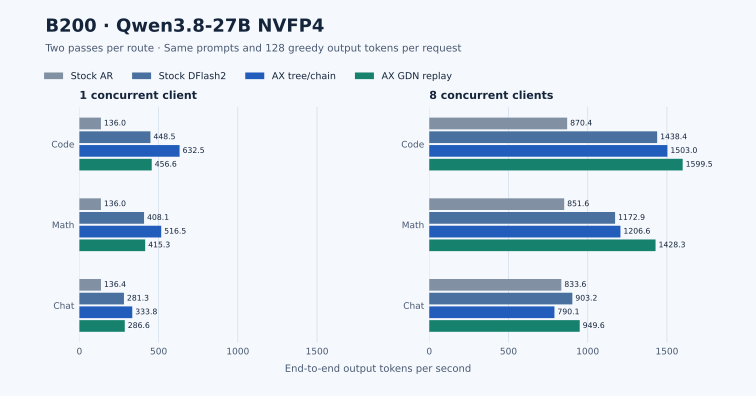
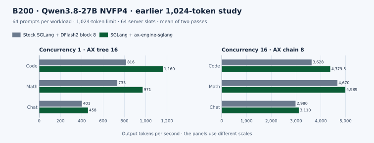
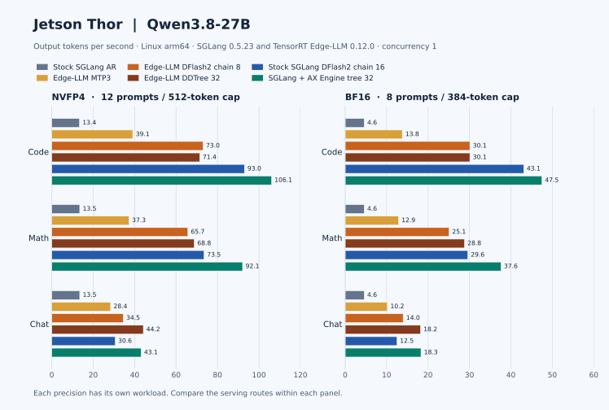

# AX Engine for SGLang

`ax-engine-sglang` is the SGLang add-on for AX Engine's Linux CUDA edition.
Deploy it on Linux amd64 (x86_64) or arm64 (aarch64) with a CUDA-enabled
SGLang environment and NVIDIA GPU. SGLang 0.5.23 is the reference release.
[Platform and model support](https://github.com/defai-digital/ax-engine-sglang/blob/main/docs/README.md) · [Side-by-side throughput](https://github.com/defai-digital/ax-engine-sglang/blob/main/docs/performance.md)

The Python distribution is `ax-engine-sglang`, the import is
`ax_engine_sglang`, and the SGLang plugin name is `ax-engine`. The plugin
integrates with the installed SGLang worker for DFlash-family speculative
verification. Its tree worker is generated at startup from installed
SGLang code and validates the expected upstream integration points.
[DForkTree attribution](https://github.com/defai-digital/ax-engine-sglang/blob/main/ax-engine-sglang/NOTICE)

## Install and run

Use Python 3.11 or 3.12 and a CUDA 13-compatible NVIDIA driver on Linux. In a
fresh virtual environment, install the [v0.5.1 release wheel](https://github.com/defai-digital/ax-engine-sglang/releases/download/v0.5.1/ax_engine_sglang-0.5.1-py3-none-any.whl)
to install the add-on and SGLang 0.5.23.

```bash
python -m pip install https://github.com/defai-digital/ax-engine-sglang/releases/download/v0.5.1/ax_engine_sglang-0.5.1-py3-none-any.whl
```

Use `python -m pip install ./ax-engine-sglang` from a source checkout. Add
`--no-deps` when you already have the pinned SGLang environment. An earlier
installed-wheel check on Jetson Thor used the 0.2.1 wheel in
`lmsysorg/sglang:v0.5.23-cu130`. The current package is 0.5.1.

```bash
ax-engine-sglang serve RadixArk/Qwen3.8-27B-NVFP4 \
  --speculative-algorithm FC1_DFLASH_TREE \
  --speculative-draft-model-path incoai/Qwen3.8-27B-DFlash2 \
  --speculative-num-draft-tokens 16
```

The command enables the plugin, passes the server flags to SGLang and stops
startup if AX fails to load. An existing `SGLANG_PLUGINS` allowlist retains
its entries. To use the upstream launcher directly, set `SGLANG_PLUGINS=ax-engine`.
On Jetson Thor, the 0.2.1 wheel served a 32-token request with six tree
rounds and rejected a checkpoint setting mismatch before loading weights.
That check is a startup record for the installed wheel, not a 0.5.1
throughput result.
[Smoke test and exact launch flags](https://github.com/defai-digital/ax-engine-sglang/blob/main/docs/README.md#installed-wheel-smoke-on-jetson-thor-v021)

## Experimental GDN replay for DFlash2 chains

On SGLang 0.5.23, AX can keep the recurrent GDN verifier and replay just the
accepted prefix into the FP32 state. The width-eight DFlash2 worker allocates
compact replay buffers in place of full speculative SSM snapshots. Use a
single CUDA GPU and disable the radix cache.

```bash
AX_GDN_CHAIN_REPLAY=1 ax-engine-sglang serve RadixArk/Qwen3.8-27B-NVFP4 \
  --speculative-algorithm DFLASH \
  --speculative-draft-model-path incoai/Qwen3.8-27B-DFlash2 \
  --speculative-num-draft-tokens 8 --disable-radix-cache \
  --max-running-requests 8 --cuda-graph-max-bs-decode 8
```

AX selects FP32 GDN state, Triton verify, and fold-after-accept replay for
this standalone chain. The option is experimental and currently covers
the dense Qwen3.8-27B target with static, width-eight verification.
[RTX 5090 validation](https://github.com/defai-digital/ax-engine-sglang/blob/main/results/rtx_5090_gdn_chain_replay/REPORT.md)

On RTX PRO 6000, replay raised warmed NVFP4 chat throughput by 16–18%
at C8 and 26–27% at C16 across both launch orders. Timed replay batches
recorded zero fallbacks. A 96-request stress run confirmed 12 cancellations,
zero errors, and identical reference outputs before and after. Use
`AX_QUALITY_PROFILE=verified` with the width-eight chain for the measured
exact-output configuration. [RTX PRO 6000 hot-path validation](../results/rtx_pro_6000_hotpath_validation/REPORT.md)

Add `AX_DFLASH_KV_GRAPH=1` to this launch to try CUDA graph replay for
the draft-context KV commit after verify. It captures per live batch size
through 16 when the draft uses the standard unquantized KV layout. Prefill
and incompatible rounds use the native eager writer. The CUDA cache check
matched eager exactly. On an RTX PRO 6000 at eight clients, the graph
raised streamed chat throughput by 0.8% and lowered frozen-prompt
throughput by 3.8%.
[RTX PRO 6000 measurements](../results/rtx_pro_6000_kv_graph/REPORT.md)

Use `AX_DFLASH_KV_DIRECT=1` with the GDN replay launch to test direct
BF16 draft KV writes. A single kernel handles the accepted rows across
all draft layers. Prefill and other KV layouts use the native writer.
The RTX PRO 6000 test measured a 0.25% gain on eight-client streamed chat.
[Direct writer measurements](../results/rtx_pro_6000_kv_direct/REPORT.md)

`AX_DFLASH_PLAN_REUSE=1` tests fixed-offset reuse and in-place page-ID
packing on the native FA2 verify CUDA graph. It requires the GDN replay
launch. Eight-client streamed chat was 1.45% slower on the RTX PRO 6000.
[Replay planning measurements](../results/rtx_pro_6000_plan_reuse/REPORT.md)

Add `AX_DFLASH_DRAFT_VOCAB=1` to this launch to try Splash-style draft
vocabulary reduction. Use `--attention-backend flashinfer` and
`--fp4-gemm-backend flashinfer_cutlass` for the NVFP4 checkpoint.
On eligible greedy batches, the draft graph projects
148,736 of 248,320 Qwen vocabulary rows and returns full-vocabulary token
IDs for verification. Batches with sampling, grammar constraints, or an
excluded token in any request's last 64 scheduler-visible tokens use the
full draft head. The packed head is for a static checkpoint. Keep the option
off for hot weight replacement.
[Thor validation and benchmark commands](../results/dflash_draft_vocab/REPORT.md)

## Launch defaults

On SGLang 0.5.23 the plugin fills in the settings below while SGLang resolves the server arguments,
so the command above runs the measured configuration. The launcher prints every value with its
origin (`auto` or `env`). Explicit values take priority. A mismatch with the
checkpoint stops the launch and reports the reason. `AX_AUTO_DEFAULTS=0` turns
off these defaults. For an existing SGLang 0.5.22 environment, use `--no-deps`
and supply the settings in the table below explicitly.

| Applies to | Default | Derived from |
|---|---|---|
| `FC1_DFLASH_TREE` | `AX_GDN_LAYERS`, `AX_GDN_HEADS` | the target's `layer_types` and `linear_num_value_heads` (48 / 48 for Qwen3.8-27B, 24 / 32 for Qwen3.5-9B) |
| `FC1_DFLASH_TREE` | `FC1_DRAFT_BLOCK` | `--speculative-num-draft-tokens`, else the drafter's `dflash_config.block_size` |
| `FC1_DFLASH_TREE` | `AX_LATTICE=1` | a DFlash2 drafter; a DFlash (v1) drafter needs `FC1_NGRAM_PATH` (checked at launch) |
| `FC1_DFLASH_TREE` | `FC1_TREE64=1 FC1_BRANCH_PILOT=1 FC1_OURS=1 FC1_FUSED=1 FC1_COMPILE_BUILD=1 AX_FAST=1 FC1_TREE_N=32` | the measured tree configuration |
| `FC1_DFLASH_TREE` | `--max-running-requests 1 --cuda-graph-max-bs-decode 1` | only when `--max-running-requests` is not given; set it (and `AX_CHAIN_*`) for multi-user chain rounds |
| Qwen4-Exp target with any speculative algorithm | `AX_QSA_RING=16` | the stock 4-slot ring is wrong for verify windows that cross a group and refuses windows above 4 |
| NVFP4 MoE target on SM110 (Jetson Thor) / SM120 | `--moe-runner-backend flashinfer_cutlass`, and `--speculative-moe-runner-backend` with speculative decoding | only when left at `auto`: SGLang 0.5.23 picks TRT-LLM (SM100 only) |

The tree is refused on Qwen4-Exp targets. If the target's or drafter's `config.json` cannot be read (offline, a wrong revision), a tree launch stops instead of guessing: set `AX_GDN_LAYERS` and `AX_GDN_HEADS`, or `AX_LATTICE` (`1` for DFlash2, `0` for DFlash v1), explicitly. It also stops when neither `--speculative-num-draft-tokens`, the drafter config nor `FC1_DRAFT_BLOCK` gives the draft block length. The published DFlash2 drafters list `block_size` 8; the measured lanes draft 16 tokens per round, so keep `--speculative-num-draft-tokens 16` (the launcher prints a note about the difference). For a stock speculative route (MTP) with an unreadable target config, the launcher notes that the NVFP4 MoE backend and `AX_QSA_RING` defaults were not derived.

| Variable | Meaning |
|---|---|
| `FC1_TREE_N` | nodes verified per round, root included. The launch default is 32, which is the tree in the serving retests. A 64-node tree was fastest in the earlier pooled RTX sweep. 16, 32 and 64 use the plugin's host-length FlashInfer plan; other sizes use SGLang's own plan |
| `FC1_DRAFT_BLOCK` | tokens drafted per round (16 on the 9B and the 27B; at most 32 with `FC1_TREE64=1`) |
| `AX_LATTICE=1` | build the tree from the DFlash2 selector lattice (needs a DFlash2 drafter) |
| `AX_FAST=1` | per-round overhead fixes (no host readback of the prefix length) |
| `AX_GDN_LAYERS`, `AX_GDN_HEADS` | Gated-DeltaNet shape of the target: 48 / 48 for Qwen3.8-27B, 24 / 32 for Qwen3.5-9B |
| `FC1_FUSED=1` | fused tree verifier; `0` uses SGLang's own tree verify (slower, a reference) |
| `FC1_NGRAM_PATH` | n-gram table of the DForkTree release, used to score trees with a DFlash (v1) drafter; lattice trees (`AX_LATTICE=1`) do not use it. The measured runs set it, so the example does too |
| `AX_CHECK=1` | validation only: checks the mask and length bound every round (synchronous, slow) |
| `AX_BTREE=K` | experimental, off by default (`0`): a greedy decode batch of 2..K requests (K at most 8) gets one DFlash2 lattice tree per request (`FC1_TREE_N` nodes each), verified in one target forward, instead of a chain round. Needs `AX_LATTICE=1`, `FC1_TREE64=1`, `FC1_BRANCH_PILOT=1` and `FC1_TREE_N` at most `FC1_DRAFT_BLOCK`; with `AX_SSM_POSITIONS=P` (fused kernels only) the accepted state is committed in place, as for the one-request tree, so the intermediate SSM cache keeps P positions per slot (needed on a 32 GB RTX 5090); without it SGLang keeps one state per node. The main target graph runner captures batch sizes 1..K. With `FC1_FUSED=1` the rounds run the batched fused GDN kernels (`ax_btree_kernels.py`); `AX_BTREE_NATIVE=1` leaves them to SGLang's native GDN tree verify. Measured on an RTX PRO 6000 (`results/rtx_pro_6000_tree_width/REPORT.md`): +17% at two requests and +26% at four over the chain rounds, while the native kernels gain 0-2%. Host prefix lengths are read back from the device once per batched round |
| `AX_TREE_TEMP`, `AX_TREE_BRANCH_PENALTY`, `AX_TREE_TAIL`, `AX_TREE_LMAX` | experimental, need `AX_LATTICE=1`; defaults `1`, `0`, `1`, `99` keep the plain lattice search. They shape which `FC1_TREE_N` nodes the lattice tree verifies (one tree per request, `AX_BTREE` included): rows and tail divided by the temperature before the softmax, a log-score cost per branch off a row's argmax, whether the mass outside the top-k counts, and at most `AX_TREE_LMAX` such branches along a path. Greedy outputs do not change; only the accepted length does. `benchmarks/sglang/tune_tree_optuna.py` searches them offline on lattice traces |
| `AX_LATTICE_TRACE=<file>` | diagnostics only, needs `AX_LATTICE=1`: one JSON line per request and decode round with the round's verified tokens, its accept length and, when the draft graph ran, the DFlash2 lattice it was drafted from. `benchmarks/sglang/simulate_lattice_tree.py` replays the recording to price chain widths and tree shapes offline. Reads back to the host every round; keep it out of speed runs |
| `AX_QSA_RING=16` | Qwen4-Exp (Qwen3.8-Flash-Next) QSA sparse attention: widen the per-request pending index-key ring from 4 to 16 slots. Fixes compressed index keys built from overwritten ring members whenever a verify window crosses a 4-token group (stock SGLang 0.5.23, MTP 1-3 included) and allows verify windows up to 13 tokens (stock refuses more than 4). Works with stock MTP (`--speculative-algorithm EAGLE`); the tree is not supported on Qwen4-Exp |
| `AX_QSA_CHECK=1` | validation only: counts QSA groups compressed from ring members that do not hold their group's positions (eager, `--disable-cuda-graph`) |
| `AX_PLE_FRESH_FILE` | on by default. With `--ple-offload-backend file`, unlink the previous boot's PLE table file so the full rewrite goes to a new sparse file (a filled file under SGLang's `MADV_RANDOM` wrote at 27 MB/s on a Jetson Thor). `0` keeps SGLang's reuse |
| `AX_ADAPTIVE_LIVE=<file>` | tuning only: with `--speculative-adaptive`, re-read the adaptive policy (the `--speculative-adaptive-config` format plus `"version"`) from this file when it changes, polled at most every `AX_ADAPTIVE_LIVE_POLL_S` seconds (0.5). Only steps captured at boot are accepted; `<file>.ack` reports each reload and the verify batches per step under the previous policy. `benchmarks/sglang/optuna_spec.py` drives it |

B200 multi-user server for the 27B (tree at one request, chain rounds of width 16 / 8 with their own
CUDA graphs on `trtllm_mha`): see `benchmarks/sglang/run_stage1a.sh` for the full flag set
(`AX_CHAIN_ATTN=trtllm_mha AX_CHAIN_GRAPH_WIDTHS="16 8" AX_CHAIN_DRAFT_WIDTHS=8`, 16 slots bf16 or 32
NVFP4, prefill on `trtllm_mha`, tree verify on `triton`). Set `HYBRID=0` to use Triton
for the target, drafter and private chain runners.

Qwen3.8-Flash-Next with stock MTP and the ring fix (`AX_QSA_RING=16` is the launch default for
Qwen4-Exp; it is spelled out here because SGLang 0.5.22 needs it):

```bash
AX_QSA_RING=16 ax-engine-sglang serve RadixArk/Qwen3.8-Flash-Next-NVFP4 \
  --speculative-algorithm EAGLE --speculative-num-steps 7 --speculative-eagle-topk 1 \
  --speculative-num-draft-tokens 8
```

The measurement lanes `axtree<spec>` (venv SGLang) and `axotree<spec>` (0.5.22 overlay) in
`benchmarks/sglang/run_tree_plugin.sh` run the standalone plugin's DFlash tree configuration.
The `axtree` lanes use `AXSITE` and the venv. Lattice lanes use DFlash2 scores
and can run without an n-gram table.

## Benchmark results

Grouped by GPU: B200, RTX PRO 6000, then Jetson Thor (B300 and RTX 5090 results are in the
[top-level README](../README.md#measured-throughput)). Within a GPU, Qwen3.8-27B comes before
Qwen3.8-Flash-Next.

### B200

Two studies, both greedy, SGLang 0.5.23, one B200. Read the serving retest
when comparing routes on the shared 128-token corpus. Read the earlier study
for concurrency up to 64 and for TensorRT-LLM 1.4. Jetson Thor is measured
separately. [Jetson Thor](#jetson-thor)

**Serving retest, 128 tokens, eight slots, package 0.5.1.** Code / math /
chat output tok/s. The add-on used a 32-node tree at one request and a
width-eight chain when requests were grouped.



| Clients | Stock DFlash2 | AX tree/chain | AX GDN replay |
|---:|---:|---:|---:|
| 1 | 448.5 / 408.1 / 281.3 | 632.5 / 516.5 / 333.8 | 456.6 / 415.3 / 286.6 |
| 8 | 1,438.4 / 1,172.9 / 903.2 | 1,503.0 / 1,206.6 / 790.1 | 1,599.5 / 1,428.3 / 949.6 |

GDN replay led at eight clients by 11.2% / 21.8% / 5.1%.
[Retest](https://github.com/defai-digital/ax-engine-sglang/blob/main/results/blackwell_nvfp4_serving_retest/REPORT.md)

**Earlier 1,024-token study.** 64 prompts per family. Full records:
[dual attention backend](https://github.com/defai-digital/ax-engine-sglang/blob/main/docs/decisions/2026-11-16-dual-attention-backend.md),
[Flash-Next](https://github.com/defai-digital/ax-engine-sglang/blob/main/docs/decisions/2026-11-17-qwen38-flash-next-feasibility.md).



| Model | Mode | Result vs. stock SGLang |
|---|---|---|
| Qwen3.8-27B NVFP4 | tree at 1 request, chain width 8 / 16 above (32-64 slots) | c = 1: code 1.42x, math 1.33x, chat 1.14x; c = 2-64: 1.01x-1.21x |
| Qwen3.8-27B bf16 | same (16 slots) | c = 1: 1.09x-1.15x vs. the faster stock block; c = 2-16: 0.93x-1.09x |
| Qwen3.8-27B, both | vs. TensorRT-LLM 1.4 DFlash2 | c = 1: 1.07x-1.72x; c = 16 chat 0.81x-0.90x (engine round cost) |
| Qwen3.8-27B, both | tree 32 vs. TensorRT Edge-LLM 0.12.0 DDTree 32 on Jetson Thor | c = 1: code 1.49x-1.58x, math 1.31x-1.34x, chat 0.98x-1.01x |
| Qwen3.8-Flash-Next NVFP4 | stock MTP 7 + `AX_QSA_RING=16` vs. stock MTP 3 | code 1.22x-1.30x, math 1.05x-1.15x, chat 0.80x-0.86x |

Correctness checks: greedy token identity against the plugin's earlier builds (192 / 192), fp32
teacher audit at the stock mismatch rate, stress runs with aborts, sampled tree verify matching plain
decoding on 28 / 28 distribution tests (bf16), QSA ring consistency check (Flash-Next).

Limits:
- Tree rounds serve one greedy request without grammar or logprobs. Every other batch, and one
  sampled request unless `AX_TREE_SAMPLING=1`, runs a stock DFlash2 chain round.
- Tested targets: Qwen3.5-9B and Qwen3.8-27B (Gated-DeltaNet hybrids). On Qwen3.8-Flash-Next
  (Qwen4-Exp) only the QSA ring fix applies; SGLang does not expose its aux hidden states (needed by
  DFlash2) and the tree needs the PLE n-gram context.
- MTP 12 on Flash-Next needs `--max-running-requests 32` (the GDN state pool grows with the draft
  length). Wider MTP is slower on chat; choose the step count per workload.

### RTX PRO 6000

The current single-request default is a 32-node tree (`FC1_TREE_N=32`).
On the per-workload NVFP4 retest that tree led stock DFlash2 at one client
(324.7 / 270.9 / 152.2 against 229.3 / 188.5 / 125.2 output tok/s on code /
math / chat). At eight clients, accepted-prefix GDN replay led
(996.8 / 898.1 / 580.8). For that chain, set `AX_CHAIN_WIDTH=8`,
`AX_CHAIN_GRAPH_WIDTHS=8`, `AX_CHAIN_DRAFT_WIDTHS=8`, and
`AX_SSM_POSITIONS=8`.
[Retest](https://github.com/defai-digital/ax-engine-sglang/blob/main/results/rtx_pro_6000_retest/REPORT.md)

An earlier sweep pooled ten frozen prompts. There a 64-node tree reached
**156.87 output tok/s** at **0.818 s median request latency** (2.88× packed
AR, 1.26× stock DFlash2). At eight requests, stock DFlash2 averaged
**489.86** tok/s and tree 32 with a width-eight chain averaged **484.78**.
Packed AR reached **388.29**. Tree 64 matched packed AR on one of ten
complete outputs per pass.
[Pooled sweep](https://github.com/defai-digital/ax-engine-sglang/blob/main/results/rtx_27b_nvfp4_speed/REPORT.md)

For a recorded token-for-token match, use `AX_QUALITY_PROFILE=verified`
with `AX_TREE=0` and a draft block of 8. That route matched serialized AR
on RTX PRO 6000 at 128 and 1,024 tokens. The tree route is refused.

### Jetson Thor

Jetson Thor (SM 11.0, aarch64, 122 GB unified memory) runs the same commands as above on
`lmsysorg/sglang:v0.5.23-cu130`; the launch defaults detect SM110. Measured single-request output
throughput (greedy, 12 prompts, 512 tokens; 27B bf16: 8 prompts, 384 tokens), code / math / chat:



| Target | AR | Stock chain 16 | TensorRT Edge-LLM DDTree 32 | ax-engine-sglang tree |
|---|---|---|---|---|
| Qwen3.5-9B bf16 | 14.8 / 14.9 / 14.9 | 118.7 / 78.0 / 31.3 | not run | 125.5 / 98.2 / 46.2 |
| Qwen3.8-27B NVFP4 | 13.4 / 13.5 / 13.5 | 93.0 / 73.5 / 30.6 | 71.4 / 68.8 / 44.2 | 106.1 / 92.1 / 43.1 |
| Qwen3.8-27B bf16 | 4.6 / 4.6 / 4.6 | 43.1 / 29.6 / 12.5 | 30.1 / 28.8 / 18.2 | 47.5 / 37.6 / 18.3 |

All SGLang rows use FlashInfer attention. TensorRT Edge-LLM 0.12.0 served the same
checkpoints, drafter and prompts; its AR matched SGLang AR. On Flash Next NVFP4 its MTP3 ran 6%
below stock SGLang MTP3. [Edge-LLM results](https://github.com/defai-digital/ax-engine-sglang/blob/main/results/edgellm_thor/REPORT.md). Full tables (Triton, vLLM, MTP, teacher checks) and the
two-host Flash-Next run are in the [Thor report](https://github.com/defai-digital/ax-engine-sglang/blob/main/docs/reports/2026-11-19-jetson-thor.md).

Settings that differ from a discrete GPU:

- `--mem-fraction-static` is a fraction of the memory free at start-up, and CUDA's free figure on
  Jetson excludes page cache. Drop the page cache before starting the server
  (`sync; echo 3 > /proc/sys/vm/drop_caches` as root) and pass
  `--mem-fraction-static 0.70 --chunked-prefill-size 2048` for the 9B and the 27B NVFP4, `0.80`
  for the 27B bf16. With other services holding about half of the memory, `0.70` still serves the
  9B and the 27B NVFP4 tree (about 87k KV tokens on the 27B NVFP4).
- Stock MTP on the 27B bf16 also needs `--max-running-requests 4`: the Gated-DeltaNet state pool
  for the default request count leaves no KV cache.
- One Thor served Qwen3.8-Flash-Next NVFP4 with the FP8 PLE table on NVMe
  using `--ple-offload-embedding --ple-offload-backend file`. The study
  used an 8,192-token KV pool and up to four simultaneous client requests.
  [Single-Thor memory settings and adaptive MTP results](../docs/reports/2026-11-21-flash-next-single-thor.md)
- The two-host Flash Next NVFP4 run used SGLang pipeline parallelism
  (`--pp-size 2 --nnodes 2 --dist-init-addr <rank-0 host>:29500
  --node-rank {0,1}`, `SGLANG_PP_LAYER_PARTITION=4,44`, `--mem-fraction-static 0.90`,
  `--max-running-requests 4`, and `SGLANG_ENABLE_PP_SPEC=1` for MTP), each host loading a stage
  directory that lists only its own shards. Without InfiniBand, set `NCCL_IB_DISABLE=1` and
  `NCCL_SOCKET_IFNAME` / `GLOO_SOCKET_IFNAME` to the Ethernet interface. The report gives the
  coordinator script. Flash-Next bf16 does not fit two Thors.
- NVFP4 targets: a fresh prefill and AR decoding disagree on about 3% of tokens on SM110, for
  stock AR as well, so greedy identity and the teacher check cannot qualify NVFP4 routes on Thor.
  Qualify exact-output requirements on bf16.

Also measured on Thor with the 9B: sampled tree verify (`AX_TREE_SAMPLING=1`) matched stock AR
on 28 of 28 distribution tests, and a server with `--max-running-requests 4` passed the mixed
request and stress checks (2,000 requests, 178 cancelled) at the stock DFlash rate for two and
four requests. Not qualified on Thor: `AX_EAGLE_JOINT_SAMPLING` and `AX_DFLASH_JOINT_SAMPLING`
on a served model (their kernel-level checks pass on SM110), and `AX_QSA_STABLE_TOPK` on a
served model. The CUDA checks used in the Thor report passed on SM110. The NVFP4 parity check
requires SM120.

## Launch check, quality profile and adaptive chain width

`ax-engine-sglang doctor` applies the launcher's rules to the target's and
drafter's `config.json` without loading weights or starting SGLang. It takes
the model and the speculative flags of the launch and reads the same `AX_*`
variables. `--sm 12.0` checks another GPU's compute capability and `--json`
prints the report for scripts. Flags outside the launch rules, such as
`--port`, are listed as not checked. The command exits with status 1 when the launch
would be refused.

```bash
AX_QUALITY_PROFILE=verified AX_TREE=0 ax-engine-sglang doctor RadixArk/Qwen3.8-27B-NVFP4 \
  --speculative-algorithm FC1_DFLASH_TREE \
  --speculative-draft-model-path incoai/Qwen3.8-27B-DFlash2 \
  --speculative-num-draft-tokens 8
```

The report gives `supported`, `experimental` or `unsupported`, the derived
settings, the exact-output qualification of the GPU, target and route, and
whether the launch could use GDN replay. It does not estimate GPU memory.

| Variable | Meaning |
|---|---|
| `AX_QUALITY_PROFILE=verified` | run the parity path (`AX_NVFP4_VERIFY_PARITY=1` and its defaults) and refuse to start unless `qualification.py` lists an exact-output measurement for the GPU, target and route. Needs SGLang 0.5.23 launch defaults. It sets the measured lane and refuses other values. Speculative serving needs the chain route: `AX_TREE=0` with `--speculative-num-draft-tokens 8` (the launcher sets `FC1_TREE_N=8` and `AX_CHAIN_WIDTH=8`); the tree route is refused. Every route: `--chunked-prefill-size 4096` (larger is accepted) and `--disable-prefill-cuda-graph`; `AX_TREE_SAMPLING=1` is refused. The launcher prints how many sequences were measured and the conditions of the measurement |
| `AX_QUALITY_PROFILE=fast` | the launcher prints that the launch makes no exact-output claim; refuses `AX_NVFP4_VERIFY_PARITY=1` |
| `AX_CHAIN_WIDTH_BY_BATCH` | chain width by the number of requests in the round, as `requests:width` entries from 1 request upwards: `1:16,4:8` verifies 16 tokens with up to three requests and 8 with four or more. Every width needs a graph in `AX_CHAIN_GRAPH_WIDTHS`. Replaces `AX_CHAIN_WIDTH`; refuses `AX_CHAIN_SCHEDULE`, `AX_POLICY_MODE=adaptive`, `AX_NVFP4_VERIFY_PARITY=1`, the verified profile, `--dp-size` above 1 and `--disable-decode-cuda-graph`. Needs `--max-running-requests` above 1 to have an effect. The doctor reports it as experimental. `1:16,4:8` and `1:16,5:8` were measured on RTX PRO 6000 (below) |
| `AX_POLICY_MODE=adaptive` | experimental: choose each chain round's width among `AX_CHAIN_GRAPH_WIDTHS` (at least two) from measured accepted tokens and round time, per batch-size group. `AX_CHAIN_WIDTH`, else the widest graph width, serves until every width is measured. One GPU (TP1, PP1, DP1). Refuses `AX_CHAIN_SCHEDULE`, `AX_NVFP4_VERIFY_PARITY=1`, `AX_GDN_CHAIN_REPLAY=1`, `--speculative-adaptive` and a graph width above the draft block |
| `AX_ADAPTIVE_MIN_SAMPLES`, `AX_ADAPTIVE_MARGIN`, `AX_ADAPTIVE_COOLDOWN`, `AX_ADAPTIVE_EXPLORE` | adaptive policy: samples per width before a decision (32), gain needed to switch (0.08), rounds between switches (50), rounds between samples of the other widths (32) |

The qualification rows cover Qwen3.8-27B NVFP4 on SM120 (RTX 5090 and RTX PRO
6000). AR and chain 8 are `exact_measured`: on an RTX PRO 6000 every sequence
equalled the AR reference at concurrency 1, 2 and 8 (1,000 of 128 tokens, 120
of 1,024 tokens, ten distinct prompts). The tree route is `experimental`: it
matched for 128 tokens, and two of ten prompts differed in 1,024-token outputs.
See `docs/reports/2026-11-21-verified-profile-gate.md`.

On an RTX PRO 6000 the better fixed chain width depends on the batch. With 200
distinct prompts (256 tokens each, radix cache off, two sweeps), width 8 was
4.7% slower than width 16 with two requests, 3.0% faster with four and 9.8%
faster with eight. `AX_CHAIN_WIDTH_BY_BATCH="1:16,5:8"` with
`AX_CHAIN_GRAPH_WIDTHS="16 8"` matched width 16 with two requests (+1.4%) and
four (+0.3%) and was the fastest lane with eight (+10.6% over width 16), but
with four requests it still ran width 16, 2.6% below width 8.

`AX_CHAIN_WIDTH_BY_BATCH="1:16,4:8"` was within 1% of the better fixed
width with two, three, four and eight requests (+0.7% over width 16 with three,
−0.2% against width 8 with four) in a second fixed-concurrency comparison.
On mixed waves of 1, 2, 4, and 8 clients, fixed width 8 led at 445.6 tok/s
and the table reached 434.0. [Mixed-wave results](../results/rtx_pro_6000_hotpath_validation/REPORT.md#mixed-request-waves)

`1:16,3:8` was 1.8% below width 16 with
three requests, where width 16 is still slightly faster than width 8. A schedule alternating 31 rounds of width 16
with one of width 8 (two switches every 32 rounds) stayed within 1% of fixed
width 16, so switches at that rate cost nothing measurable.

Compare widths on many distinct prompts. Without the verified profile, greedy
outputs depend on the batch and the chain width, so the generated text and its
acceptance differ between lanes. On ten prompts the same schedule was 4% to 9%
below width 16 with two requests, a loss the 200 prompts did not reproduce.

The adaptive policy stays experimental and the default stays `static`. On the
200 prompts it was 2.3% below width 16 with two requests, 1.2% above width 8
with four (its two sweeps differed by 3%) and 0.6% below width 8 with eight. Its
choices appear under `adaptive` in the round statistics the worker prints every
1,000 rounds.

With the radix cache on, SGLang may run fewer requests than
`--max-running-requests`: it logs `max_running_requests is capped to N by the
mamba state cache`. Eight slots became three on a 97 GB GPU at
`--mem-fraction-static 0.82`; `--disable-radix-cache` or a larger
`--max-mamba-cache-size` restores them.

## Maintenance and validation

Startup parses and validates the tree/chain configuration before installing
upstream hooks. QSA/RNG fixes can load without constructing a DFlash worker;
tree hooks load when their flags or the custom algorithm request them. Supported
SGLang versions are 0.5.22 and 0.5.23. `AX_ALLOW_UNTESTED_SGLANG=1` permits an
explicit porting experiment; exact source-anchor checks still apply.

Round policy is pure Python in `policy.py`. `runtime.py` keeps round decisions,
planning lengths and fused GDN buffers on each worker. Startup patches use
`compat.py` to restore replaced attributes on failure. SSM allocation and budget
hooks are compiled together before either replacement is published.
Tree rounds read fresh logits or a lattice from the drafter's sampler folded
into its CUDA graph. Eager drafts and draft graph misses use chain verification
for the round, including when the server was launched with the tree algorithm.
When chain verification keeps a prefix of a wider draft, it keeps the sampled
candidate IDs and proposal probabilities for those same positions.

The package owns `ax_fast.py` and `ax_lattice.py`; `benchmarks/sglang/dft_*.py` preserve the
older research imports. Legacy DForkTree overlays copy the package-owned files.
Shared commit fixtures and benchmark evidence schemas live in `../contracts/`;
see [maintenance boundaries](https://github.com/defai-digital/ax-engine-sglang/blob/main/docs/decisions/2026-11-17-maintenance-boundaries.md).

Run the CPU checks from the repository root. Install `setuptools>=77`, `wheel`,
`scipy` and `jsonschema` in the test environment, as in the CPU workflow.

```bash
python -m unittest discover -s ax-engine-sglang/tests -v
python scripts/check_engine_contracts.py --validate-schema
python scripts/check_engine_contracts.py --peer /path/to/ax-engine
python benchmarks/sglang/test_dft_lattice.py --plugin ax-engine-sglang/ax_engine_sglang
python benchmarks/sglang/test_paired_ci.py
```

CUDA checks include `benchmarks/sglang/test_dft_fast.py`, `benchmarks/sglang/test_tree_gdn.py`, and
`ax-engine-sglang/tests/gpu_runtime_check.py` (its header lists the flags).
`gpu_ple_offload_check.py` checks pinned-host PLE reads and CUDA replay, including
large offsets. `gpu_qsa_diagnostic_check.py` checks multimodal QSA diagnostics
against real ring-overwrite and RoPE-store negative controls.
`gpu_nvfp4_moe_check.py` checks SM110 (Jetson Thor) / SM120 CUTLASS weight preparation, nonzero MoE
execution and changed-input graph replay before loading Flash Next weights.
`scripts/check_model_regression.py --help` describes the bounded comparison
against an earlier checkout with local target/drafter checkpoints. It checks
greedy identity, mixed request types and post-request state reuse. Optional
`--stress-requests`, `--sampling-n`, `--sampling-seed` and `--long-context` controls
exercise cancellation, sampled distributions and longer contexts. The stress
check requires matching idle pool usage and an observed abort when cancellation
is enabled. Use
`--candidate-only --route ar|mtp3|mtp7|mtp12` for Flash Next, with a local model
and `--model-override` for pinned FP8 PLE on a 96 GB card. `--qsa-ring 16
--qsa-check --eager` enables the synchronous ring diagnostic. The runner refuses
Flash Next tree verification until PLE/QSA tree support exists. The RTX
development checks cover correctness and lifecycle behavior. See the
[RTX validation plan](https://github.com/defai-digital/ax-engine-sglang/blob/main/docs/decisions/2026-11-17-rtx-development-validation.md)
and [installed-wheel QA results](https://github.com/defai-digital/ax-engine-sglang/blob/main/docs/reports/2026-11-18-development-qa.md).
The independent RTX BF16 distribution control passes; the NVFP4 AR/chain
comparison fails and remains outside cross-route lossless qualification.

For Flash Next NVFP4 on SM110 (Jetson Thor) and SM120 the runner must be
`flashinfer_cutlass` for the target and the MTP draft. SGLang 0.5.23's automatic
NVFP4 MoE selection can prepare a different weight layout from the runner it
later chooses (`g1_scale_c` missing during graph warmup). The plugin's launch
defaults select CUTLASS when both are left at `auto`; benchmark harnesses still
pass the backends explicitly so they appear in the saved launch command.

Sampling defaults to the server RNG. Paired comparisons use `--server-seed` for
the baseline and the next seed for the candidate, and enforce
`sampling_dist_check.py compare A B --require-independent-seeds`. A single lane
uses the requested server seed unchanged and records
`sampling_comparison: not_run_single_lane`. Collection sidecars record the
effective seed mode, tokenized prompt hashes, and a hash of the completed sample file.
Request-seed collection requires `--candidate-only` and
`--enable-deterministic-inference`; correlated request-seed cohorts cannot be
used for the independent two-sample test. SGLang otherwise ignores that request
field. The distribution gate requires at least 10 samples per prompt in each
cohort and reports an inconclusive result when low expected counts force all
observed differences into one cell.

For failure diagnosis, `--repeat-reference` checks reference stability before
stress, and stress records retain the before/after token arrays.
`--candidate-only --keep-server-on-failure` keeps an owned failed server resident
and writes its process-group stop command to `retained-server.json`. Each model
run also saves a copy of the harness source for replay.

`AX_QSA_STABLE_TOPK=1` (runner: `--qsa-stable-topk`) selects a fixed-shape,
stable tensor-sort fallback for QSA. It supports CUDA graph replay on SM120,
where the native deterministic FilteredTopK path needs more shared memory than
the device provides. Equal scores select the smaller relative block index.
`gpu_qsa_topk_check.py` covers ragged rows, ties, replay and hook rollback (it also passes on
SM110; a served Flash-Next model with this option was not run on Jetson Thor).
This is an opt-in correctness control; its throughput is not qualified.

`AX_EAGLE_JOINT_SAMPLING=1` matches AR's FlashInfer top-k/top-p filter during
target-only EAGLE verification on SGLang 0.5.23. Both filters use the original
probabilities. The option applies when both cutoffs are active and min-p is
disabled. NVFP4 model logits can still differ between AR and block verification.
`gpu_eagle_sampling_check.py` checks the filter against FlashInfer's AR sampler.

`AX_DFLASH_JOINT_SAMPLING=1` (runner flag `--dflash-joint-sampling`) applies
FlashInfer AR's joint top-k/top-p filter to target probabilities in
`FC1_DFLASH_TREE` chain rounds on SGLang 0.5.23. It applies when both cutoffs
are active and min-p is disabled. Rejection sampling retains the drafter's
proposal probabilities, and sampling-mask capture uses the same target filter.
`gpu_dflash_sampling_check.py` checks the target support and frequencies against
the FlashInfer AR sampler on CUDA.

For the B200 Qwen3.8-27B NVFP4 sampled profile, use `--attention-backend
flashinfer --fp4-gemm-backend flashinfer_cutlass` with checkpoint-selected FP8
KV. Enable `AX_GDN_UNPACKED_DECODE=1` on the AR reference and
`AX_DFLASH_JOINT_SAMPLING=1` on the DFlash2 service with chain width 8. The
profile passed all 28 distribution checks at the specified cutoff. AR and
DFlash2 produced identical greedy token sequences for two of seven prompts.
[B200 retest and commands](https://github.com/defai-digital/ax-engine-sglang/blob/main/docs/reports/2026-11-18-b200-27b-nvfp4.md) ·
[Greedy token identity and logit example](https://github.com/defai-digital/ax-engine-sglang/blob/main/docs/reports/2026-11-18-b200-27b-nvfp4.md#greedy-follow-up)

The RTX PRO 6000 retest passed real NVFP4 serving and kernel checks. Recurrent
GDN tree and chain each matched four of seven greedy outputs against RTX AR.
[RTX PRO 6000 model and kernel results](https://github.com/defai-digital/ax-engine-sglang/blob/main/docs/reports/2026-11-19-rtx-27b-nvfp4.md)

For the dense Qwen3.8-27B NVFP4 checkpoint on SM12x, the regression runner
accepts `--nvfp4-verify-parity` for AR, DFlash2 tree and chain.
It selects FlashInfer paged attention, CUTLASS NVFP4 and unpacked GDN.
The default per-tensor FP8 projection uses a fixed Triton tile in prefill,
decode and verification to keep the accumulation order stable. The serving
Python must be able to import `cutlass.cute` from NVIDIA CUTLASS DSL. Use the
option on both sides of a greedy comparison, because it changes the AR
numerical reference. `--nvfp4-parity-rows` (`AX_NVFP4_PARITY_ROWS`, default 0)
must also match on both sides. A value from 1 to 64 keeps SGLang's FP8 kernels
and pads AR decode and verification to groups of that many rows; that mode
matched only with one request in flight.

With the current source checkout on GeForce RTX 5090, AR, tree and chain
each matched the serialized AR reference on 100 of 100 fixed-length
requests with a 4,096-token prefill chunk limit. A 512-token limit changed
the 2,266-token prompt's output at concurrency two.
[RTX 5090 parity retest](https://github.com/defai-digital/ax-engine-sglang/blob/main/results/rtx_5090_27b_nvfp4/REPORT.md#fp8-parity-retest)

When you launch a server yourself, `AX_NVFP4_VERIFY_PARITY=1` is enough on
SGLang 0.5.23. The launch defaults add FlashInfer attention, the CUTLASS NVFP4
GEMM and unpacked GDN decode, and disable FlashInfer autotune, which picks
GEMM tactics by row count, and the radix cache, which was not checked with
partial prefix hits. Prefill graphs stay on. With `FC1_DFLASH_TREE` they also select the
16-node tree, recurrent GDN verification with `FC1_FUSED=0` and the Triton
verify backend. Recurrent verification is one launch of SGLang's verify kernel
per layer, with a parent table that makes it match unpacked decode bit for bit.
`AX_SSM_POSITIONS=8` lets tree 64 run with eight slots: a tree round serves one
request and uses the whole capped snapshot buffer as one row. On SM12x, GDN
decode and verification use 8 value columns per program instead of SGLang's 32;
tiles of 8, 16 and 32 gave the same bits, and parity tree 32 rose from 120.05
to 131.58 tok/s alone with the same outputs. A stock speculative algorithm, another attention or NVFP4 GEMM
backend, or `AX_CHAIN_ATTN` stops the launch, because those paths bypass the
matched verification. The earlier RTX PRO 6000 measurements used the generic
FP8 path and recorded matches at concurrency two, three and eight.
[RTX PRO 6000 fixed-length results](https://github.com/defai-digital/ax-engine-sglang/blob/main/docs/reports/2026-11-20-rtx-nvfp4-parity-forced-128.md) · [One-launch GDN results](https://github.com/defai-digital/ax-engine-sglang/blob/main/docs/reports/2026-11-20-rtx-nvfp4-parity-gdn-one-launch.md) · [Generic FP8 GEMM results](https://github.com/defai-digital/ax-engine-sglang/blob/main/docs/reports/2026-11-20-rtx-nvfp4-parity-invariant-gemm.md) · [Verification controls](https://github.com/defai-digital/ax-engine-sglang/blob/main/docs/reports/2026-11-19-rtx-nvfp4-parity.md) · [Row group results](https://github.com/defai-digital/ax-engine-sglang/blob/main/docs/reports/2026-11-20-rtx-nvfp4-parity-row-groups.md)

On the Flash Next AR reference server, `AX_GDN_UNPACKED_DECODE=1` selects
unpacked Triton Gated DeltaNet decode before CUDA graph capture. To reproduce
the AR profile through the plugin, set `SGLANG_PLUGINS=ax-engine` and
`AX_FI_OFFSET_FIX=0`. Both MTP7 configurations passed the 28 distribution checks
against the unpacked AR reference. The packed AR comparisons still fail.
[B200 sampling and throughput results](https://github.com/defai-digital/ax-engine-sglang/blob/main/docs/reports/2026-11-18-b200-eagle-sampling.md)

To avoid reloading unrelated target shards for Flash Next MTP, derive a compact
snapshot outside the repository with `scripts/prepare_flash_mtp.py --help`,
then pass it as `--mtp-draft`. The tool selects the loader's MTP/embedding names,
preserves model configuration and verifies every tensor's SHA-256 after writing.
It records the declared source revision in `derivation.json` and does not
requantize weights.

The [main deployment and logit report](https://github.com/defai-digital/ax-engine-sglang/blob/main/docs/reports/2026-11-18-main-deployment-and-nvfp4.md)
records clean-wheel GPU smokes and the unresolved NVFP4 AR/block-verification
differences on RTX PRO 6000, including native DFlash controls. The
[27B NVFP4 B200 retest](https://github.com/defai-digital/ax-engine-sglang/blob/main/docs/reports/2026-11-18-b200-27b-nvfp4.md) records
the follow-up attention and sampling controls. `scripts/nvfp4_forward_probe.py`
provides opt-in SGLang forward-hook factories and a matched-prefix analyzer.
Use eager execution and a single greedy request in flight; it rejects tree positions,
rejected speculative histories and incomplete/mismatched prompt sets. Its
synchronous replay probes preserve model outputs and are unsuitable for timing.
