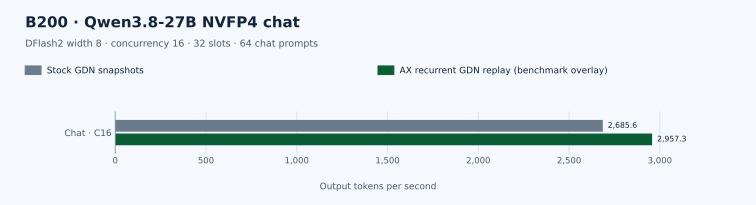
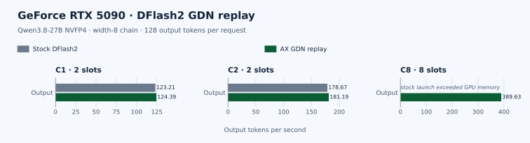
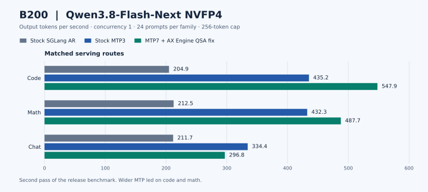

# Serving performance

## How to read the comparisons

- **Stock SGLang AR** uses standard autoregressive decoding without speculation.
- **Stock SGLang + DFlash2** uses SGLang's built-in DFlash2 chain verifier and
  the indicated draft block size.
- **SGLang + ax-engine-sglang** enables the AX Engine add-on and uses the
  verifier and width shown for that run.

Each row compares output tokens per second within one workload and platform.
The reports record checkpoint revisions, request limits and kernel settings.
[Model routes and precision support](README.md#model-routes)

## B200 · Qwen3.8-27B

The 64-slot NVFP4 run used 64 prompts per family, greedy decoding and a
1,024-token output limit. Each result is the mean of two passes. Cells
show code / math / chat output tok/s.

| Concurrency | Stock SGLang + DFlash2 block 8 | SGLang + ax-engine-sglang |
|---|---:|---:|
| 1 | 816 / 733 / 401 | 1,160 / 971 / 458 (tree 16) |
| 16 | 3,628 / 4,670 / 2,980 | 4,379.5 / 4,989 / 3,110 (chain 8) |

The add-on measured **1.14×–1.42×** stock DFlash2 at concurrency one
and **1.04×–1.21×** at concurrency 16. The 64-slot NVFP4 campaign
paired the stock and add-on speculative routes. The study also records
other concurrency levels, BF16 and TensorRT-LLM results.
[B200 dense-model study](decisions/2026-11-16-dual-attention-backend.md)

### Experimental recurrent GDN replay

On one B200, the benchmark overlay kept SGLang's recurrent DFlash2
verification and replayed each accepted prefix into the FP32 state. The
reverse-order run measured width-8 DFlash2 at concurrency 16 with 32
request slots, 64 greedy NVFP4 chat prompts and a 1,024-token output limit.

| DFlash2 configuration | Output tok/s | Median decode tok/s per request | Median time to first token |
|---|---:|---:|---:|
| Stock GDN snapshots | 2,685.6 | 190.2 | 130 ms |
| Recurrent GDN replay overlay | 2,957.3 | 210.5 | 129 ms |

Replay raised aggregate throughput by **10.1%**. A separate 256-token
check matched all **64 of 64** stock greedy sequences.
[Benchmark data and reproduction](decisions/2026-11-16-dual-attention-backend.md#recurrent-verification-with-accepted-prefix-replay-2026-11-20)

## RTX PRO 6000 · Qwen3.8-27B NVFP4

All lanes used SGLang 0.5.23, a fixed 128-token greedy output, FlashInfer
attention and FlashInfer CUTLASS NVFP4 GEMM. The tests used the same frozen
prompts and include prefill and local HTTP overhead. The table pools two
passes by dividing total output tokens by total wall time. NVFP4 describes
the target checkpoint. The DFlash2 drafter was BF16.

| Concurrency and requests per pass | Stock SGLang AR | Stock SGLang + DFlash2 | SGLang + ax-engine-sglang |
|---|---:|---:|---:|
| 1, 10 requests | 54.41 | 124.50 (block 8) | 156.87 (tree 64) |
| 8, 40 requests | 388.29 | 489.86 (block 8) | 484.78 (tree 32, chain width 8) |

Tree 64 delivered **2.88×** AR and **1.26×** stock DFlash2 at concurrency
one. Median request latency was 2.379 s for AR, 1.003 s for stock DFlash2
and 0.818 s for tree 64. At concurrency eight, stock DFlash2 and the add-on
exchanged the lead across the two passes. Their pooled rates were within
about 1%. [Full RTX sweep, per-pass rates and launch commands](../results/rtx_27b_nvfp4_speed/REPORT.md)

### RTX speed and parity profiles

The speed sweep ran with verification parity disabled. Tree 64 matched
packed AR on one of ten complete 128-token sequences in each pass. A
separate verification run used a 32-token output budget and AR configured
with the same parity numerics as the speculative lanes. Tree and chain
each matched that reference on all ten prompts. The independent AR and
DFlash2 cohorts passed all 28 checks in the recorded sampling comparison.
Parity AR reached 47.93 tok/s, parity chain 21.68 tok/s and parity tree
14.65 tok/s on that shorter workload. [Parity protocol and results](reports/2026-11-19-rtx-nvfp4-parity.md)

That first profile ran each target projection once per candidate. The current
profile pads AR decode and verification to groups of 16 projection rows. On
the same ten inputs, tree and chain again matched the AR reference on all ten
prompts and the sampling comparison passed all 28 checks.

| RTX PRO 6000 parity profile, 32-token budget, concurrency one | Output tok/s | Relative to AR |
|---|---:|---:|
| Parity AR | 46.34 | 1.00× |
| Parity DFlash2 tree, 16 nodes | 86.77 | 1.87× |
| Parity DFlash2 chain, width 8 | 88.24 | 1.90× |

With a 128-token budget, tree and chain matched AR on all ten complete
sequences. Tree reached 123.64 tok/s and chain 122.88 tok/s against 49.09
tok/s for parity AR.
[Row group measurements and limits](reports/2026-11-20-rtx-nvfp4-parity-row-groups.md)

Row groups matched only with one request in flight: at concurrency eight, 20
or 21 of 30 outputs equalled the same request alone. The profile now runs FP8
projections on a path that gave a row the same bits at every row count.

| RTX PRO 6000 parity profile, eight slots, 128-token budget | Equal to alone at C8 | Alone tok/s | C8 tok/s |
|---|---:|---:|---:|
| Parity AR | 30/30 | 48.84 | 237.80 |
| Parity DFlash2 tree, 16 nodes | 30/30 | 112.33 | 384.84 |
| Parity DFlash2 chain, width 8 | 30/30 | 118.02 | 401.66 |
| Parity DFlash2 tree, 16 nodes, former 16-row groups | 21/30 | 111.44 | 240.68 |

Tree 64 also matched AR on all ten inputs, at 71.16 tok/s alone with two slots.
[Invariant GEMM measurements and limits](reports/2026-11-20-rtx-nvfp4-parity-invariant-gemm.md)

GDN verification then moved from one decode call per candidate to one launch
per layer, with the same bits. On a second pod, with prefill graphs and
FlashInfer autotune enabled, every lane below equalled the reference AR on all
ten inputs and its own alone outputs on 30/30 requests at concurrency eight.

| RTX PRO 6000 parity profile, 128-token budget | Alone tok/s | C8 tok/s |
|---|---:|---:|
| Parity AR | 51.19 | 268.70 |
| Parity DFlash2 tree, 16 nodes | 160.70 | 570.58 |
| Parity DFlash2 tree, 32 nodes | 160.21 | 559.08 |
| Parity DFlash2 chain, width 8 | 140.74 | 575.09 |
| Parity DFlash2 tree, 64 nodes, two slots | 140.44 | 248.27 |

[One-launch GDN measurements and limits](reports/2026-11-20-rtx-nvfp4-parity-gdn-one-launch.md)

Those runs stopped at end-of-sequence. With exactly 128 tokens per request,
FlashInfer autotune changed one or two of ten outputs at concurrency eight, so
the parity defaults now disable it and keep prefill graphs on. Every lane below
equalled parity AR on all ten inputs and its own alone outputs at concurrency
eight. Tree 64 runs with eight slots through the capped snapshot buffer.

| RTX PRO 6000, parity defaults, exactly 128 tokens | C1 tok/s | C8 tok/s |
|---|---:|---:|
| Parity AR | 51.79 | 226.78 |
| Parity DFlash2 tree, 16 nodes | 118.09 | 493.03 |
| Parity DFlash2 tree, 32 nodes | 120.05 | 520.60 |
| Parity DFlash2 chain, width 8 | 109.76 | 507.35 |
| Parity DFlash2 tree, 64 nodes, `AX_SSM_POSITIONS=8` | 102.34 | 508.50 |

On the same pod with the speed sweep's flags, speed-profile tree 16 reached
126.59 and 449.86 tok/s and parity tree 16 112.70 and 387.57 tok/s.
[Fixed-length comparison and profile](reports/2026-11-20-rtx-nvfp4-parity-forced-128.md)

A narrower GDN value tile then gave GDN verification four times the programs
with the same bits. Parity tree 16 reached 128.53 tok/s at C1, tree 32 131.58,
chain 8 115.43 and tree 64 114.10; AR stayed at 51.82 with the same outputs.
[Value tile measurements](reports/2026-11-20-rtx-nvfp4-parity-forced-128.md#narrower-gdn-value-tile)

## GeForce RTX 5090 · Qwen3.8-27B NVFP4

Stock AR, stock DFlash2 and AX Engine ran on one 32 GB RTX 5090 with
SGLang 0.5.23 and two GPU request slots. The text workload used the RTX
PRO 6000 suite's frozen inputs and fixed 128-token greedy outputs. Rates
pool two passes and include prefill and loopback HTTP.

| Concurrency and requests per pass | Stock SGLang AR | Stock SGLang + DFlash2, block 8 | SGLang + ax-engine-sglang |
|---|---:|---:|---:|
| 1, 10 requests | 57.64 | 125.01 | **135.18** (tree 32) |
| 2, 40 requests | 101.77 | **182.38** | 181.36 (tree 32, chain width 8) |

Tree 32 delivered **2.35×** stock AR and **1.08×** stock DFlash2 at
concurrency one. AX Engine delivered **1.78×** stock AR at concurrency
two and finished within **0.6%** of stock DFlash2. Verification parity
was disabled for the timed comparison. Both speculative routes matched
packed AR on 0 of 10 complete outputs per pass at concurrency one.
[Per-pass timings, token matches and reproduction](../results/rtx_5090_27b_nvfp4/REPORT.md)

### Experimental recurrent GDN replay

The width-eight DFlash2 follow-up reused the frozen prompts and 128-token
greedy outputs. The two-slot rates pool four passes and the eight-slot
rate pools two. Rates include prefill and loopback HTTP.

| Concurrency | Stock DFlash2 output tok/s | AX GDN replay output tok/s |
|---:|---:|---:|
| 1 | 123.21 | 124.39 |
| 2 | 178.67 | 181.19 |
| 8 | GPU memory limit | 389.63 |

Replay matched all 200 fixed-length stock DFlash2 sequences at one and
two concurrent requests. It replaced 3.38 GiB of speculative SSM
snapshots with about 0.017 GiB of replay buffers in the two-slot runs.
[Replay evidence and test settings](../results/rtx_5090_27b_nvfp4/REPORT.md#accepted-prefix-gdn-replay-follow-up)

## Jetson Thor · Qwen3.8-27B

All rows use the single-request FlashInfer lanes on a Linux arm64 Jetson
Thor with SGLang 0.5.23. The 27B NVFP4 run used 12 prompts per family with
a 512-token output limit. The BF16 run used eight prompts per family with
a 384-token limit. Each cell gives code / math / chat output tok/s for
that checkpoint's workload.

| Target precision | Stock SGLang AR | Stock SGLang + DFlash2 chain 16 | SGLang + ax-engine-sglang tree 32 |
|---|---:|---:|---:|
| NVFP4 | 13.4 / 13.5 / 13.5 | 93.0 / 73.5 / 30.6 | 106.1 / 92.1 / 43.1 |
| BF16 | 4.6 / 4.6 / 4.6 | 43.1 / 29.6 / 12.5 | 47.5 / 37.6 / 18.3 |

The Thor report also records Qwen3.5-9B BF16 with the original DFlash
drafter. Its FlashInfer follow-up changed host load, and the chain lane
overlapped a download. See the report for the conditions and the separate
Triton lanes. [Jetson Thor results](reports/2026-11-19-jetson-thor.md)

## Qwen3.8-Flash-Next NVFP4 · MTP

Flash Next uses SGLang MTP with the add-on's QSA fix. Its comparison uses
stock MTP3 as the speculative baseline.

### One B200

In the second B200 pass at
concurrency one, each lane used greedy decoding with a 256-token output
limit. Rates are in output tok/s.

| Workload | Stock SGLang AR | Stock SGLang MTP3 | SGLang MTP7 + ax-engine-sglang QSA fix |
|---|---:|---:|---:|
| Code | 204.9 | 435.2 | 547.9 |
| Math | 212.5 | 432.3 | 487.7 |
| Chat | 211.7 | 334.4 | 296.8 |

The wider MTP window improved code and math in this pass, while stock MTP3
had higher chat throughput. The report includes both passes, time to first
token and multi-client results. [B200 Flash Next release benchmark](reports/2026-11-18-b200-v0.1.1.md)

### Two Jetson Thor hosts

SGLang 0.5.23 served the RadixArk NVFP4 checkpoint with two pipeline stages,
one on each Linux arm64 host. The single-request runs used FlashInfer CUTLASS
for NVFP4 MoE and a 2.5 GbE link between hosts. Rates are in output tok/s.

| Workload | Stock SGLang AR | Stock SGLang MTP3 | MTP3 + ax-engine-sglang QSA fix | MTP7 + ax-engine-sglang QSA fix |
|---|---:|---:|---:|---:|
| Code | 18.3 | 32.0 | 33.3 | **43.1** |
| Math | 19.0 | 32.4 | 32.5 | **37.5** |
| Chat | 19.2 | 24.8 | **25.7** | 22.8 |

The two add-on routes used a 16-slot QSA pending ring. MTP7 gave the highest
code and math throughput. The MTP3 add-on route led the four measured chat
lanes. [Thor Flash Next configuration and accepted tokens](reports/2026-11-19-jetson-thor.md#5-qwen38-flash-next-nvfp4-over-two-thors)

## Reproduce

- [Run the GeForce RTX 5090 comparison](../results/rtx_5090_27b_nvfp4/REPORT.md#reproduce-the-comparison).
- [Run the RTX three-route comparison](../results/rtx_27b_nvfp4_speed/REPORT.md#launch-the-measured-configurations).
- [Run SGLang benchmarks and serving checks](../benchmarks/sglang/).
- [Validate benchmark records](../contracts/benchmark-result-v1.schema.json).
