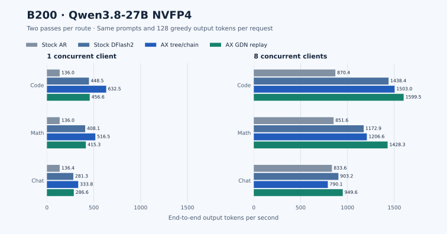
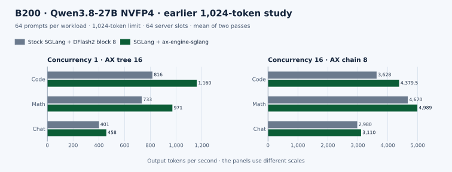
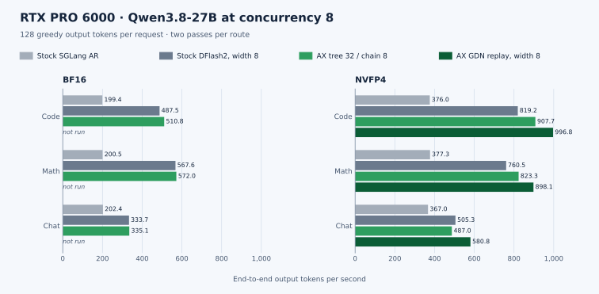
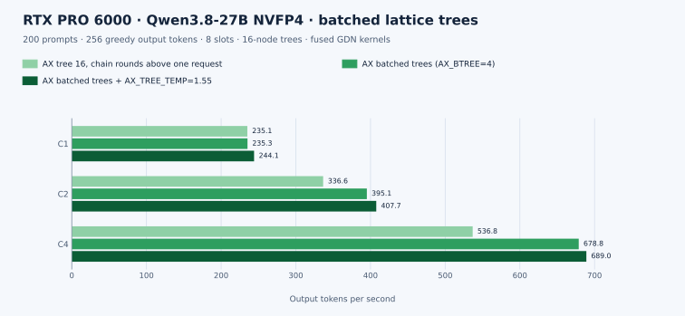
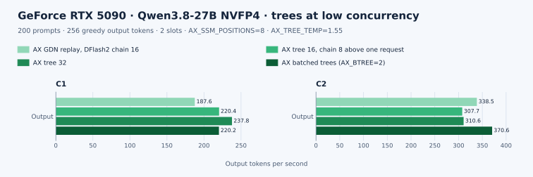
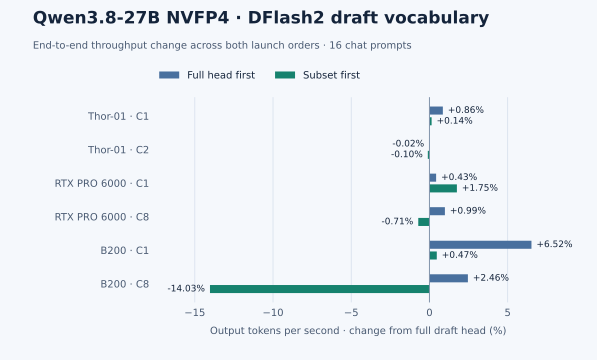
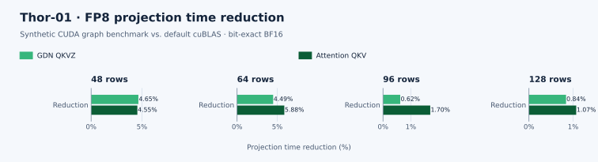
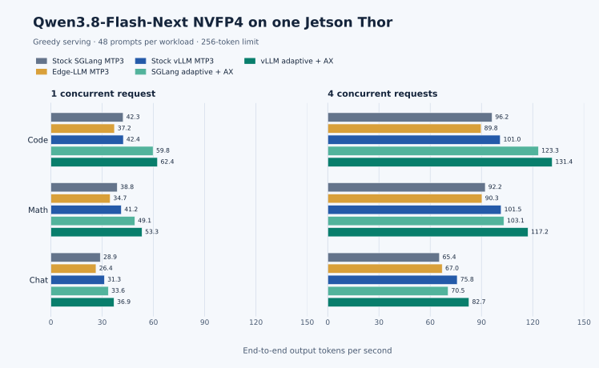

# Serving performance

## How to read the comparisons

- **Stock SGLang AR** uses standard autoregressive decoding without speculation.
- **Stock SGLang + DFlash2** uses SGLang's built-in DFlash2 chain verifier and
  the indicated draft block size.
- **SGLang + ax-engine-sglang** enables the AX Engine add-on and uses the
  verifier and width shown for that run.
- **Stock vLLM** is `0.34.0rc1.dev1105+g2f170a0fe` with no plugins, run on
  the same checkpoint, drafter, prompts and output budget as the table it
  joins. Its DFlash2 lanes use `num_speculative_tokens: 7`, the drafter's
  eight-position block.

Each row compares output tokens per second within one workload and platform.
The reports record checkpoint revisions, request limits and kernel settings.
[Model routes and precision support](README.md#model-routes)

For B200 and RTX PRO 6000, the matched serving retests are the current
cross-route comparison: 128 greedy tokens, eight slots, and the same prompt
corpus for code, math, and chat. The 1,024-token studies and the pooled
ten-prompt sweeps use different budgets, so their tok/s do not substitute
for the retest tables. Batched lattice trees (`AX_BTREE`) are a separate
256-token study and are off by default. The verified profile is the
current exact-output gate. The parity tables under it are the measurements
that produced that gate.

## B200 · Qwen3.8-27B

### Serving retest

Each route ran two streamed passes with the same inputs and exactly 128
greedy output tokens per request. Each pass used eight prompts per
workload at one client and 24 at eight clients. Values are code / math /
chat output tok/s pooled over both passes. AX tree/chain used a 32-node
tree for one eligible request and a width-eight chain for grouped requests.

| Clients | Stock AR | Stock DFlash2 | AX tree/chain | AX GDN replay |
|---:|---:|---:|---:|---:|
| 1 | 136.0 / 136.0 / 136.4 | 448.5 / 408.1 / 281.3 | **632.5** / **516.5** / **333.8** | 456.6 / 415.3 / 286.6 |
| 8 | 870.4 / 851.6 / 833.6 | 1,438.4 / 1,172.9 / 903.2 | 1,503.0 / 1,206.6 / 790.1 | **1,599.5** / **1,428.3** / **949.6** |

AX tree/chain led all three single-client workloads. Width-eight GDN
replay led all three at eight clients and lowered chat p95 request latency
from 1.41 to 1.34 s compared with stock DFlash2. An AR confirmation after
checkpoint staging reached 953.0 tok/s on eight-client chat, close to the
replay result.
[Per-pass throughput and output agreement](../results/blackwell_nvfp4_serving_retest/REPORT.md#b200-qwen38-27b-nvfp4)

### Earlier 1,024-token study

The 64-slot NVFP4 run used 64 prompts per family, greedy decoding and a
1,024-token output limit. Each result is the mean of two passes. Cells
show code / math / chat output tok/s.

| Concurrency | Stock SGLang + DFlash2 block 8 | SGLang + ax-engine-sglang |
|---|---:|---:|
| 1 | 816 / 733 / 401 | 1,160 / 971 / 458 (tree 16) |
| 16 | 3,628 / 4,670 / 2,980 | 4,379.5 / 4,989 / 3,110 (chain 8) |

The add-on measured **1.14×–1.42×** stock DFlash2 at concurrency one
and **1.04×–1.21×** at concurrency 16. The 64-slot NVFP4 campaign
paired the stock and add-on speculative routes. The study also records
other concurrency levels, BF16 and TensorRT-LLM results.
[B200 dense-model study](decisions/2026-11-16-dual-attention-backend.md)

### Experimental recurrent GDN replay

On one B200, the benchmark overlay kept SGLang's recurrent DFlash2
verification and replayed each accepted prefix into the FP32 state. The
reverse-order run measured width-8 DFlash2 at concurrency 16 with 32
request slots, 64 greedy NVFP4 chat prompts and a 1,024-token output limit.

| DFlash2 configuration | Output tok/s | Median decode tok/s per request | Median time to first token |
|---|---:|---:|---:|
| Stock GDN snapshots | 2,685.6 | 190.2 | 130 ms |
| Recurrent GDN replay overlay | 2,957.3 | 210.5 | 129 ms |

Replay raised aggregate throughput by **10.1%**. A separate 256-token
check matched all **64 of 64** stock greedy sequences.
[Benchmark data and reproduction](decisions/2026-11-16-dual-attention-backend.md#recurrent-verification-with-accepted-prefix-replay-2026-11-20)

## RTX PRO 6000 · Qwen3.8-27B NVFP4

### Serving retest

Two passes per route used 128 greedy output tokens. Cells are code / math /
chat output tok/s. The add-on used a 32-node tree for one eligible request
and a width-eight chain for grouped requests. Package version at measurement
was 0.4.0; the later B200 retest used 0.5.1 on the same prompt corpus.

#### BF16

| Clients | Stock AR | Stock DFlash2 | TensorRT-LLM DFlash2 | Stock vLLM DFlash2 | AX tree / chain |
|---:|---:|---:|---:|---:|---:|
| 1 | 27.1 / 27.2 / 27.2 | 132.0 / 120.9 / 70.5 | 133.1 / 119.3 / 73.8 | 135.3 / 120.6 / 73.7 | **184.3** / **163.2** / **94.1** |
| 8 | 199.4 / 200.5 / 202.4 | 487.5 / 567.6 / 333.7 | **529.5** / **720.6** / **402.4** | 520.8 / 664.0 / 382.0 | 510.8 / 572.0 / 335.1 |

#### NVFP4

| Clients | Stock AR | Stock DFlash2 | TensorRT-LLM DFlash2 | Stock vLLM DFlash2 | AX tree / chain | AX GDN replay |
|---:|---:|---:|---:|---:|---:|---:|
| 1 | 54.2 / 54.1 / 54.4 | 229.3 / 188.5 / 125.2 | 246.0 / 210.3 / 128.9 | 279.8 / 266.4 / **154.5** | **324.7** / **270.9** / 152.2 | 235.8 / 195.2 / 128.9 |
| 8 | 376.0 / 377.3 / 367.0 | 819.2 / 760.5 / 505.3 | 878.7 / **1,178.0** / 605.3 | **1,002.3** / 980.1 / **704.0** | 907.7 / 823.3 / 487.0 | 996.8 / 898.1 / 580.8 |

At eight clients, NVFP4 GDN replay raised chat from 505.3 to 580.8 tok/s
over stock SGLang DFlash2 and matched it on 48 of 48 greedy chat outputs.
A reverse-order run measured 560.5 against 503.9 tok/s and matched 38 of
48.

Stock vLLM ran later on the same GPU with the same token IDs, 128 output
tokens and pass order. The AX tree still led code and math at one client.
vLLM's DFlash2 led every workload at eight clients on both checkpoints,
and chat at one client on NVFP4. Its proposer accepted 5.8–6.5 tokens per
verify on code and math, and about 3.1–3.3 on chat. Stock vLLM refuses
Flash Next with DFlash2: "Qwen4Exp speculative decoding supports only its
native MTP checkpoint and linear n-gram proposers". TensorRT-LLM 1.4.0rc3
AR ran within 1.5% of stock AR at one client; at eight clients it was
14% slower on NVFP4 and 2% faster on BF16. Its DFlash2 drafter needs
FlashAttention 2 on SM120; with an SM120 build installed, TensorRT-LLM
DFlash2 led every BF16 workload at eight clients (529.5 / 720.6 / 402.4)
and NVFP4 math (1,178.0). The AX tree still led BF16 and NVFP4 code and
math at one client.
[Latency, checkpoints, and output agreement](../results/rtx_pro_6000_retest/REPORT.md) · [Stock vLLM setup](../results/cross_engine_2026-11-25/REPORT.md#rtx-pro-6000-qwen38-27b-and-flash-next-dflash2)

### Earlier pooled speed sweep

All lanes used SGLang 0.5.23, a fixed 128-token greedy output, FlashInfer
attention and FlashInfer CUTLASS NVFP4 GEMM. The tests used the same frozen
prompts and include prefill and local HTTP overhead. The table pools two
passes by dividing total output tokens by total wall time. Rates are pooled
across families, so they are lower than the per-workload retest above.
NVFP4 describes the target checkpoint. The DFlash2 drafter was BF16.

| Concurrency and requests per pass | Stock SGLang AR | Stock SGLang + DFlash2 | SGLang + ax-engine-sglang |
|---|---:|---:|---:|
| 1, 10 requests | 54.41 | 124.50 (block 8) | 156.87 (tree 64) |
| 8, 40 requests | 388.29 | 489.86 (block 8) | 484.78 (tree 32, chain width 8) |

Tree 64 delivered **2.88×** AR and **1.26×** stock DFlash2 at concurrency
one. Median request latency was 2.379 s for AR, 1.003 s for stock DFlash2
and 0.818 s for tree 64. At concurrency eight, stock DFlash2 and the add-on
exchanged the lead across the two passes. Their pooled rates were within
about 1%. [Full RTX sweep, per-pass rates and launch commands](../results/rtx_27b_nvfp4_speed/REPORT.md)

### RTX speed and parity profiles

The tables in this subsection record the steps that produced the current
verified profile. The profile itself is under
[Verified profile gate](#verified-profile-gate). The speed sweep ran with
verification parity disabled. Tree 64 matched
packed AR on one of ten complete 128-token sequences in each pass. A
separate verification run used a 32-token output budget and AR configured
with the same parity numerics as the speculative lanes. Tree and chain
each matched that reference on all ten prompts. The independent AR and
DFlash2 cohorts passed all 28 checks in the recorded sampling comparison.
Parity AR reached 47.93 tok/s, parity chain 21.68 tok/s and parity tree
14.65 tok/s on that shorter workload. [Parity protocol and results](reports/2026-11-19-rtx-nvfp4-parity.md)

That first profile ran each target projection once per candidate. The current
profile pads AR decode and verification to groups of 16 projection rows. On
the same ten inputs, tree and chain again matched the AR reference on all ten
prompts and the sampling comparison passed all 28 checks.

| RTX PRO 6000 parity profile, 32-token budget, concurrency one | Output tok/s | Relative to AR |
|---|---:|---:|
| Parity AR | 46.34 | 1.00× |
| Parity DFlash2 tree, 16 nodes | 86.77 | 1.87× |
| Parity DFlash2 chain, width 8 | 88.24 | 1.90× |

With a 128-token budget, tree and chain matched AR on all ten complete
sequences. Tree reached 123.64 tok/s and chain 122.88 tok/s against 49.09
tok/s for parity AR.
[Row group measurements and limits](reports/2026-11-20-rtx-nvfp4-parity-row-groups.md)

Row groups matched only with one request in flight: at concurrency eight, 20
or 21 of 30 outputs equalled the same request alone. The profile now runs FP8
projections on a path that gave a row the same bits at every row count.

| RTX PRO 6000 parity profile, eight slots, 128-token budget | Equal to alone at C8 | Alone tok/s | C8 tok/s |
|---|---:|---:|---:|
| Parity AR | 30/30 | 48.84 | 237.80 |
| Parity DFlash2 tree, 16 nodes | 30/30 | 112.33 | 384.84 |
| Parity DFlash2 chain, width 8 | 30/30 | 118.02 | 401.66 |
| Parity DFlash2 tree, 16 nodes, former 16-row groups | 21/30 | 111.44 | 240.68 |

Tree 64 also matched AR on all ten inputs, at 71.16 tok/s alone with two slots.
[Invariant GEMM measurements and limits](reports/2026-11-20-rtx-nvfp4-parity-invariant-gemm.md)

GDN verification then moved from one decode call per candidate to one launch
per layer, with the same bits. On a second pod, with prefill graphs and
FlashInfer autotune enabled, every lane below equalled the reference AR on all
ten inputs and its own alone outputs on 30/30 requests at concurrency eight.

| RTX PRO 6000 parity profile, 128-token budget | Alone tok/s | C8 tok/s |
|---|---:|---:|
| Parity AR | 51.19 | 268.70 |
| Parity DFlash2 tree, 16 nodes | 160.70 | 570.58 |
| Parity DFlash2 tree, 32 nodes | 160.21 | 559.08 |
| Parity DFlash2 chain, width 8 | 140.74 | 575.09 |
| Parity DFlash2 tree, 64 nodes, two slots | 140.44 | 248.27 |

[One-launch GDN measurements and limits](reports/2026-11-20-rtx-nvfp4-parity-gdn-one-launch.md)

Those runs stopped at end-of-sequence. With exactly 128 tokens per request,
FlashInfer autotune changed one or two of ten outputs at concurrency eight, so
the parity defaults now disable it and keep prefill graphs on. Every lane below
equalled parity AR on all ten inputs and its own alone outputs at concurrency
eight. Tree 64 runs with eight slots through the capped snapshot buffer.

| RTX PRO 6000, parity defaults, exactly 128 tokens | C1 tok/s | C8 tok/s |
|---|---:|---:|
| Parity AR | 51.79 | 226.78 |
| Parity DFlash2 tree, 16 nodes | 118.09 | 493.03 |
| Parity DFlash2 tree, 32 nodes | 120.05 | 520.60 |
| Parity DFlash2 chain, width 8 | 109.76 | 507.35 |
| Parity DFlash2 tree, 64 nodes, `AX_SSM_POSITIONS=8` | 102.34 | 508.50 |

On the same pod with the speed sweep's flags, speed-profile tree 16 reached
126.59 and 449.86 tok/s and parity tree 16 112.70 and 387.57 tok/s.
[Fixed-length comparison and profile](reports/2026-11-20-rtx-nvfp4-parity-forced-128.md)

A narrower GDN value tile then gave GDN verification four times the programs
with the same bits. Parity tree 16 reached 128.53 tok/s at C1, tree 32 131.58,
chain 8 115.43 and tree 64 114.10; AR stayed at 51.82 with the same outputs.
[Value tile measurements](reports/2026-11-20-rtx-nvfp4-parity-forced-128.md#narrower-gdn-value-tile)

### Verified profile gate

`AX_QUALITY_PROFILE=verified` was then launched by itself on an RTX PRO 6000
with eight slots, so the launcher derived the parity settings (prefill chunk
4,096, no prefill graphs, radix cache and autotune off). Each lane sent the ten
frozen prompts repeatedly; every sequence was compared with AR alone.

| RTX PRO 6000, verified profile, eight slots | Equal to AR, 128 tokens | Equal to AR, 1,024 tokens | C1 tok/s | C8 tok/s, 128 / 1,024 tokens |
|---|---:|---:|---:|---:|
| AR | 1,000 of 1,000 | 120 of 120 | 52–54 | 362 / 356 |
| DFlash2 chain, width 8 | 1,000 of 1,000 | 120 of 120 | 109–113 | 489 / 561 |
| DFlash2 tree, 16 nodes | 1,000 of 1,000 | 116 of 120 | 126–132 | 499 / 592 |

The tree lane's four unequal sequences came from two prompts in two serialized
passes. The first differences were at output tokens 330 and 493, counted from
one. Chain rounds with two or more requests matched. The sequences are ten
distinct prompts repeated at concurrency 1, 2 and 8.

### DFlash2 hot-path follow-up

The verified width-eight chain matched all 40 1,024-token sequences in
the follow-up and delivered 2.05× AR throughput at C1 and 1.81× at C2 and
C8. The serialized tree probe reproduced both divergences and measured
reversed token rankings on the shared decoded prefixes.

Native accepted-prefix replay improved warmed chat throughput by 16–18%
at C8 and 26–27% at C16 in both launch orders, on 64 held-out prompts and
512 output tokens per request. P95 latency fell from 9.91–9.98 s to
7.74–8.43 s at C16. The stress test recorded 12 confirmed cancellations
and zero errors. The median C16 target-verify GPU span fell from 33.5 ms
to 23.4 ms, with draft KV append near 0.36 ms in both lanes.
[Throughput, token scores, and Nsight attribution](../results/rtx_pro_6000_hotpath_validation/REPORT.md)

### FP8 tactic serving comparison

The RTX PRO 6000 ran both launch orders at concurrency eight. Each timed
pass used 64 held-out UltraChat prompts and 512 greedy output tokens per
request. Both lanes used width-eight DFlash2 and GDN replay.

| First lane | Default (output tok/s) | Candidate (output tok/s) | Change | Default → candidate p95 (s) | Exact outputs |
|---|---:|---:|---:|---:|---:|
| Default | 699.74 | 718.01 | +2.61% | 7.16 → 7.13 | 57/64 |
| Candidate | 710.20 | 724.04 | +1.95% | 6.96 → 7.09 | 57/64 |

The 64-row GDN QKVZ tactic reduced its projection time by 4.55% on
captured operands. The attention QKV tactic was within 0.1% of the native
tactic. In serving, both modes repeated their own 64 outputs across
launch orders. Seven outputs differed between modes in each order.
[RTX PRO 6000 projection audit and graph coverage](../results/fp8_verify_tactics/REPORT.md#rtx-pro-6000-live-qwen38-27b-nvfp4) · [RTX 5090 serving measurements](#fp8-verification-tactics-at-c8)

### Chain width by batch size

On the speed profile (no exact-output claim) the better fixed chain width
depends on how many requests run. The first comparison used the ten frozen
prompts; because the generated text differs between lanes without the verified
profile, it was repeated on 200 distinct prompts (256 output tokens, radix cache
off, two sweeps; concurrency two uses the second sweep, after a slow first pass).
Output tok/s against fixed width 16, RTX PRO 6000:

| Lane | C2 | C3 | C4 | C8 |
|---|---:|---:|---:|---:|
| width 8 | −3.9% | −0.8% | +3.1% | +9.0% |
| `AX_CHAIN_WIDTH_BY_BATCH="1:16,4:8"` | +0.1% | +0.7% | +3.0% | +9.3% |
| `AX_CHAIN_WIDTH_BY_BATCH="1:16,3:8"` | +0.1% | −1.8% | +3.9% | +8.9% |

Width 16 reached 347.9, 470.7, 570.9 and 792.6 tok/s. `1:16,4:8` was within 1%
of the better fixed width at every concurrency in this fixed-concurrency
sweep. Switching widths twice every 32 rounds cost nothing measurable.
The adaptive policy
(`AX_POLICY_MODE=adaptive`) was 2.3% below width 16 at concurrency two and 0.6%
below width 8 at eight on another pod, so it stays experimental and off by
default.
[Gate, width comparisons and limits](reports/2026-11-21-verified-profile-gate.md)

On 200 held-out prompts submitted in waves of 1, 2, 4, and 8 clients,
fixed width 8 led at 445.6 tok/s, followed by `1:16,4:8` at 434.0 and fixed
width 16 at 411.9. The table switched widths at four live requests.
[Mixed-wave throughput and latency](../results/rtx_pro_6000_hotpath_validation/REPORT.md#mixed-request-waves)

### Batched lattice trees

Experimental and off by default. `AX_BTREE=4` with the fused GDN kernels
gives each of two to four greedy requests its own 16-node DFlash2 lattice
tree in one target pass. The run used 200 prompts and 256 output tokens.
`AX_TREE_TEMP=1.55` is the tree shape found by offline Optuna tuning.
Output tok/s:

| Route | C1 | C2 | C4 |
|---|---:|---:|---:|
| Tree 16, chain rounds above one request | 235.1 | 336.6 | 536.8 |
| Batched trees (`AX_BTREE=4`) | 235.3 | 395.1 | 678.8 |
| Batched trees + `AX_TREE_TEMP=1.55` | **244.1** | **407.7** | **689.0** |

With SGLang's native GDN kernels the batched trees gained 0–2%.
[Benchmark report](../results/rtx_pro_6000_tree_width/REPORT.md)

### RTX PRO 6000 NVFP4 GEMM backend

SGLang 0.5.23 resolves `--fp4-gemm-backend auto` to FlashInfer CUTLASS on SM120. FlashInfer cute-dsl
ran the 27B MLP GEMMs 23-37% faster at 8-64 rows and 1% slower at 128. Served on another RTX PRO 6000
pod with the backends alternating route by route (128 tokens, code / math / chat):

| Route | Clients | CUTLASS | cute-dsl |
|---|---:|---:|---:|
| AX tree 32 | 1 | 292.0 / 250.8 / 154.0 | **310.1 / 267.3 / 164.6** |
| AX tree 32 | 8 | 789.1 / 665.5 / 443.3 | **822.1 / 745.1 / 455.5** |
| AX GDN replay 8 | 1 | 216.4 / 180.0 / 121.8 | **249.8 / 208.9 / 143.6** |
| AX GDN replay 8 | 8 | 862.7 / **772.6** / 520.2 | **896.8** / 748.3 / **546.0** |
| Stock DFlash2 width 8 | 1 | 203.0 / 167.6 / 114.2 | **238.0 / 199.3 / 135.7** |
| Stock DFlash2 width 8 | 8 | 738.0 / 659.2 / 441.0 | **819.3 / 722.5 / 482.0** |

Eight-client cells are the second sweep: cute-dsl compiles kernels the first time it meets a shape,
and the first server's first eight-client pass ran with a 3.85 s worst first-token time. Greedy
outputs matched across the backends on 24/24 one-client requests per route. The plugin now selects
cute-dsl for dense NVFP4 targets on SM12x unless the backend is set or parity is requested.
[FP4 backend report](../results/rtx_pro_6000_fp4_backend/REPORT.md)

### RTX PRO 6000 prefill CUDA graphs

The SGLang lanes above (and the 27B lanes on other GPUs) ran with `--disable-prefill-cuda-graph`. A
later RTX PRO 6000 Workstation Edition pod alternated eager and prefill-graph servers route by route,
two servers per lane, with cute-dsl GEMMs, then ran stock vLLM DFlash2 (7 speculative tokens) on the
same workload. Cells pool every sweep except the first sweep of each lane's first server, where kernels
compile:

| Route | Clients | Eager prefill | Prefill graphs | Stock vLLM DFlash2 |
|---|---:|---:|---:|---:|
| Stock DFlash2 width 8 | 1 | 299.8 / 248.5 / 165.6 | 337.5 / 273.6 / 177.9 | 317.2 / 292.0 / 182.9 |
| Stock DFlash2 width 8 | 8 | 1,080.9 / 977.7 / 624.4 | 1,310.4 / 1,226.2 / 725.7 | 1,144.9 / 1,157.5 / 775.5 |
| AX tree 32 | 1 | 401.2 / 340.1 / 204.8 | **464.8 / 389.5 / 222.0** | |
| AX tree 32 | 8 | 1,097.4 / 980.7 / 602.7 | 1,349.4 / 1,281.5 / 714.5 | |
| AX GDN replay 8 | 1 | 311.8 / 257.3 / 172.3 | 349.9 / 284.6 / 184.8 | |
| AX GDN replay 8 | 8 | 1,130.4 / 1,038.0 / 699.7 | **1,464.4 / 1,389.7 / 835.2** | |

Tokens per verify were unchanged and first-token time halved (0.084-0.088 → 0.038-0.041 s at one
client, 0.165-0.170 → 0.071-0.079 s at eight). With eager prefill every SGLang route trailed vLLM on
math and chat at eight clients; with prefill graphs replay led all three workloads there. Greedy outputs
matched across the modes on 72/72 one-client requests of stock and replay and 69/72 of the tree. The
27B harnesses now keep prefill graphs for speed lanes.
[Prefill-graph report](../results/rtx_pro_6000_prefill_graph/REPORT.md)

## GeForce RTX 5090 · Qwen3.8-27B NVFP4

Stock AR, stock DFlash2 and AX Engine ran on one 32 GB RTX 5090 with
SGLang 0.5.23 and two GPU request slots. The text workload used the RTX
PRO 6000 suite's frozen inputs and fixed 128-token greedy outputs. Rates
pool two passes and include prefill and loopback HTTP.

| Concurrency and requests per pass | Stock SGLang AR | Stock SGLang + DFlash2, block 8 | SGLang + ax-engine-sglang |
|---|---:|---:|---:|
| 1, 10 requests | 57.64 | 125.01 | **135.18** (tree 32) |
| 2, 40 requests | 101.77 | **182.38** | 181.36 (tree 32, chain width 8) |

Stock vLLM ran later on the same pod with the same inputs and pass order.
Its DFlash2 reached **168.5** tok/s at one request and **279.6** at two,
1.25 times the AX tree and 1.53 times stock SGLang DFlash2. Stock vLLM AR
reached 73.7 / 129.2 and TensorRT-LLM AR 70.2 / 120.4.
[Stock vLLM and TensorRT-LLM lanes](../results/cross_engine_2026-11-25/REPORT.md#geforce-rtx-5090-qwen38-27b-nvfp4-dflash2)

Tree 32 delivered **2.35×** stock AR and **1.08×** stock DFlash2 at
concurrency one. AX Engine delivered **1.78×** stock AR at concurrency
two and finished within **0.6%** of stock DFlash2. Verification parity
was disabled for the timed comparison. Both speculative routes matched
packed AR on 0 of 10 complete outputs per pass at concurrency one.
[Per-pass timings, token matches and reproduction](../results/rtx_5090_27b_nvfp4/REPORT.md)

### Batched lattice trees

The batched-tree workload above, on 32 GB: 200 prompts, 256 greedy tokens,
two slots, `AX_SSM_POSITIONS=8`, and `AX_TREE_TEMP=1.55` on the tree lanes.
Output tok/s. Experimental and off by default.

| Route | C1 | C2 |
|---|---:|---:|
| AX GDN replay, DFlash2 chain 16 | 187.6 | 338.5 |
| AX tree 16, chain 8 above one request | 220.4 | 307.7 |
| AX tree 32 | **237.8** | 310.6 |
| AX batched trees (`AX_BTREE=2`) | 220.2 | **370.6** |

`AX_BTREE` keeps 16-node trees, so one server uses tree 32 for single
requests or batched trees for two.
[RTX 5090 results](../results/rtx_pro_6000_tree_width/REPORT.md#5-rtx-5090-low-concurrency)

### Experimental recurrent GDN replay

The width-eight DFlash2 follow-up reused the frozen prompts and 128-token
greedy outputs. The two-slot rates pool four passes and the eight-slot
rate pools two. Rates include prefill and loopback HTTP.

| Concurrency | Stock DFlash2 output tok/s | AX GDN replay output tok/s |
|---:|---:|---:|
| 1 | 123.21 | 124.39 |
| 2 | 178.67 | 181.19 |
| 8 | GPU memory limit | 389.63 |

Replay matched all 200 fixed-length stock DFlash2 sequences at one and
two concurrent requests. It replaced 3.38 GiB of speculative SSM
snapshots with about 0.017 GiB of replay buffers in the two-slot runs.
[Replay evidence and test settings](../results/rtx_5090_27b_nvfp4/REPORT.md#accepted-prefix-gdn-replay-follow-up)

### FP8 verification tactics at C8

Both lanes used width-eight DFlash2 with accepted-prefix GDN replay.
Each timed pass ran 64 held-out UltraChat prompts to 512 greedy output
tokens per request. The candidate used cuDNN for GDN QKVZ and attention
QKV at 64 verification rows.

| First lane | Default (output tok/s) | Candidate (output tok/s) | Change | Default → candidate p95 (s) | Exact outputs |
|---|---:|---:|---:|---:|---:|
| Default | 802.33 | 824.01 | +2.70% | 6.31 → 6.10 | 10/64 |
| Candidate | 807.25 | 824.02 | +2.08% | 6.30 → 6.10 | 10/64 |

Each lane reproduced all 64 of its own outputs across launch orders.
The candidate replayed 83 full eight-request tactic graphs per pass,
with zero fallbacks at that size. The isolated projections differed
by about 0.1% in paired timings. During serving, the candidate generated
3.17 tokens per verification versus 3.09 for the default lane.
[Full projection audit and serving results](../results/fp8_verify_tactics/REPORT.md#rtx-5090-live-qwen38-27b-nvfp4)

### RTX 5090 NVFP4 GEMM backend

The RTX PRO 6000 backend A/B on a later 5090 pod: two slots, 4,096 KV tokens, the 128-token retest
workload (8 prompts per workload at one request, 24 at two), two rounds of servers alternating
CUTLASS / cute-dsl per route. Output tok/s, code / math / chat. Cells pool every sweep except the
first one, where the first cute-dsl server compiled its kernels. These rates use shorter outputs than
the ten-prompt mix above and are not comparable with it.

| Route | Requests | CUTLASS | cute-dsl | Change |
|---|---:|---:|---:|---:|
| AX tree 32 | 1 | 321.2 / 269.9 / 169.7 | **333.3 / 281.0 / 177.9** | +3.8 / +4.1 / +4.9% |
| AX tree 32 | 2 | 349.1 / 334.6 / 208.5 | **377.1 / 361.9 / 230.2** | +8.0 / +8.2 / +10.4% |
| Stock DFlash2 width 8 | 1 | 242.4 / 202.9 / 130.9 | **271.7 / 229.5 / 149.3** | +12.1 / +13.1 / +14.0% |
| Stock DFlash2 width 8 | 2 | 323.3 / 325.0 / 202.4 | **351.7 / 354.3 / 224.4** | +8.8 / +9.0 / +10.9% |

Greedy outputs matched across the backends on 96/96 one-request requests of both routes, 288/288
two-request tree requests and 272/288 two-request stock requests. Both backends fit the 32 GB budget;
pass-to-pass spread was at most 3.6% per cell.
[FP4 backend report](../results/rtx_pro_6000_fp4_backend/REPORT.md#rtx-5090)

## H200 · Qwen3.8-27B

One H200 (SM90, 141 GB, driver 595.112.07) ran the 128-token serving
retest: the first 8 (C1) and 24 (C8) prompts per workload, exactly 128
greedy tokens, two sweeps. SGLang 0.5.23 with package 0.5.1 served BF16,
the official `Qwen/Qwen3.8-27B-FP8` checkpoint (`c3a462cc`, 128×128 block
scales) and NVFP4 through `--fp4-gemm-backend marlin`. Stock vLLM
`0.34.0rc1.dev1105` and TensorRT-LLM 1.4.0rc3 served the same token IDs
with `incoai/Qwen3.8-27B-DFlash2`. The AX lane is tree 32 at one client
and a width-eight chain at eight. Cells are code / math / chat output
tok/s.

| Precision | Clients | Stock SGLang AR | Stock SGLang DFlash2 | TensorRT-LLM DFlash2 | Stock vLLM DFlash2 | AX tree/chain |
|---|---:|---:|---:|---:|---:|---:|
| BF16 | 1 | 67.4 / 67.3 / 67.3 | 268.9 / 244.4 / 153.0 | 286.2 / 259.8 / 164.7 | 309.1 / 285.5 / 175.9 | **366.2 / 325.4 / 193.3** |
| BF16 | 8 | 457.4 / 463.7 / 451.0 | 1,029.1 / 946.3 / 619.4 | 931.7 / 1,011.1 / 702.6 | **1,084.5 / 1,313.6 / 830.1** | 1,061.0 / 955.4 / 626.7 |
| FP8 | 1 | 93.8 / 93.9 / 94.0 | 311.3 / 289.6 / 189.1 | 350.1 / 316.4 / 198.9 | 402.2 / **373.7 / 236.9** | **410.5** / 352.4 / 226.1 |
| FP8 | 8 | 611.8 / 612.2 / 637.4 | 1,122.1 / 895.0 / 690.7 | 1,083.0 / 1,115.2 / 721.7 | **1,160.3 / 1,359.2 / 1,018.3** | 1,132.4 / 938.0 / 705.0 |
| NVFP4 | 1 | 102.4 / 102.4 / 102.4 | 342.7 / 304.5 / 204.2 | needs Blackwell | **465.7 / 429.9 / 282.2** | 409.5 / 336.3 / 221.3 |
| NVFP4 | 8 | 642.5 / 643.9 / 672.3 | 1,063.8 / 873.5 / 609.4 | needs Blackwell | **1,357.3 / 1,382.4 / 971.8** | 1,071.7 / 913.2 / 619.9 |

At one client the tree led BF16 on every workload and FP8 on code; stock
vLLM led FP8 math and chat and every NVFP4 workload. At eight clients
stock vLLM led every cell. Tokens per verify at one client were
10.3–11.4 / 8.3–8.8 / 4.4–4.6 for the tree, 6.4–6.8 / 5.7 / 3.3 for
stock SGLang DFlash2 and 6.5–7.1 / 5.7–5.8 / 3.3–3.5 for vLLM. The tree
accepted the most tokens, so the FP8 and NVFP4 gap to vLLM is per-step
cost. At eight clients all three DFlash2 implementations accepted about
5.8–6.2 / 5.8–6.0 / 3.0–3.2.

NVFP4 on SGLang needed `SGLANG_DISABLE_SILU_FP4_QUANT_FUSION=1`: SGLang
0.5.23 kept its fused SiLU+FP4-quant path with the Marlin backend and
failed with `'tuple' object has no attribute 'dtype'`. TensorRT-LLM's NVFP4
kernels need Blackwell (SM100 or SM120).
[H200 setup, failed lanes and pass spread](../results/cross_engine_2026-11-25/REPORT.md#h200-qwen38-27b-bf16-fp8-and-nvfp4)

### H200 tree size, GDN replay and Marlin

A second H200 pod (package 0.5.1 with the `AX_TREE_TEMP=1.55` default) swept the AX routes. Stock
DFlash2 ran 5-10% faster on this pod, so compare within it.

| Precision | Clients | Stock DFlash2 width 8 | AX tree 16 | AX tree 32 | AX GDN replay 8 |
|---|---:|---:|---:|---:|---:|
| FP8 | 1 | 332.1 / 307.2 / 197.9 | **458.0** / 366.7 / 238.5 | 443.3 / **388.1 / 246.6** | 317.5 / 293.9 / 188.7 |
| FP8 | 8 | 1,182.2 / 995.8 / 709.4 | 1,247.0 / **1,045.7** / 742.2 | **1,261.1** / 1,025.5 / 739.7 | 1,248.3 / 959.8 / **753.7** |
| NVFP4 | 1 | 368.5 / 324.9 / 214.7 | **473.6** / 375.8 / 245.8 | 448.5 / **379.9 / 248.8** | 335.3 / 309.6 / 197.3 |
| NVFP4 | 8 | 1,166.4 / **988.6** / 609.2 | 1,208.1 / 924.8 / **667.7** | **1,212.6** / 971.0 / 666.6 | 1,193.6 / 955.7 / 658.4 |

Tree 16 and tree 32 finish within 2% of each other over the three workloads, so the 32-node default
stays on SM90. A tree-32 round costs 1.3 ms more than a stock round on FP8 and 2.7 ms more on NVFP4.
GEMMs are about 80% of a verify round; on NVFP4, Marlin W4A16 (the MLP) is 44-50%. Forcing other Marlin
tiles found no faster bit-identical configuration: the kernel reaches about 40% of the H200's memory
bandwidth at eight rows. GDN replay showed no reliable gain at eight clients on SM90. Skipping the
lattice on chain-only servers (`AX_TREE=0`) gained 1.2-1.3% at one client with identical outputs.
The Gated-DeltaNet update, convolution and state commit take 1.4-1.6 ms (8.4%) of a round on both
stock and tree routes.
[H200 tree sweep](../results/h200_tree_sweep/REPORT.md)

## Jetson Thor · Qwen3.8-27B

All rows are single-request runs on a Linux arm64 Jetson Thor. SGLang
0.5.23 used FlashInfer. TensorRT Edge-LLM 0.12.0 served the same
checkpoints, DFlash2 drafter and prompts through `trtedge serve`. The 27B
NVFP4 run used 12 prompts per family with a 512-token output limit. The
BF16 run used eight prompts per family with a 384-token limit. Each cell
gives code / math / chat output tok/s for that checkpoint's workload.

| Route | NVFP4 | BF16 |
|---|---:|---:|
| Stock SGLang AR | 13.4 / 13.5 / 13.5 | 4.6 / 4.6 / 4.6 |
| Edge-LLM AR | 13.3 / 13.3 / 13.3 | 4.7 / 4.7 / 4.7 |
| Stock SGLang MTP3 | 36.2 / 35.2 / 27.0 | 13.5 / 12.9 / 9.9 |
| Edge-LLM MTP3 | 39.1 / 37.3 / 28.4 | 13.8 / 12.9 / 10.2 |
| Edge-LLM DFlash2 chain 8 | 73.0 / 65.7 / 34.5 | 30.1 / 25.1 / 14.0 |
| Edge-LLM DDTree 32 (`draft_top_k` 4) | 71.4 / 68.8 / **44.2** | 30.1 / 28.8 / 18.2 |
| Stock vLLM DFlash2 chain 8 | 65.9 / 57.6 / 33.1 | 28.7 / 24.4 / 13.6 |
| Stock SGLang + DFlash2 chain 16 | 93.0 / 73.5 / 30.6 | 43.1 / 29.6 / 12.5 |
| SGLang + ax-engine-sglang tree 32 | **106.1 / 92.1** / 43.1 | **47.5 / 37.6 / 18.3** |

Edge-LLM's AR matched stock SGLang AR and its MTP3 ran 0–8% faster. Its
DFlash2 chain verifies the drafter's `block_size` of 8 tokens per round,
against SGLang's 16. The add-on's tree 32 ran 1.49 / 1.34 / 0.98 times as
fast as Edge-LLM's DDTree 32 on NVFP4 and 1.58 / 1.31 / 1.01 times on BF16.
Stock vLLM `0.34.0rc1.dev1105+g2f170a0fe` ran the same drafter with
`num_speculative_tokens: 7`. It accepted 7.6 / 6.2 / 3.5 tokens per verify
on NVFP4, but this build runs speculative verification on Thor without CUDA
graphs. Tree 32 ran 1.61 / 1.60 / 1.30 times as fast on NVFP4 and
1.66 / 1.54 / 1.35 times on BF16. Stock vLLM refuses Flash Next with
DFlash2.
[Edge-LLM setup and failed lanes](../results/edgellm_thor/REPORT.md) · [Stock vLLM lanes](../results/cross_engine_2026-11-25/REPORT.md#jetson-thor-qwen38-27b-dflash2)

The Thor report also records Qwen3.5-9B BF16 with the original DFlash
drafter. Its FlashInfer follow-up changed host load, and the chain lane
overlapped a download. See the report for the conditions and the separate
Triton lanes. [Jetson Thor results](reports/2026-11-19-jetson-thor.md)

### DFlash2 draft vocabulary

Thor-01 measured an experimental 148,736-row draft head with the
Qwen3.8-27B NVFP4 checkpoint. The CUDA graph probe timed the projection
and top-k on synthetic activations. The serving benchmark compares it
with the full 248,320-row draft head using width-eight DFlash2 and
GDN replay. The flag is off by default, and the retest found no
throughput gain.

#### Graph timing retest

The 2026-11-25 retest timed every draft and verify graph call with
CUDA events. It used fixed request groups, warmed every concurrency,
and ran an incremental eligibility check. The subset draft graph was
faster than the native graph in the same server at every live batch
size. All outputs matched the full head: 80/80 per pass on B200 and
48/48 on Thor-01.

| GPU | Live requests | Draft graph saving | Share of round | Throughput change, warm servers | Tokens per verify full → subset |
|---|---:|---:|---:|---:|---|
| Thor-01 | 1 | 812–860 µs | 0.8–0.9% | −0.29% | 2.9811 → 2.9724 |
| Thor-01 | 2 | 583–595 µs | 0.6% | +0.05% | 2.9638 → 2.9553 |
| B200 | 1 | 56–59 µs | 0.4% | −2.47% to −0.46% | 3.1077 → 3.0890 |
| B200 | 8 | 46–90 µs | 0.3–0.7% | −1.47% to +0.26% | 2.9299 → 2.9299 |

The saving is below 1% of each decode round. The subset head cannot
propose an excluded token, so acceptance fell at one and two requests.
At eight requests one excluded token in any request sends the batch
to the full head; B200 used the subset in 70 of 315 such rounds. The
excluded range holds 35,568 ASCII tokens, including Markdown tokens
such as `**.` and `):**`. Throughput varied by up to 2.6% between
server launches. The first server on each host ran slower, and the
earlier +6.52% B200 C1 result came from a first full-head server.

[Graph timing, launch orders and analysis](../results/dflash_draft_vocab/REPORT.md#fixed-code-retest-with-graph-timing)

#### Earlier slot-refill runs

Thor-01 first measured +0.14–0.86% at C1 and stayed within 0.11%
of the full-head throughput at C2. All 16 greedy outputs matched
at both concurrencies in both launch orders.

#### B200 C8 retest

The first test refilled client slots as requests finished. In the retest,
SGLang admitted eight pretokenized requests together and finished
each group before starting the next. The retest repeated the same
16 prompts five times per lane.

| Request arrival | First lane | Full tok/s | Subset tok/s | Change | Exact outputs |
|---|---|---:|---:|---:|---:|
| Slot refill | Full head | 933.75 | 956.69 | +2.46% | 14/16 |
| Slot refill | Subset | 1,112.55 | 956.45 | −14.03% | 1/16 |
| Fixed groups | Full head | 1,269.97 | 1,265.19 | −0.38% | 80/80 |
| Fixed groups | Subset | 1,284.16 | 1,283.03 | −0.09% | 80/80 |

The refill control reached full batches in 26 rounds in the first order
and 56 in the reverse order. All four fixed-group runs recorded 315
full batches and 2.930 output tokens per verification. The subset ran
in 70 of those 315 full batches in each order.

[B200 batch counts and reproduction flags](../results/dflash_draft_vocab/REPORT.md#b200-retest-with-fixed-request-groups)
[All three GPUs, both launch orders, and reproduction commands](../results/dflash_draft_vocab/REPORT.md)

### FP8 verification projections

The Thor-01 (SM110) probe timed the default cuBLAS tactic and the fastest
bit-exact candidate on synthetic E4M3 inputs. Each pair below shows
default → candidate median CUDA graph time per projection. Percentages
are medians of three paired time reductions.

| Verification rows | GDN QKVZ (µs) | Time reduction | Attention QKV (µs) | Time reduction |
|---:|---:|---:|---:|---:|
| 48 | 340.45 → 324.62 | 4.65% | 298.29 → 284.72 | 4.55% |
| 64 | 350.07 → 334.34 | **4.49%** | 312.32 → 294.06 | **5.88%** |
| 96 | 334.06 → 331.89 | 0.62% | 302.93 → 298.91 | 1.70% |
| 128 | 339.12 → 336.51 | 0.84% | 309.77 → 306.19 | 1.07% |

The probe excluded 32 of 182 candidate and shape combinations after
they changed BF16 output bits. The timing comparison covers individual
projections on Thor-01.
[Tactics, software versions, and workload](../results/fp8_verify_tactics/REPORT.md#thor-01-synthetic-cuda-measurements) · [Benchmark commands](../benchmarks/sglang/README.md#dflash2-fp8-verification-tactics)

## Qwen3.8-Flash-Next BF16 · MTP

BF16 weights are about 360 GB. Two B200s served `Qwen/Qwen3.8-Flash-Next`
with tensor parallelism of 2. The PLE table stayed in pinned host memory.
Package 0.5.1, SGLang 0.5.23, 24 greedy prompts per workload, a 256-token
limit, and two passes. Cells are code / math / chat output tok/s. This is
not the 128-token single-GPU retest.

| Clients | Stock SGLang MTP3 | Stock vLLM MTP3 | AX MTP7 |
|---:|---:|---:|---:|
| 1 | 406.7 / 430.3 / 336.9 | 508.9 / 483.5 / **369.5** | **535.9 / 506.6** / 303.8 |
| 4 | 877.1 / 979.5 / 754.3 | **1,260.3 / 1,270.7 / 945.0** | 943.2 / 1,029.8 / 654.3 |
| 16 | 1,042.3 / 2,117.8 / 1,599.7 | **2,589.4 / 2,671.9 / 1,943.0** | 2,078.6 / 2,230.6 / 1,443.4 |

Mean acceptance length was 3.93 / 3.50 / 2.64 for stock SGLang MTP3,
3.92 / 3.52 / 2.62 for stock vLLM MTP3, and 7.40 / 5.56 / 3.12 for AX
MTP7. The two MTP3 lanes accepted the same number of tokens per verify.
Stock autoregressive rows are in the report. TensorRT-LLM 1.4.0rc3 loaded
the checkpoint but failed in the first decode step: its Flash Next
attention kernel JIT could not find `cuda.h`.
[Two-B200 report](../results/cross_engine_2026-11-25/REPORT.md#two-b200-gpus-qwen38-flash-next-bf16)

### Prefill CUDA graphs on two B200s

The SGLang lanes above ran with `--disable-prefill-cuda-graph`. A second two-B200 pod reran them with
SGLang's default prefill CUDA graphs, alongside stock vLLM MTP3. Cells pool every pass (four for the
graphed MTP lanes and vLLM, two otherwise):

| Clients | Stock SGLang MTP3, eager prefill | Stock SGLang MTP3 | Stock vLLM MTP3 | AX MTP7 |
|---:|---:|---:|---:|---:|
| 1 | 309.0 / 353.0 / 285.5 | 418.2 / 409.3 / **319.2** | 364.7 / 440.1 / 314.6 | **549.4 / 505.7** / 311.1 |
| 4 | 544.3 / 705.5 / 572.6 | 969.9 / 948.2 / **781.1** | 884.3 / **1,126.1** / 777.3 | **1,073.5** / 1,090.0 / 679.0 |
| 16 | 752.0 / 1,567.3 / 1,125.0 | 1,932.9 / 2,127.4 / 1,565.9 | **2,096.2** / 2,432.1 / **1,679.6** | 1,978.8 / **2,490.2** / 1,442.4 |

First-token time at one and four clients fell from 0.20-0.33 s to 0.08-0.11 s. Every prefill stalls
the running decode batch, so eager prefills cost most at four and sixteen clients. AX MTP7's pooled
C16 code cell includes a first pass that compiled kernels (1,362.5 tok/s); its other passes ran at
2,040.7-2,507.5. This pod was slower than the first for both engines, and pass-to-pass spread reached
25-45% in some cells. The launcher now notes the cost when a speculative launch outside the parity
path passes `--disable-prefill-cuda-graph`; the 27B routes on an RTX PRO 6000 lost 16-34% at eight
clients to it ([27B prefill graphs](#rtx-pro-6000-prefill-cuda-graphs)).
[Prefill-graph report](../results/b200x2_flash_next_prefill_graph/REPORT.md)

An earlier two-B300 TP2 run used package 0.2.0, the same prompt file, and
the second pass only. B300 is not a recorded board on the platform list.
[Two-B300 report](../results/b300-flash-next-bf16/REPORT.md)

## Qwen3.8-Flash-Next NVFP4 · MTP

Flash Next uses SGLang MTP with the add-on's QSA fix. Its comparison uses
stock MTP3 as the speculative baseline.

### H200 Flash Next

On one H200 only stock vLLM loaded the NVFP4 checkpoint, through its FP4
Marlin fallback. MTP3 reached 259.9 / 247.1 / 246.1 tok/s at one client
and 846.4 / 727.1 / 710.0 at eight, with 3.8 / 3.4 / 2.6–2.7 tokens per
verify. SGLang 0.5.23 ran out of memory while repacking the 512 experts
for Marlin (138 GB allocated with the PLE table on the host), so the
SGLang and AX lanes did not run.
[H200 Flash Next](../results/cross_engine_2026-11-25/REPORT.md#h200-qwen38-flash-next-nvfp4)

### RTX PRO 6000 Flash Next serving retest

Both passes used the same prompts, 128 greedy output tokens per request,
and pinned-host FP8 PLE. Each pass used eight prompts per workload at C1
and 24 at C8. Values are code / math / chat output tok/s pooled over both
passes.

| Clients | Stock AR | Stock MTP3 | AX MTP3 | AX MTP7 |
|---:|---:|---:|---:|---:|
| 1 | 83.1 / 83.8 / 83.7 | 183.5 / 164.1 / 134.0 | 182.1 / 164.8 / **135.0** | **218.9** / **174.0** / 114.7 |
| 8 | 414.1 / 421.5 / 399.3 | 679.0 / **582.6** / **455.4** | 594.2 / 572.4 / 405.5 | **728.0** / 542.7 / 356.5 |

At C8, AX MTP7 was 7.2% faster than stock MTP3 on code. Stock MTP3 led
math and chat. Both MTP3 routes reached 458.22 tok/s in their second
chat pass.
[RTX PRO 6000 setup and complete pass results](../results/blackwell_nvfp4_serving_retest/REPORT.md#rtx-pro-6000-qwen38-flash-next-nvfp4)

### B200 Flash Next serving retest

The B200 used the same prompts and 128-token output budget as the RTX
PRO 6000 retest. Values are code / math / chat output tok/s pooled over two
streamed passes.

| Clients | Stock AR | Stock MTP3 | AX MTP3 | AX MTP7 |
|---:|---:|---:|---:|---:|
| 1 | 136.9 / 136.4 / 130.6 | 304.9 / 273.3 / **223.4** | 302.8 / 270.9 / 213.3 | **389.7** / **297.1** / 208.9 |
| 8 | 614.7 / 717.4 / 594.2 | 720.7 / 947.0 / 684.5 | 745.1 / 976.8 / **715.4** | **1,126.9** / **978.8** / 607.5 |

AX MTP7 led code at both concurrencies. AX MTP3 led C8 chat with
715.4 tok/s and 1.94 s p95 request latency.
[B200 setup, pass rates, and exact-output counts](../results/blackwell_nvfp4_serving_retest/REPORT.md#b200-qwen38-flash-next-nvfp4)

### One B200

In the second B200 pass at
concurrency one, each lane used greedy decoding with a 256-token output
limit. Rates are in output tok/s.

| Workload | Stock SGLang AR | Stock SGLang MTP3 | SGLang MTP7 + ax-engine-sglang QSA fix |
|---|---:|---:|---:|
| Code | 204.9 | 435.2 | 547.9 |
| Math | 212.5 | 432.3 | 487.7 |
| Chat | 211.7 | 334.4 | 296.8 |

The wider MTP window improved code and math in this pass, while stock MTP3
had higher chat throughput. The report includes both passes, time to first
token and multi-client results. [B200 Flash Next release benchmark](reports/2026-11-18-b200-v0.1.1.md)

### Two Jetson Thor hosts

SGLang 0.5.23 served the RadixArk NVFP4 checkpoint with two pipeline stages,
one on each Linux arm64 host. The single-request runs used FlashInfer CUTLASS
for NVFP4 MoE and a 2.5 GbE link between hosts. Rates are in output tok/s.

| Workload | Stock SGLang AR | Stock SGLang MTP3 | MTP3 + ax-engine-sglang QSA fix | MTP7 + ax-engine-sglang QSA fix |
|---|---:|---:|---:|---:|
| Code | 18.3 | 32.0 | 33.3 | **43.1** |
| Math | 19.0 | 32.4 | 32.5 | **37.5** |
| Chat | 19.2 | 24.8 | **25.7** | 22.8 |

The two add-on routes used a 16-slot QSA pending ring. MTP7 gave the highest
code and math throughput. The MTP3 add-on route led the four measured chat
lanes. [Thor Flash Next configuration and accepted tokens](reports/2026-11-19-jetson-thor.md#5-qwen38-flash-next-nvfp4-over-two-thors)

### One Jetson Thor with adaptive MTP

One Thor served the NVFP4 checkpoint with its FP8 PLE table on local NVMe.
Each cell gives output tok/s at one and four concurrent requests.
All configurations used the same 48 greedy prompts per workload and a
256-token output limit.

| Configuration | Code | Math | Chat |
|---|---:|---:|---:|
| TensorRT Edge-LLM 0.12.0 AR | 17.3 / 49.1 | 17.2 / 51.5 | 17.5 / 50.1 |
| TensorRT Edge-LLM 0.12.0 MTP3 | 37.2 / 89.8 | 34.7 / 90.3 | 26.4 / 67.0 |
| Stock SGLang MTP3 | 42.3 / 96.2 | 38.8 / 92.2 | 28.9 / 65.4 |
| Stock vLLM MTP3 | 42.4 / 101.0 | 41.2 / 101.5 | 31.3 / 75.8 |
| SGLang adaptive MTP + ax-engine-sglang + 64k draft vocabulary map | 59.8 / 123.3 | 49.1 / 103.1 | 33.6 / 70.5 |
| vLLM adaptive K + ax-engine-vllm + NVFP4 draft lm_head | **62.4 / 131.4** | **53.3 / 117.2** | **36.9 / 82.7** |

The AX vLLM lane used QSA block alignment and selected three, five,
or seven draft tokens from observed acceptance. The default adaptive
policies scored slightly higher than the Optuna-selected policies on
the held-out workloads. On full HumanEval and GSM8K, the AX vLLM lane
matched vLLM AR's accuracy (0.963 / 0.961) and finished in 4,625 seconds
versus 8,773 seconds for AR.

Edge-LLM served `nvidia/Qwen3.8-Flash-Next-NVFP4` with in-flight batching
(batch 4) and the cached PLE table. The RadixArk checkpoint used by the
SGLang and vLLM rows failed to load in Edge-LLM with a CUDA
`misaligned address` error. Edge-LLM MTP3's geomean was 51.4 tok/s, 6%
below stock SGLang MTP3's 54.9. Flash Next BF16 (about 360 GB) does not
fit one Thor and was not run.
[Edge-LLM lanes](../results/edgellm_thor/REPORT.md#qwen38-flash-next-nvfp4-concurrency-1-and-4)
[Single-Thor setup, all lanes, Optuna and the QSA fix](reports/2026-11-21-flash-next-single-thor.md)

## Reproduce

- [Run the GeForce RTX 5090 comparison](../results/rtx_5090_27b_nvfp4/REPORT.md#reproduce-the-comparison).
- [Run the RTX three-route comparison](../results/rtx_27b_nvfp4_speed/REPORT.md#launch-the-measured-configurations).
- [Run SGLang benchmarks and serving checks](../benchmarks/sglang/).
- [Validate benchmark records](../contracts/benchmark-result-v1.schema.json).
