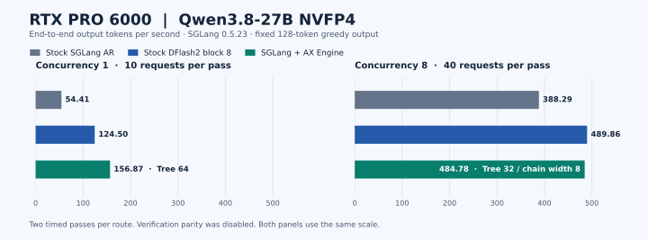
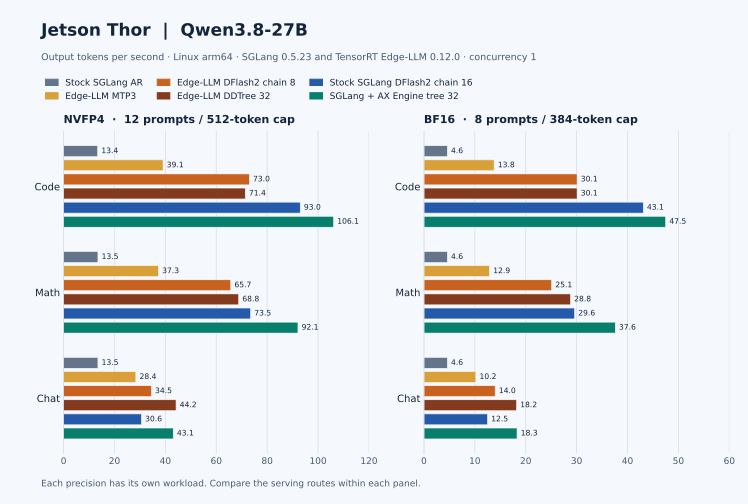
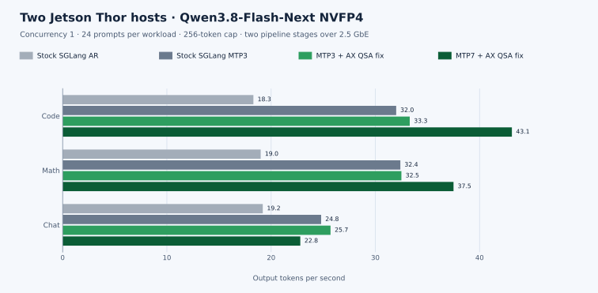

# Serving performance

## How to read the comparisons

- **Stock SGLang AR** uses standard autoregressive decoding without speculation.
- **Stock SGLang + DFlash2** uses SGLang's built-in DFlash2 chain verifier and
  the indicated draft block size.
- **SGLang + ax-engine-sglang** enables the AX Engine add-on and uses the
  verifier and width shown for that run.

Each row compares output tokens per second within one workload and platform.
The reports record checkpoint revisions, request limits and kernel settings.
[Model routes and precision support](README.md#model-routes)

## B200 · Qwen3.8-27B

The 64-slot NVFP4 run used 64 prompts per family, greedy decoding and a
1,024-token output limit. Each result is the mean of two passes. Cells
show code / math / chat output tok/s.

| Concurrency | Stock SGLang + DFlash2 block 8 | SGLang + ax-engine-sglang |
|---|---:|---:|
| 1 | 816 / 733 / 401 | 1,160 / 971 / 458 (tree 16) |
| 16 | 3,628 / 4,670 / 2,980 | 4,379.5 / 4,989 / 3,110 (chain 8) |

The add-on measured **1.14×–1.42×** stock DFlash2 at concurrency one
and **1.04×–1.21×** at concurrency 16. The 64-slot NVFP4 campaign
paired the stock and add-on speculative routes. The study also records
other concurrency levels, BF16 and TensorRT-LLM results.
[B200 dense-model study](decisions/2026-11-16-dual-attention-backend.md)

## RTX PRO 6000 · Qwen3.8-27B NVFP4

All lanes used SGLang 0.5.23, a fixed 128-token greedy output, FlashInfer
attention and FlashInfer CUTLASS NVFP4 GEMM. The tests used the same frozen
prompts and include prefill and local HTTP overhead. The table pools two
passes by dividing total output tokens by total wall time. NVFP4 describes
the target checkpoint. The DFlash2 drafter was BF16.

| Concurrency and requests per pass | Stock SGLang AR | Stock SGLang + DFlash2 | SGLang + ax-engine-sglang |
|---|---:|---:|---:|
| 1, 10 requests | 54.41 | 124.50 (block 8) | 156.87 (tree 64) |
| 8, 40 requests | 388.29 | 489.86 (block 8) | 484.78 (tree 32, chain width 8) |

Tree 64 delivered **2.88×** AR and **1.26×** stock DFlash2 at concurrency
one. Median request latency was 2.379 s for AR, 1.003 s for stock DFlash2
and 0.818 s for tree 64. At concurrency eight, stock DFlash2 and the add-on
exchanged the lead across the two passes. Their pooled rates were within
about 1%. [Full RTX sweep, per-pass rates and launch commands](../results/rtx_27b_nvfp4_speed/REPORT.md)

### RTX speed and parity profiles

The speed sweep ran with verification parity disabled. Tree 64 matched
packed AR on one of ten complete 128-token sequences in each pass. A
separate verification run used a 32-token output budget and AR configured
with the same parity numerics as the speculative lanes. Tree and chain
each matched that reference on all ten prompts. The independent AR and
DFlash2 cohorts passed all 28 checks in the recorded sampling comparison.
Parity AR reached 47.93 tok/s, parity chain 21.68 tok/s and parity tree
14.65 tok/s on that shorter workload. [Parity protocol and results](reports/2026-11-19-rtx-nvfp4-parity.md)

## Jetson Thor · Qwen3.8-27B

All rows use the single-request FlashInfer lanes on a Linux arm64 Jetson
Thor with SGLang 0.5.23. The 27B NVFP4 run used 12 prompts per family with
a 512-token output limit. The BF16 run used eight prompts per family with
a 384-token limit. Each cell gives code / math / chat output tok/s for
that checkpoint's workload.

| Target precision | Stock SGLang AR | Stock SGLang + DFlash2 chain 16 | SGLang + ax-engine-sglang tree 32 |
|---|---:|---:|---:|
| NVFP4 | 13.4 / 13.5 / 13.5 | 93.0 / 73.5 / 30.6 | 106.1 / 92.1 / 43.1 |
| BF16 | 4.6 / 4.6 / 4.6 | 43.1 / 29.6 / 12.5 | 47.5 / 37.6 / 18.3 |

The Thor report also records Qwen3.5-9B BF16 with the original DFlash
drafter. Its FlashInfer follow-up changed host load, and the chain lane
overlapped a download. See the report for the conditions and the separate
Triton lanes. [Jetson Thor results](reports/2026-11-19-jetson-thor.md)

## Qwen3.8-Flash-Next NVFP4 · MTP

Flash Next uses SGLang MTP with the add-on's QSA fix. Its comparison uses
stock MTP3 as the speculative baseline.

### One B200

In the second B200 pass at
concurrency one, each lane used greedy decoding with a 256-token output
limit. Rates are in output tok/s.

| Workload | Stock SGLang AR | Stock SGLang MTP3 | SGLang MTP7 + ax-engine-sglang QSA fix |
|---|---:|---:|---:|
| Code | 204.9 | 435.2 | 547.9 |
| Math | 212.5 | 432.3 | 487.7 |
| Chat | 211.7 | 334.4 | 296.8 |

The wider MTP window improved code and math in this pass, while stock MTP3
had higher chat throughput. The report includes both passes, time to first
token and multi-client results. [B200 Flash Next release benchmark](reports/2026-11-18-b200-v0.1.1.md)

### Two Jetson Thor hosts

SGLang 0.5.23 served the RadixArk NVFP4 checkpoint with two pipeline stages,
one on each Linux arm64 host. The single-request runs used FlashInfer CUTLASS
for NVFP4 MoE and a 2.5 GbE link between hosts. Rates are in output tok/s.

| Workload | Stock SGLang AR | Stock SGLang MTP3 | MTP3 + ax-engine-sglang QSA fix | MTP7 + ax-engine-sglang QSA fix |
|---|---:|---:|---:|---:|
| Code | 18.3 | 32.0 | 33.3 | **43.1** |
| Math | 19.0 | 32.4 | 32.5 | **37.5** |
| Chat | 19.2 | 24.8 | **25.7** | 22.8 |

The two add-on routes used a 16-slot QSA pending ring. MTP7 gave the highest
code and math throughput. The MTP3 add-on route led the four measured chat
lanes. [Thor Flash Next configuration and accepted tokens](reports/2026-11-19-jetson-thor.md#5-qwen38-flash-next-nvfp4-over-two-thors)

## Reproduce

- [Run the RTX three-route comparison](../results/rtx_27b_nvfp4_speed/REPORT.md#launch-the-measured-configurations).
- [Run SGLang benchmarks and serving checks](../benchmarks/sglang/).
- [Validate benchmark records](../contracts/benchmark-result-v1.schema.json).
