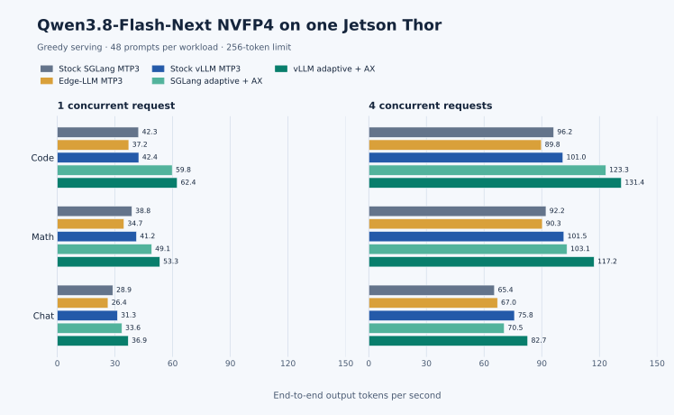

# Qwen3.8-Flash-Next NVFP4 on one Jetson Thor

The study ran from November 21 to 23, 2026 on Thor-02 (SM110, 122 GB
unified memory). It used SGLang 0.5.23 (`lmsysorg/sglang:v0.5.23-cu130`)
with ax-engine-sglang and vLLM `0.34.0rc1.dev1105+g2f170a0fe` (aarch64,
PyTorch 2.14.0+cu130) with ax-engine-vllm. The adaptive tuning and PLE
startup experiments used development builds.

## Summary

The fastest configuration on one Thor is **vLLM with ax-engine-vllm's adaptive MTP length**
(`AX_VLLM_ADAPTIVE_K`, K chosen each step from 3/5/7 by accepted drafts) plus the QSA block fix
and an NVFP4 copy of the draft lm_head. One server beat the best fixed length on every workload and
concurrency but one (math C1: 53.3 against MTP7's 53.5 tok/s, within noise), and beat the best
SGLang configuration on every workload and concurrency:

| 48 prompts, output tok/s (C1 / C4) | Code | Math | Chat | Geomean |
|---|---:|---:|---:|---:|
| Stock SGLang MTP3 | 42.3 / 96.2 | 38.8 / 92.2 | 28.9 / 65.4 | 54.9 |
| Stock vLLM MTP3 | 42.4 / 101.0 | 41.2 / 101.5 | 31.3 / 75.8 | 59.1 |
| SGLang adaptive + AX + 64k draft map | 59.8 / 123.3 | 49.1 / 103.1 | 33.6 / 70.5 | 66.8 |
| vLLM MTP7 + NVFP4 draft lm_head + AX QSA block | 61.6 / 130.9 | 53.5 / 115.0 | 31.5 / 64.4 | 68.2 |
| **vLLM adaptive K + NVFP4 draft lm_head + AX QSA block** | **62.4 / 131.4** | 53.3 / **117.2** | **36.9 / 82.7** | **73.4** |



- Against stock SGLang MTP3 the result is 26–48% faster; against the best SGLang configuration
  4–17% faster (geomean +10%). Against AR (20.6 tok/s on code at C1) code runs 3.0 times faster.
- The SGLang and vLLM adaptive rows come from the same evaluation step after Optuna tuning, each
  on its own server boot.
- The default adaptive policies scored slightly higher on the held-out prompts
  after 20 Optuna trials per engine. The selected policies' geometric means
  changed by −0.9% for SGLang and −0.6% for vLLM. Trial-to-trial noise was about ±2%.
- ax-engine-vllm fixed vLLM's MTP 5–8 startup failure (`AX_VLLM_QSA_BLOCK_ALIGN`), which the
  7-token chain needs. The SGLang development build addressed the 27 MB/s PLE
  table rewrite with `AX_PLE_FRESH_FILE`.
- Greedy outputs differ between lanes (Flash Next NVFP4 is not batch-invariant on SM110), so small
  differences are within noise; the vLLM lead holds on all six levels.
- Accuracy held: on full HumanEval and GSM8K, vLLM's adaptive lane scored exactly what its AR server
  scored (0.963 / 0.961) in half the time; SGLang's fastest lane scored 2 HumanEval items lower
(not significant, p = 0.63) and the same on GSM8K.

## Runs

| Run | Engine | Prompts per workload | Concurrency | Lanes |
|---|---|---:|---|---|
| 6 | SGLang | 24 | 1 | AR, MTP3, MTP3 + AX, MTP7 + AX, adaptive + AX |
| 7 | SGLang | 48 | 1, 4 | MTP3, MTP7 + AX, adaptive + AX, adaptive + AX + token map |
| vLLM 1–3 | vLLM | 48 | 1, 4 | MTP 3, 4, 5, 7, 9; NVFP4 draft lm_head; greedy verifier; QSA block fix |
| 8 | SGLang | 48 | 1, 4 | MTP3 + map, adaptive + AX + 32k map |
| Optuna | both | 16 tuning + 48 evaluation | 1, 4 | live adaptive policy, 20 trials per engine |

All runs: greedy without thinking, 256-token limit, code (HumanEval), math (GSM8K) and chat
(16 fixed prompts plus UltraChat) prompts, output tok/s over the whole level. Runs 7 and later use
the same 48 prompts per workload.

## SGLang

### Run 6: adaptive MTP

| Workload | Stock AR | Stock MTP3 | MTP3 + AX | MTP7 + AX | Adaptive MTP + AX |
|---|---:|---:|---:|---:|---:|
| Code | 20.6 | 41.7 | 41.0 | **48.2** | 47.9 |
| Math | 20.6 | 38.5 | 38.4 | 36.5 | **40.5** |
| Chat | 20.3 | 29.0 | 28.5 | 20.3 | **29.2** |

Adaptive (`--speculative-adaptive`, steps 1/3/5/7) matched MTP7 on code and MTP3 on chat. MTP7 on
chat gave no gain over AR: it verifies eight tokens per round and chat accepts about three. The
QSA ring fix (`AX_QSA_RING=16`) did not change MTP3 speed on one Thor. Adaptive switched 320 times
(3↔5, 5↔7, rarely 7→3) and never chose one step.

### Run 7: 48 prompts, concurrency 1 and 4, draft vocabulary map

| Lane | Code C1 / C4 | Math C1 / C4 | Chat C1 / C4 |
|---|---:|---:|---:|
| Stock MTP3 | 42.3 / 96.2 | 38.8 / 92.2 | 28.9 / **65.4** |
| MTP7 + AX | 49.5 / 114.5 | 39.5 / 95.5 | 22.8 / 50.3 |
| Adaptive + AX | 48.2 / 110.6 | 40.6 / 96.5 | 29.2 / 61.4 |
| Adaptive + AX + 64k map | **59.1 / 121.8** | **47.6 / 102.7** | **33.6** / 54.2 |

Accepted tokens per verify (C1): MTP3 3.91 / 3.52 / 2.62, MTP7 7.29 / 5.55 / 3.08, adaptive
6.79 / 4.81 / 2.67, adaptive + map 6.78 / 4.46 / 2.64.

Each MTP draft step projects onto the full 248,320-token vocabulary through the shared BF16
lm_head (1.27 GB), which dominates a step's 11–15 ms. `--speculative-token-map` restricts the draft
to a hot-token list and maps its top-1 back to a global token ID. The target
verifies against the full vocabulary. The experiment built the lists from
UltraChat `train_sft` assistant replies and GSM8K train answers, plus all
special and added tokens. Coverage of the AR outputs of this benchmark:

| Map size | Code | Math | Chat |
|---:|---:|---:|---:|
| 8,192 | .82 | .83 | .77 |
| 16,384 | .90 | .91 | .89 |
| 32,768 | .94 | .94 | .96 |
| 65,536 | .991 | .983 | .992 |

The 64k map raised C1 by 15–23% at a small acceptance cost (math 4.81 → 4.46).

### Run 8: map size and chat at four requests

| Lane | Code C1 / C4 | Math C1 / C4 | Chat C1 / C4 | Accepted C1 (code / math / chat) |
|---|---:|---:|---:|---|
| Stock MTP3 + 64k map | 47.7 / 103.8 | 44.3 / 101.3 | 32.9 / 64.9 | 3.85 / 3.45 / 2.58 |
| Adaptive + AX + 32k map | 53.1 / 107.0 | 46.0 / 96.1 | 33.3 / 64.1 | 5.33 / 4.00 / 2.56 |

- The 64k map raised stock MTP3 by 13% (code C1), 14% (math C1) and 14% (chat C1) and left chat C4
  unchanged (64.9 against 65.4 without the map).
- The 32k map lost code acceptance (5.33 against 6.78 with the 64k map) and 10% of code C1. Use 64k.
- The chat C4 result of run 7 (54.2 with the map) did not repeat: adaptive + 64k map measured 70.5
  in the Optuna evaluation below. Single C4 levels of 48 requests vary more than C1 levels.
- With `KEEP_PLE=1` the driver left the previous PLE file in place and ax-engine-sglang replaced it
  (`PLE table file ... replaced by a sparse file`); the target loaded in 670 s.

## vLLM

vLLM supports Qwen4-Exp (`method: "mtp"`), keeps the PLE table on disk (`--engram-config
'{"disk_offload": true}'`, rows read with `preadv`) and can quantize the draft's copy of the lm_head
(`draft_lm_head_quantization`). Each lane booted separately:

| Lane | Code C1 / C4 | Math C1 / C4 | Chat C1 / C4 | Accepted (code / math / chat) |
|---|---:|---:|---:|---|
| MTP3 | 42.4 / 101.0 | 41.2 / 101.5 | 31.3 / 75.8 | 3.88 / 3.51 / 2.61 |
| MTP3 + NVFP4 lm_head | 49.0 / 110.8 | 47.5 / 109.7 | **36.6 / 80.8** | 3.89 / 3.50 / 2.61 |
| MTP4 + NVFP4 lm_head | 53.9 / 118.4 | 51.0 / 110.6 | 36.4 / 74.5 | 4.78 / 4.13 / 2.82 |
| MTP4 + NVFP4 lm_head + AX greedy verify | 53.8 / 117.1 | 51.0 / 111.3 | 36.4 / 75.6 | 4.79 / 4.16 / 2.83 |
| MTP7 + AX QSA block | 49.0 / 114.3 | 42.4 / 101.6 | 24.9 / 59.9 | 7.08 / 5.52 / 3.09 |
| MTP5 + NVFP4 lm_head + AX QSA block | 57.1 / 121.3 | 52.9 / 111.9 | 35.2 / 69.7 | 5.65 / 4.76 / 2.96 |
| MTP7 + NVFP4 lm_head + AX QSA block | **61.6 / 130.9** | **53.5 / 115.0** | 31.5 / 64.4 | 7.13 / 5.53 / 3.06 |
| MTP9 + NVFP4 lm_head | **60.9 / 129.5** | **51.2 / 111.0** | 28.0 / 60.0 | 8.08 / 6.08 / 3.11 |

- The NVFP4 draft lm_head kept acceptance and raised MTP3 by 6–16%.
- The best fixed length differs by workload: 7 for code and math, 3 for chat.
- The AX greedy verifier made no difference on Thor (−1% to +1%).
- vLLM was ready in about 16 minutes (weights 383 s, draft 88 s). SGLang loaded its target in
  670–750 s once the PLE file started sparse, plus about 2 minutes for the draft.

### MTP 5 to 8 did not start

With 5 to 8 draft tokens vLLM stopped during startup with `AssertionError: QSA ring capacity 12
must divide the attention block size 1664`. The QSA indexer keeps the raw keys of each request's open
compress group in a ring of `round_up(4 + N, 4)` slots and asserts that the ring divides the
scheduler block. vLLM sizes that block from the Mamba page and each attention backend's smallest
kernel block (QSA: multiple of 16, indexer: any), so the ring never enters the alignment: 1664 =
16 × 104 works for 8- and 16-slot rings (N ≤ 4 and N 9–12) but not 12.

ax-engine-vllm `AX_VLLM_QSA_BLOCK_ALIGN=1` makes the indexer backend report a multiple of the ring
capacity to the calls that choose and validate the block size. The run logged a 1728-token block,
a multiple of lcm(16, 12) = 48, and MTP7 started and served. Rounding 1664 up to a multiple of 48
alone would give 1680, so another of vLLM's block alignments also applies on this host.

## Adaptive length in vLLM and Optuna tuning

### Adaptive K for vLLM

vLLM can change the number of speculative tokens K every step, but only from a static table indexed
by batch size (`num_speculative_tokens_per_batch_size`); the drafter captures CUDA graphs for each K
in that table. ax-engine-vllm `AX_VLLM_ADAPTIVE_K=<policy.json>` rewrites the scheduler's batch-size
→ K table before each step from the accepted drafts of earlier steps, with the policy SGLang's
`--speculative-adaptive` uses (EMA of accepted drafts, step up above `K − 0.5 + up_hysteresis`,
down at `K_prev − 0.5 + down_hysteresis`). The server boots with
`num_speculative_tokens: 7`, `max_num_seqs: 8` and the schedule
`[[1,1,7],[2,2,6],[3,3,5],[4,4,4],[5,5,3],[6,8,2]]`, which captures graphs for K = 2 to 7.

Fixed K = 4 through the same table measured 55.1 / 118.5, 51.3 / 114.6 and 36.5 / 74.3, against
53.9 / 118.4, 51.0 / 110.6 and 36.4 / 74.5 for the static MTP4 lane: the per-step table costs
nothing. The gain comes from the choice of K. Under the default policy one tuning trial ran 1,937
verify batches at K = 3, 820 at K = 5 and 960 at K = 7.

### Optuna

The experiment reloaded both policies from a file at runtime using
`AX_ADAPTIVE_LIVE` in the SGLang development build and
`AX_VLLM_ADAPTIVE_K` in ax-engine-vllm. This let each trial reuse the
running server and its graphs. The Optuna TPE sweep covered EMA alpha, update interval, warmup,
both hysteresis values and the candidate steps for one request and for two or more. Each trial ran
16 tuning prompts per workload at C1 and C4 (HumanEval 100–119, GSM8K test 500–519, UltraChat
prompts after the 200th qualifying one, none in the 48-prompt evaluation) and scored the geometric
mean of the six output rates. The first three trials were the engine default, fixed 3 and fixed 4.

| Tuning score | SGLang (steps 1–7, 64k map) | vLLM (K 2–7) |
|---|---:|---:|
| Default adaptive | 65.2 (1/3/5/7) | 72.3 (3/5/7) |
| Fixed 3 | 61.1 | 66.6 |
| Fixed 4 | 63.1 | 69.2 |
| Best of 20 | 68.5 (trial 18) | 73.0 (trial 18) |

SGLang's best policy used steps 5/7 for one request and 4/5 for more, with a near-zero chance of
stepping down; vLLM's best kept 3/5/7. On the 48-prompt evaluation, on the same servers:

| 48 prompts (C1 / C4) | Code | Math | Chat | Geomean |
|---|---:|---:|---:|---:|
| SGLang default adaptive | 59.8 / 123.3 | 49.1 / 103.1 | 33.6 / 70.5 | 66.8 |
| SGLang Optuna best | 58.5 / 117.2 | 50.2 / 107.3 | 32.2 / 70.3 | 66.1 |
| vLLM default adaptive K | 62.4 / 131.4 | 53.3 / 117.2 | 36.9 / 82.7 | 73.4 |
| vLLM Optuna best | 62.9 / 129.1 | 53.3 / 116.9 | 36.4 / 82.1 | 73.0 |

The tuned policies did not carry over: the default policies are within noise of the best on this
workload mix. Eleven of the 20 trials of each engine scored within 3% of the
best. Keep the default policies; the live-reload hooks stay available for other workloads.

## Fitting Flash Next on one Thor

The checkpoint is 135 GB: 73 GB of NVFP4 experts, a 51 GB FP8 PLE n-gram table and about 11 GB of
other weights. The PLE table stays off the GPU, so the GPU-side weights are about 82 GB.

1. **MTP draft.** The checkpoint's quantization config excludes `mtp.*`, so the MTP layer's 512
   experts load in BF16 (5.0 GB plus 0.2 GB of other MTP weights). With the host's other services
   stopped, 94 GB was available, which left 8.8 GB after the target and the OOM killer stopped the
   scheduler while the draft loaded. Moving the stopped services' 24 GB of `/dev/shm` data to disk
   raised available memory to 119 GB; after the target, draft, 8,192 KV tokens and CUDA graphs,
   26.7 GB remained.
2. **PLE file rewrite (SGLang).** Every boot rewrites the whole PLE table through the weight
   loader. SGLang maps the file with `MADV_RANDOM`, and writing into pages that already hold data
   then costs one synchronous 4 KB read per page. A 2 GB test on the same NVMe:

   | Write into the table file | MB/s |
   |---|---:|
   | Sparse file, `MADV_RANDOM` (first boot) | 1549 |
   | Filled file, `MADV_RANDOM` (every later boot) | 27 |
   | Filled file, default advice | 604 |
   | Filled file, `pwrite` | 2324 |

   In the slowest load the 14 PLE shards took 24 of 29 minutes. Deleting the table file before each
   boot cut the target load from 1480–1755 s to 1050 s, and a 2-second
   `SGLANG_QWEN4_PLE_FILE_RSS_INTERVAL_S` (default 30) to 746 s. The single-rank
   development build used `AX_PLE_FRESH_FILE` to replace the previous table file.
3. **Startup wait.** `run_baselines.sh` waited at most 30 minutes for `/health`, which a 29-minute
   load exceeded. The study runner used a 3,600-second readiness timeout.

## Answer quality

Each engine's fastest lane was scored against its own AR server on the full HumanEval (164) and
GSM8K test (1,319) sets: greedy without thinking, 1,024-token limit, four requests at a time, the
`benchmarks/baselines/eval_quality.py` prompts and checks (2026-11-22/23, df-thor-02).

| Lane | HumanEval pass@1 | GSM8K accuracy | Wall time | Output tok/s |
|---|---:|---:|---:|---:|
| vLLM AR | 158 / 164 (0.963) | 1268 / 1319 (0.961) | 8,773 s | 60.9 |
| vLLM adaptive K + NVFP4 draft lm_head + AX QSA block | 158 / 164 (0.963) | 1268 / 1319 (0.961) | **4,625 s** | **115.2** |
| SGLang AR | 158 / 164 (0.963) | 1269 / 1319 (0.962) | 9,359 s | 57.4 |
| SGLang adaptive + AX + 64k draft map | 156 / 164 (0.951) | 1269 / 1319 (0.962) | 5,297 s | 100.7 |

- vLLM's adaptive lane scored the same as its AR server on both sets; GSM8K swapped 7 items each
  way. SGLang's lane scored 2 HumanEval items lower, losing 3 and gaining 1 (exact McNemar
  p = 0.63, not significant), and the same on GSM8K with 9 items swapped each way.
- Over about 533k generated tokens per lane, vLLM's adaptive lane ran 1.90 times faster than its AR
  server and 14% faster than SGLang's fastest lane, consistent with the 48-prompt results. Mean
  acceptance length was 4.91 (vLLM) and 4.21 (SGLang) in the GSM8K phase.
- Text agreement with the same engine's AR output was 80% (HumanEval)
  and 36% (GSM8K) for vLLM, and 62% and 10% for SGLang. The two AR
  servers agreed on 65% and 11%, respectively. The comparison leaves
  the effects of implementation numerics, verification shape, and drafting
  combined.

## Output agreement

Greedy outputs were not bit-identical across any lanes, including stock MTP3 against MTP3 + AX
(23–28 of 72 rows identical to AR in run 6). Several rows diverge at the first or second generated
token in every lane: Flash Next NVFP4 is not batch-invariant across verify shapes on SM110.
Speed differences of a few percent are within the noise of different generated text.

## Configuration

SGLang server flags:

```text
--mem-fraction-static 0.94 --max-total-tokens 8192 --max-mamba-cache-size 16
--context-length 4096 --chunked-prefill-size 1024 --max-running-requests 4
--cuda-graph-max-bs-decode 4 --moe-runner-backend flashinfer_cutlass
--speculative-moe-runner-backend flashinfer_cutlass
--ple-offload-embedding --ple-offload-backend file --weight-loader-drop-cache-after-load
SGLANG_QWEN4_PLE_FILE_RSS_BUDGET_GB=1
```

Run 6 used two running requests. MTP lanes use EAGLE with top-k 1 and `N + 1` draft tokens. AX
lanes set `SGLANG_PLUGINS=ax-engine` and `AX_QSA_RING=16`. Adaptive lanes start from MTP7 and add
`--speculative-adaptive --speculative-adaptive-config adaptive.json` with candidate steps 1/3/5/7
for one and four requests. SGLang's adaptive mode requires EAGLE with top-k 1 and no pipeline
parallelism, so it does not apply to the two-Thor pipeline setup.

vLLM server flags:

```text
vllm serve RadixArk/Qwen3.8-Flash-Next-NVFP4 --max-model-len 4096 --max-num-seqs 4
  --gpu-memory-utilization 0.85 --reasoning-parser qwen3 --language-model-only
  --engram-config '{"disk_offload": true}'
  --speculative-config '{"method":"mtp","num_speculative_tokens":N,"draft_lm_head_quantization":"nvfp4"}'
```

Drivers, raw logs, token maps and memory samples are in `results/flash_next_single_thor/` (not
tracked by Git).
