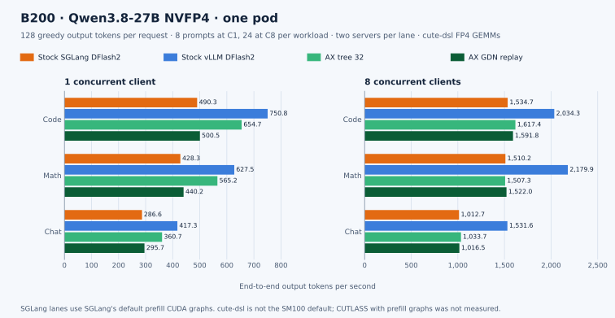

# B200 · Qwen3.8-27B NVFP4: prefill CUDA graphs and stock vLLM on one pod (2026-11-28)

Qwen3.8-27B NVFP4 (ModelOpt mixed precision) with the DFlash2 drafter on one B200 (SM100, 183,359 MiB,
driver 595.112.07). SGLang 0.5.23, torch 2.14.1, FlashInfer 0.7.2, ax-engine-sglang 0.5.1 at ea53273,
FlashInfer cute-dsl FP4 GEMMs (`--fp4-gemm-backend flashinfer_cutedsl`). Stock vLLM
0.34.0rc1.dev1105+g2f170a0fe (torch 2.14.0, FlashInfer 0.7.4).

Workload, runners and pooling as in `results/h200_prefill_graph`: the 128-token retest (8 prompts per
workload at one client, 24 at eight, greedy, exactly 128 tokens), two sweeps per server, two servers
per lane, eager and prefill-graph servers alternating route by route, then two stock vLLM DFlash2
servers (8 sequences, 4,096-token context, 8,192 batched tokens, memory utilization 0.90, prefix caching
off, FP32 Mamba state, 7 speculative tokens). Cells pool every sweep except the first sweep of each
lane's first server.

**GEMM backend.** On SM100 SGLang 0.5.23's `auto` already picks `flashinfer_cutedsl`
(`fp4_utils.initialize_fp4_gemm_config`), the backend this run passed explicitly, and vLLM runs the
same cute-dsl `mm_fp4` kernels; the earlier B200 retest (`results/blackwell_nvfp4_serving_retest`) ran
`flashinfer_cutlass`. (An earlier version of this note said cute-dsl was not the SM100 default; it is.)
The gap below was later traced to DFlash prefill admission and the Triton GDN prefill
(`results/b200_gdn_prefill`).

## Results

Output tok/s, code / math / chat. First-token time is the median over the cell's requests.

| Route | Clients | Prefill graphs | Against vLLM | First token | Tokens per verify |
|---|---:|---:|---:|---:|---:|
| Stock DFlash2 width 8 | 1 | 490.3 / 428.3 / 286.6 | −34.7 / −31.7 / −31.3% | 0.065 s | 6.48 / 5.42 / 3.31 |
| Stock DFlash2 width 8 | 8 | 1,534.7 / 1,510.2 / 1,012.7 | −24.6 / −30.7 / −33.9% | 0.162 s | 5.64 / 5.77 / 3.05 |
| AX tree 32 | 1 | 654.7 / 565.2 / 360.7 | −12.8 / −9.9 / −13.6% | 0.066 s | 10.67 / 8.53 / 4.72 |
| AX tree 32 | 8 | 1,617.4 / 1,507.3 / 1,033.7 | −20.5 / −30.9 / −32.5% | 0.166 s | 5.83 / 5.80 / 3.07 |
| AX GDN replay 8 | 1 | 500.5 / 440.2 / 295.7 | −33.3 / −29.8 / −29.1% | 0.066 s | 6.48 / 5.42 / 3.31 |
| AX GDN replay 8 | 8 | 1,591.8 / 1,522.0 / 1,016.5 | −21.8 / −30.2 / −33.6% | 0.162 s | 5.66 / 5.76 / 3.08 |
| Stock vLLM DFlash2 | 1 | **750.8 / 627.5 / 417.3** | | 0.045 s | 6.97 / 5.52 / 3.33 |
| Stock vLLM DFlash2 | 8 | **2,034.3 / 2,179.9 / 1,531.6** | | 0.134 s | 5.87 / 5.80 / 3.17 |

- **Against stock vLLM, same pod.** vLLM led every cell. The AX tree trailed by 10-14% at one client
  and 21-33% at eight; stock SGLang and replay trailed by 29-35% at one client and 22-34% at eight.
  Acceptance explains little of it: at one client on code vLLM verified 6.97 tokens per round against
  6.48 for stock SGLang, while throughput ÷ tokens per verify gives about 108 verify rounds per second
  for vLLM against 76 for stock SGLang and 61 for the tree. The gap is per-step cost.
- **Against the earlier B200 retest** (another pod, eager prefill, CUTLASS GEMMs): stock DFlash2 +2 to
  +9% at one client and +7 to +29% at eight; the tree +3.5 to +9% and +8 to +31% (against the earlier
  width-eight chain at eight clients); replay +3 to +10% and −0.5 to +7%.
- **Eager prefill lanes are not usable here.** With eager prefill and cute-dsl, five of six cells spread 12-48%
  between passes (prefill-graph cells: at most 4.1%, except one replay sweep below), and first-token time
  stayed at 0.20 s at one client against 0.065 s with graphs. In one eager server the one-client math
  first-token time fell from 0.20 s to 0.13 s within a sweep. A likely cause (not verified) is that
  cute-dsl compiles a kernel for each new prefill shape, which eager prefills keep producing; captured
  prefill graphs have fixed shapes. The eager rows (stock 340.6 / 319.7 / 224.4 at one client and
  918.1 / 784.4 / 640.8 at eight) are therefore not a fair baseline and are left out of the chart; the
  earlier CUTLASS eager run reached 1,438.4 on stock code at eight clients.
- **Spread.** One replay prefill-graph sweep ran chat at 867.5 tok/s against 1,079-1,114 in the other
  three, which gives that cell its 28.4% spread. vLLM's cells spread at most 6.6%; its first server
  spent 1,065 s in JIT before serving.
- **Outputs.** Greedy outputs matched between eager and prefill-graph servers on 33-39 of 72
  one-client requests per route and 79-103 of 216 at eight.

Follow-up: `results/b200_gdn_prefill` (FlashInfer GDN prefill and one-at-a-time DFlash admission).

## Files

`benchmarks/sglang/hopper_tree_sweep.py` (`AX_SWEEP_FP4_BACKEND=flashinfer_cutedsl`; eager lanes with
`AX_BENCH_EAGER_PREFILL=1`) and the cross-engine vLLM client.
