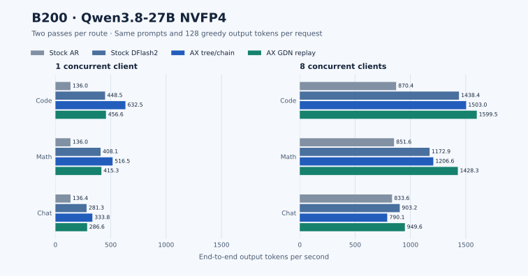
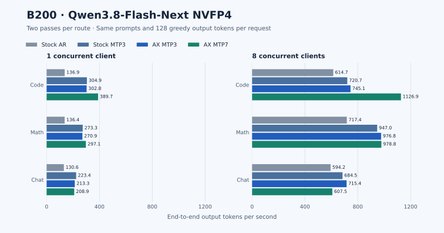
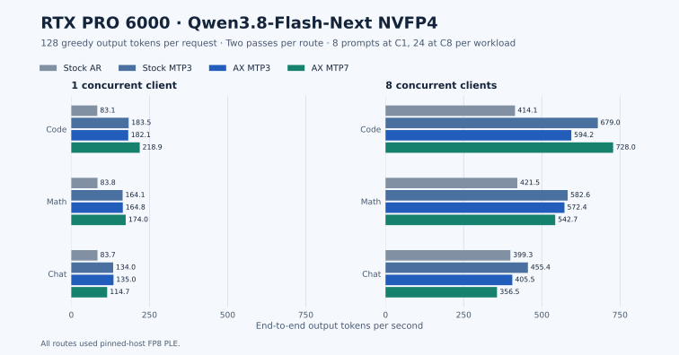

# Blackwell NVFP4 serving retest

The tested GPUs were one NVIDIA B200 (183,359 MiB) and one NVIDIA RTX PRO
6000 Blackwell Server Edition (97,887 MiB), both with driver 595.112.07.
The servers used SGLang 0.5.23, FlashInfer 0.7.2, PyTorch 2.14.1+cu130,
and AX Engine for SGLang 0.5.1.

## Workload

Each lane ran two timed passes on the same code, math, and chat prompts.
Each pass used eight prompts at C1 and 24 at C8. Requests used 128 greedy
output tokens, ignored EOS, and streamed through the local `/generate`
API. The tables pool both passes by dividing total output tokens by total
elapsed time. The prompt corpus has SHA-256
`7f5953285f237f81eda3a502e3e2454719d9352106c824c67889c9d1f2855dd8`.
[Prior retest and checkpoint revisions](../rtx_pro_6000_retest/REPORT.md#measurement-conditions)

All lanes used eight request slots, a 4,096-token context limit, decode
CUDA graphs, FlashInfer attention, and FlashInfer CUTLASS NVFP4 GEMM.
Radix cache, prefill graphs, and autotuning were off. The dense target used
a 16,384-token KV pool. Flash Next used an 8,192-token pool and pinned-host
FP8 PLE, with FlashInfer CUTLASS for target and draft MoE. The AX MTP lanes
used a 16-slot QSA pending ring. Timed passes followed C1 and C8 warm-ups.

## B200 Qwen3.8-27B NVFP4

Cells show output tok/s for code / math / chat. AX tree/chain used a
32-node tree for eligible single requests and a width-eight chain for
grouped verification.

| Clients | Stock AR | Stock DFlash2 | AX tree/chain | AX GDN replay |
|---:|---:|---:|---:|---:|
| 1 | 136.0 / 136.0 / 136.4 | 448.5 / 408.1 / 281.3 | **632.5** / **516.5** / **333.8** | 456.6 / 415.3 / 286.6 |
| 8 | 870.4 / 851.6 / 833.6 | 1,438.4 / 1,172.9 / 903.2 | 1,503.0 / 1,206.6 / 790.1 | **1,599.5** / **1,428.3** / **949.6** |

At C8, width-eight GDN replay improved over stock DFlash2 by 11.2% on
code, 21.8% on math, and 5.1% on chat. The chat lane produced 3.04
tokens per verification with both stock DFlash2 and GDN replay.

| C8 chat route | Pass 1 / 2 (tok/s) | p50 TTFT (ms) | p95 request (s) | Exact on repeat | Exact vs AR |
|---|---:|---:|---:|---:|---:|
| Stock AR | 755.3 / 930.0 | 156 | 1.75 | 21/24 | — |
| Stock DFlash2 | 855.4 / 956.6 | 172 | 1.41 | 2/24 | 0/48 |
| AX tree/chain | 669.4 / 963.9 | 206 | 2.34 | 4/24 | 0/48 |
| AX GDN replay | 888.7 / 1,019.5 | 171 | 1.34 | 2/24 | 0/48 |

These are speed-profile runs. The exact counts compare complete output
token sequences. The table includes both passes because throughput and
outputs varied across repeats.

The initial B200 AR run overlapped Flash Next checkpoint staging. An AR
confirmation after staging, with the matching FlashInfer kernel cache
installed, reached 910.0 / 912.6 / 953.0 tok/s at C8 for code / math /
chat. Chat passed at 948.4 and 957.7 tok/s. That places warmed AR and GDN
replay close on this short chat workload.

## B200 Qwen3.8-Flash-Next NVFP4

The B200 used FlashInfer's matching 0.7.2 CUDA 13.0 SM100a kernel cache
for the completed Flash Next runs. The first AR launch had been compiling
the MoE kernels locally. All completed Flash Next lanes used the same
cache package. [FlashInfer installation documentation](https://docs.flashinfer.ai/installation.html)

| Clients | Stock AR | Stock MTP3 | AX MTP3 | AX MTP7 |
|---:|---:|---:|---:|---:|
| 1 | 136.9 / 136.4 / 130.6 | 304.9 / 273.3 / **223.4** | 302.8 / 270.9 / 213.3 | **389.7** / **297.1** / 208.9 |
| 8 | 614.7 / 717.4 / 594.2 | 720.7 / 947.0 / 684.5 | 745.1 / 976.8 / **715.4** | **1,126.9** / **978.8** / 607.5 |

AX MTP7 led code at C1 and C8, reaching 56.4% above stock MTP3 at C8.
The two AX routes had similar C8 math
rates. AX MTP3 led C8 chat at 715.4 tok/s, 4.5% above stock MTP3,
and reduced p95 from 2.25 to 1.94 s.

| C8 chat route | Pass 1 / 2 (tok/s) | p50 TTFT (ms) | p95 request (s) | Tokens per verify | Exact on repeat | Exact vs AR |
|---|---:|---:|---:|---:|---:|---:|
| Stock AR | 516.8 / 699.0 | 173 | 2.73 | — | 16/24 | — |
| Stock MTP3 | 606.8 / 785.1 | 119 | 2.25 | 2.61 | 7/24 | 0/48 |
| AX MTP3 | 655.6 / 787.2 | 125 | 1.94 | 2.59 | 7/24 | 1/48 |
| AX MTP7 | 552.1 / 675.3 | 133 | 2.28 | 3.01 | 6/24 | 0/48 |

## RTX PRO 6000 Qwen3.8-Flash-Next NVFP4

The first AR and stock MTP3 startups hit the host-memory limit while the
dense weights were staged in shared memory. Moving those weights to
local disk freed about 25 GiB of shared memory. The AX lanes then
completed, followed by fresh AR and stock MTP3 runs with the compiled
kernels cached. The table uses two completed passes per lane.

| Clients | Stock AR | Stock MTP3 | AX MTP3 | AX MTP7 |
|---:|---:|---:|---:|---:|
| 1 | 83.1 / 83.8 / 83.7 | 183.5 / 164.1 / 134.0 | 182.1 / 164.8 / **135.0** | **218.9** / **174.0** / 114.7 |
| 8 | 414.1 / 421.5 / 399.3 | 679.0 / **582.6** / **455.4** | 594.2 / 572.4 / 405.5 | **728.0** / 542.7 / 356.5 |

AX MTP7 led C8 code by 7.2% over stock MTP3. Stock MTP3 led C8 math
and chat. AX MTP3 started its first timed chat pass at 363.7 tok/s and
reached 458.2 tok/s on repeat, close to stock MTP3's second pass.

| C8 chat route | Pass 1 / 2 (tok/s) | p50 TTFT (ms) | p95 request (s) | Tokens per verify | Exact on repeat | Exact vs AR |
|---|---:|---:|---:|---:|---:|---:|
| Stock AR | 394.7 / 404.0 | 151 | 2.64 | — | 0/24 | — |
| Stock MTP3 | 452.7 / 458.2 | 145 | 2.76 | 2.62 | 22/24 | 0/48 |
| AX MTP3 | 363.7 / 458.2 | 145 | 3.83 | 2.62 | 22/24 | 0/48 |
| AX MTP7 | 347.8 / 365.7 | 171 | 3.60 | 2.98 | 22/24 | 0/48 |

The separate Qwen3.8-27B FP8 comparison on RTX PRO 6000 used 64 chat
prompts and 512 output tokens per request.
[RTX PRO 6000 DFlash2 tactic report](../fp8_verify_tactics/REPORT.md#rtx-pro-6000-live-qwen38-27b-nvfp4)
