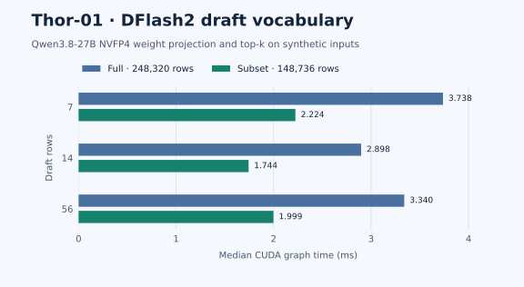
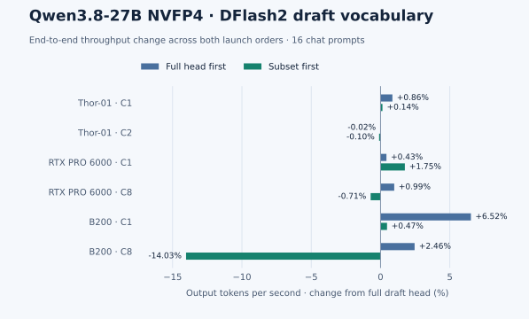

# DFlash2 draft vocabulary subset

The opt-in `AX_DFLASH_DRAFT_VOCAB=1` packs 148,736 of 248,320
Qwen vocabulary rows. The two retained ID ranges end on 128-row
NVFP4 scale boundaries. The packed NVFP4 weight and scale tensors
use about 409 MiB. The draft selector maps top-k results back to
global IDs before constructing its proposals. The target continues
to verify over the full vocabulary.

The first test used one Jetson Thor (SM110, driver 595.78) with SGLang
0.5.23, FlashInfer 0.7.2, PyTorch 2.14.1+cu130, and cuDNN 9.24.
The target was RadixArk/Qwen3.8-27B-NVFP4 at revision `319f741c`
with incoai/Qwen3.8-27B-DFlash2 at `015e7956`.

## Thor-01 draft projection and top-k

This probe used the checkpoint's NVFP4 vocabulary head and synthetic
BF16 activations (seed 42). It timed seven alternating pairs of CUDA
graph replays with CUTLASS projection and the FlashInfer radix top-k.
Each timing is the median of seven samples. Each sample averages
16 replays. The reduction is the median of the paired reductions.

| Draft rows | Full head (ms) | Subset (ms) | Reduction | Bit-identical retained logits |
|---:|---:|---:|---:|---:|
| 7 | 3.738 | 2.224 | 40.46% | 1,041,152/1,041,152 |
| 14 | 2.898 | 1.744 | 39.80% | 2,082,304/2,082,304 |
| 56 | 3.340 | 1.999 | 40.07% | 8,329,216/8,329,216 |

All remapped top-k IDs gathered bit-identical scores from the full
projection. The measurements cover draft projection and top-k.
[Reproduction commands](../../benchmarks/sglang/README.md#dflash2-draft-vocabulary-subset)

## RTX PRO 6000 draft projection and top-k

The same probe ran on one RTX PRO 6000 Blackwell Server Edition (SM120,
driver 595.112.07). All retained logits and mapped top-k scores matched
the full head bit for bit on the synthetic activations.

| Draft rows | Full head (µs) | Subset (µs) | Reduction |
|---:|---:|---:|---:|
| 7 | 742.17 | 471.36 | 36.48% |
| 14 | 719.94 | 461.90 | 35.88% |
| 56 | 577.79 | 376.19 | 34.89% |

## B200 draft projection and top-k

On one B200 (SM100, driver 595.112.07), all retained logits and mapped
top-k scores also matched bit for bit in the projection probe.

| Draft rows | Full head (µs) | Subset (µs) | Reduction |
|---:|---:|---:|---:|
| 7 | 223.40 | 147.64 | 33.94% |
| 14 | 203.33 | 147.94 | 27.26% |
| 56 | 224.33 | 139.35 | 37.89% |

## Serving validation

Both lanes use the same width-eight native DFlash2 worker with
accepted-prefix GDN replay. The first prototype replaced the native
FlashInfer plan buffers during the second graph capture. A request that
switched back to the full draft graph hit CUDA error 700. The revision
reuses the captured plan wrappers and allocates subset graph temporaries
from a separate pool. On Thor-01 the original reproducer then completed.

The smoke pass matched all four 128-token outputs at C1 and C2 against
the earlier full-head run. At C1, 126 of 158 decode rounds used the
subset. In the two-client run, the subset replayed for 32 of 63 rounds
with both requests active. All 29 multilingual fallback rounds, nine
two-request mixed rounds, and eight sampled rounds used the full draft
head. The three multilingual outputs matched the full-head run.

The timed comparison uses 16 held-out UltraChat prompts selected from
the prior FP8 evaluation cohort by their last 64 input tokens. Every
request emits 128 greedy tokens with EOS disabled. The initial prompt
check permits a prompt to leave the subset as new tokens arrive.
Each server warms once before timing both concurrencies, then runs
the excluded-ID and sampled fallback checks. Both lanes use a context
limit of 4,096 and disable radix caching.

- Timed prompt SHA-256 `d491e6d6198d5f763175c7bbacb0c81eed43d1c8705651cf27efe49650bfa4f2`
- Fallback prompt SHA-256 `8de5e1a549718f18876f3efe4f562ab4f99b07fce8d572fb75fb1a7822991c90`

Both Runpod GPU runs used FlashInfer 0.7.2, SGLang 0.5.23, PyTorch
2.14.1+cu130 and cuDNN 9.24. The checkpoint configuration and weight
index matched the Thor run. The KV limit was 4,096 tokens on Thor
and 8,192 on the two Runpod GPUs. All observed live batch sizes had
matching draft and verify graph sizes.

| GPU | Clients | First lane | Full tok/s | Subset tok/s | Change | p95 full → subset (s) | Exact outputs | Subset replays at full batch |
|---|---:|---|---:|---:|---:|---:|---:|---:|
| Thor-01 | 1 | Full | 28.92 | 29.17 | +0.86% | 7.05 → 6.97 | 16/16 | 597/703 |
| Thor-01 | 1 | Subset | 29.10 | 29.14 | +0.14% | 7.01 → 6.96 | 16/16 | 597/703 |
| Thor-01 | 2 | Full | 51.71 | 51.70 | -0.02% | 7.68 → 7.62 | 16/16 | 252/336 |
| Thor-01 | 2 | Subset | 51.98 | 51.92 | -0.10% | 7.65 → 7.48 | 16/16 | 252/336 |
| RTX PRO 6000 | 1 | Full | 113.69 | 114.17 | +0.43% | 1.75 → 1.73 | 16/16 | 499/716 |
| RTX PRO 6000 | 1 | Subset | 111.97 | 113.94 | +1.75% | 1.81 → 1.73 | 16/16 | 499/716 |
| RTX PRO 6000 | 8 | Full | 523.33 | 528.49 | +0.99% | 2.79 → 2.74 | 15/16 | 7/26 |
| RTX PRO 6000 | 8 | Subset | 530.57 | 526.79 | -0.71% | 2.75 → 2.75 | 15/16 | 7/26 |
| B200 | 1 | Full | 228.08 | 242.95 | +6.52% | 1.13 → 0.95 | 16/16 | 483/672 |
| B200 | 1 | Subset | 242.61 | 243.75 | +0.47% | 1.01 → 0.90 | 16/16 | 483/672 |
| B200 | 8 | Full | 933.75 | 956.69 | +2.46% | 1.54 → 1.50 | 14/16 | 7/26 |
| B200 | 8 | Subset | 1112.55 | 956.45 | -14.03% | 1.38 → 1.50 | 1/16 | 7/26 |

Thor-01 matched all 16 outputs at C1 and C2 in both orders.
Tokens per verify changed from 2.981 to 2.972 at C1 and from
2.964 to 2.955 at C2. RTX PRO 6000 matched all C1 outputs and
15 of 16 C8 outputs in each order. Its one C8 difference started
at output token 26 in the same prompt. Each RTX lane repeated all
16 of its own outputs across orders.

At C8 on B200, the full-head control ran 26 rounds with eight live
requests in the first order and 56 in the reverse order. It repeated
1 of 16 full outputs across orders. The subset repeated 16 of 16 of its
outputs and replayed 7 of 26 eight-request rounds in each order.
The observed end-to-end change ranged from +2.46% to −14.03% at C8.
Its C1 change was +0.47% to +6.52% with all outputs matching.

All three GPUs completed the sampled fallback and the three
multilingual checks in both orders. The multilingual outputs
matched the full-head controls. The flag remains experimental
and off by default. The throughput gain was consistent only
at C1 in this workload.
