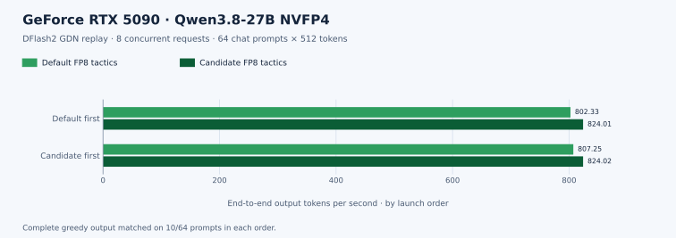
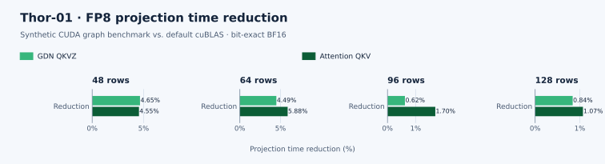

# DFlash2 FP8 verification tactics

## RTX PRO 6000 serving

The original Runpod host had no free GPU. FP8 tactic serving measurements
on RTX PRO 6000 remain pending. The reference below is the earlier
Qwen3.8-27B NVFP4 width-eight DFlash2 run with accepted-prefix GDN replay
on 64 held-out UltraChat prompts and 512 output tokens per request.
The ranges cover both launch orders in that run.
[Prior RTX measurements](../rtx_pro_6000_hotpath_validation/REPORT.md#warmed-chat-throughput)

| Live clients | Replay output tok/s | p95 request latency |
|---|---:|---:|
| 8 | 771.72–782.87 | 6.32–6.46 s |
| 16 | 1,200.63–1,202.68 | 7.74–8.43 s |

## RTX 5090 live Qwen3.8-27B NVFP4

The Runpod retry used one GeForce RTX 5090 (32 GiB, SM120) with NVIDIA
driver 595.112.07, SGLang 0.5.23, FlashInfer 0.7.2, PyTorch 2.14.1+cu130,
and cuDNN 9.24. Both serving lanes used width-eight DFlash2, accepted-prefix
GDN replay, eight request slots, a context limit of 2,048, and an 8,192-token
KV pool. An initial cold request timed out during CUDA compilation. The
completed operand capture used the warmed kernel cache.

### 64-row projection audit

Sixteen UltraChat tuning prompts supplied four distinct live layer samples
per projection. Twelve of 42 candidate and projection combinations matched
default cuBLAS BF16 outputs in eager and graph execution. The other 30
changed BF16 bits in eager execution, including the SM120 CUTLASS default
for each projection. The cuDNN default was selected by paired timings for
both projections. Its measured reductions were about a tenth of a percent.

| Projection | Default cuBLAS (µs) | Default cuDNN (µs) | Median paired time reduction |
|---|---:|---:|---:|
| GDN QKVZ | 57.38 | 57.39 | 0.07% |
| Attention QKV | 51.77 | 51.64 | 0.10% |

Each timing column is a median. The reduction is the median of the
three per-trial percentage reductions and can differ from the ratio of
the displayed medians.

### Paired serving comparison

Both launch orders used the same 64 UltraChat prompts held out from tactic
selection, eight concurrent clients, and exactly 512 greedy output tokens
per request. Each lane warmed on eight requests before timing. The
evaluation prompt ID file had SHA-256
`f5be64a6d25a23bc285d31c702f2d5c5c3297e08f69ea0d3fc7a4f29a848b6d5`.

| First lane | Default (output tok/s) | Candidate (output tok/s) | Change | Default p95 (s) | Candidate p95 (s) | Exact outputs |
|---|---:|---:|---:|---:|---:|---:|
| Default | 802.33 | 824.01 | +2.70% | 6.31 | 6.10 | 10/64 |
| Candidate | 807.25 | 824.02 | +2.08% | 6.30 | 6.10 | 10/64 |

The default lane recorded 89 full eight-request GDN replay rounds per
pass. The candidate recorded 83 full eight-request tactic graph replays
per pass. Both had zero fallbacks at that size. Most live rounds had
seven requests. Both candidate passes averaged 3.17 output tokens per
verification versus 3.09 for the default passes.

Each lane matched 64/64 of its own outputs across launch orders. The
earliest difference between lanes was at output token eight. The cuDNN
profile remains experimental because the bit-exact projection samples
were insufficient to establish serving parity.

## Thor-01 synthetic CUDA measurements

The probe ran on NVIDIA Thor (SM110) using SGLang 0.5.23, FlashInfer 0.7.2,
PyTorch 2.14.1+cu130, and cuDNN 9.24. Each row count used two seeded
synthetic E4M3 activation and weight pairs per projection, with BF16
outputs and FP32 scales of 0.0625 and 0.125. The seed was 42 and the
workspace was 40 MiB.

Times are medians across three paired graph trials, in microseconds per
projection. Each timed trial replayed the graph four times. The graph
contained 12 iterations over the two weight sets. The reduction is the
median of the three paired relative changes. The table reports the fastest
bit-exact tactic by that measure, compared with the cuBLAS default.

| Rows | Projection | Fastest exact tactic | Native (µs) | Candidate (µs) | Time reduction |
|---:|---|---|---:|---:|---:|
| 48 | GDN QKVZ | cuBLAS 6 | 340.45 | 324.62 | 4.65% |
| 48 | Attention QKV | cuDNN 9, knob 12=228 | 298.29 | 284.72 | 4.55% |
| 64 | GDN QKVZ | cuDNN 9, knob 12=228 | 350.07 | 334.34 | 4.49% |
| 64 | Attention QKV | cuDNN 9, knob 12=228 | 312.32 | 294.06 | 5.88% |
| 96 | GDN QKVZ | cuBLAS 5 | 334.06 | 331.89 | 0.62% |
| 96 | Attention QKV | cuDNN 9, knob 12=132 | 302.93 | 298.91 | 1.70% |
| 128 | GDN QKVZ | cuBLAS 5 | 339.12 | 336.51 | 0.84% |
| 128 | Attention QKV | cuBLAS 3 | 309.77 | 306.19 | 1.07% |

Of 182 candidate and shape combinations, 150 matched in eager and graph
execution. The other 32 changed BF16 bits in eager execution and were
excluded. A separate synthetic hook test used FlashInfer 0.7.2 and CUDA
graph replay to confirm the selected 64-row attention tactic matched BF16
bits and reported coverage. These tests cover isolated projections.

## Reproduce on SM120

Run `capture` and `probe` at each target concurrency on the GPU model
the profile will serve. Run both launch
orders with `compare` on held-out prompts if the probe emits a profile.
Record the paired serving results from `summary.json` alongside the
projection audit.
[Benchmark commands](../../benchmarks/sglang/README.md#dflash2-fp8-verification-tactics)
