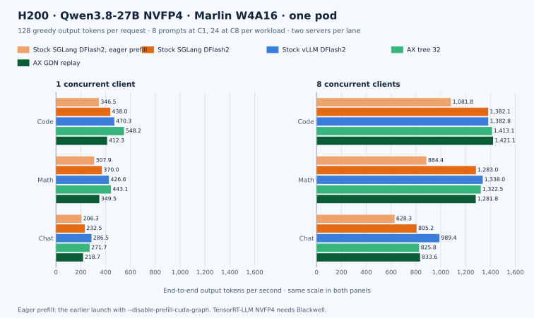

# H200 · Qwen3.8-27B NVFP4: prefill CUDA graphs and stock vLLM on one pod (2026-11-28)

Qwen3.8-27B NVFP4 (ModelOpt mixed precision) with the DFlash2 drafter on one H200 SXM (SM90, 143,771 MiB,
driver 595.112.07). NVFP4 runs through SGLang's Marlin W4A16 fallback (`--fp4-gemm-backend marlin`,
`SGLANG_DISABLE_SILU_FP4_QUANT_FUSION=1`); Hopper has no FP4 tensor cores. SGLang 0.5.23, torch
2.14.1, FlashInfer 0.7.2, ax-engine-sglang 0.5.1 at 75738f5. Stock vLLM 0.34.0rc1.dev1105+g2f170a0fe
(torch 2.14.0, FlashInfer 0.7.4), which uses its own FP4 Marlin path on SM90.

Workload, runners and pooling as in `results/rtx_pro_6000_prefill_graph`: the 128-token retest (8
prompts per workload at one client, 24 at eight, greedy, exactly 128 tokens), two sweeps per server,
two servers per lane, eager and prefill-graph servers alternating route by route, then two stock vLLM
DFlash2 servers (8 sequences, 4,096-token context, 8,192 batched tokens, memory utilization 0.90,
prefix caching off, FP32 Mamba state, 7 speculative tokens). Cells pool every sweep except the first
sweep of each lane's first server.

## Results

Output tok/s, code / math / chat. First-token time is the median over the cell's requests.

| Route | Clients | Eager prefill | Prefill graphs | Change | First token (eager → graphs) |
|---|---:|---:|---:|---:|---:|
| Stock DFlash2 width 8 | 1 | 346.5 / 307.9 / 206.3 | 438.0 / 370.0 / 232.5 | +26.4 / +20.2 / +12.7% | 0.126 → 0.055 s |
| Stock DFlash2 width 8 | 8 | 1,081.8 / 884.4 / 628.3 | 1,382.1 / 1,283.0 / 805.2 | +27.8 / +45.1 / +28.2% | 0.254 → 0.127 s |
| AX tree 32 | 1 | 409.8 / 354.2 / 236.3 | **548.2 / 443.1** / 271.7 | +33.8 / +25.1 / +15.0% | 0.131 → 0.059 s |
| AX tree 32 | 8 | 1,091.2 / 886.9 / 615.5 | 1,413.1 / 1,322.5 / 825.8 | +29.5 / +49.1 / +34.2% | 0.251 → 0.129 s |
| AX GDN replay 8 | 1 | 325.0 / 289.5 / 193.5 | 412.3 / 349.5 / 218.7 | +26.9 / +20.7 / +13.0% | 0.131 → 0.055 s |
| AX GDN replay 8 | 8 | 1,077.8 / 908.3 / 629.1 | **1,421.1** / 1,281.8 / 833.6 | +31.9 / +41.1 / +32.5% | 0.253 → 0.125 s |

| Stock vLLM DFlash2 | Clients | Output tok/s | Tokens per verify | First token |
|---|---:|---:|---:|---:|
| | 1 | 470.3 / 426.6 / **286.5** | 7.07 / 5.62 / 3.51 | 0.045 s |
| | 8 | 1,382.8 / **1,338.0 / 989.4** | 6.17 / 5.90 / 3.14 | 0.134 s |

- **Prefill graphs.** Tokens per verify were unchanged (tree 32 at one client: 11.38-11.51 / 8.83 /
  4.92 in both modes). First-token time halved, and SGLang gained 13-34% at one client and 28-49% at
  eight, more than on the RTX PRO 6000 (7-34%): eager prefills on this pod took 0.13 s at one client.
- **Against stock vLLM, same pod.** With eager prefill every SGLang route trailed vLLM by 13-38%. With
  prefill graphs the tree led code at one client (+16.6%) and was level on math (+3.9%); at eight
  clients the tree and replay were level with vLLM on code and math (−4.2 to +2.8%). vLLM still led
  chat by 5-24%, and stock SGLang and replay at one client by 7-24%.
- **vLLM warm-up.** Both vLLM servers ran their first eight-client sweep slower than the second (code
  1,368.7 / 1,221.9 against 1,479.2 / 1,481.4); the second sweeps alone give 1,480.3 / 1,380.6 /
  1,012.8 at eight clients. SGLang's sweeps agreed within 5.6%.
- **Outputs.** Greedy outputs matched between eager and prefill-graph servers on 66-69 of 72
  one-client requests per route and 185-209 of 216 at eight clients.

The Marlin W4A16 GEMM is still about half of a verify round on SM90 (`results/h200_tree_sweep`), so
the remaining gap to vLLM at one client is per-step cost.

## Files

`benchmarks/sglang/hopper_tree_sweep.py` (default Marlin backend; eager lanes with
`AX_BENCH_EAGER_PREFILL=1`) and the cross-engine vLLM client.
