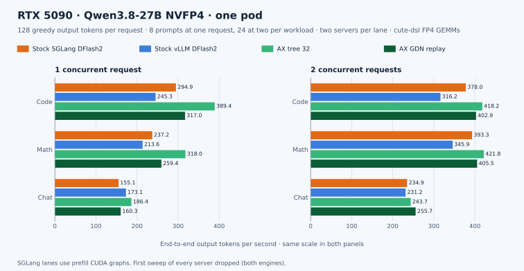

# RTX 5090 · Qwen3.8-27B NVFP4: prefill CUDA graphs and stock vLLM on one pod (2026-11-28)

Qwen3.8-27B NVFP4 (ModelOpt mixed precision) with the DFlash2 drafter on one GeForce RTX 5090 (SM120,
32,607 MiB, driver 595.91.07). SGLang 0.5.23, torch 2.14.1, FlashInfer 0.7.2, ax-engine-sglang 0.5.1
at 42c0cde, FlashInfer cute-dsl FP4 GEMMs (the add-on's SM12x default). Stock vLLM
0.34.0rc1.dev1105+g2f170a0fe (torch 2.14.0, FlashInfer 0.7.4).

The 5090 server shape: two request slots, 4,096 KV tokens, static memory fraction 0.94,
`SGLANG_FLASHINFER_WORKSPACE_SIZE=67108864`, and `AX_SSM_POSITIONS=8` on the stock and tree lanes
(GDN replay refuses it). Workload as in `results/rtx_pro_6000_prefill_graph` with two clients in place
of eight: 8 prompts per workload at one request and 24 at two, greedy, exactly 128 tokens, two sweeps
per server, two servers per lane, eager and prefill-graph servers alternating route by route. Stock
vLLM: 2 sequences, 4,096-token context, 2,048 batched tokens, memory utilization 0.92, FP8 KV cache
(as in the earlier 5090 cross-engine run), prefix caching off, FP32 Mamba state, 7 speculative tokens.
The replay lanes ran after vLLM, the others before. Cells pool every sweep except the first sweep of
each lane's first server.

## Results

Output tok/s, code / math / chat. First-token time is the median over the cell's requests.

| Route | Requests | Eager prefill | Prefill graphs | Change | First token (eager → graphs) |
|---|---:|---:|---:|---:|---:|
| Stock DFlash2 width 8 | 1 | 271.5 / 229.4 / 149.0 | 328.6 / 268.9 / 162.6 | +21.0 / +17.2 / +9.1% | 0.135 → 0.053 s |
| Stock DFlash2 width 8 | 2 | 352.5 / 354.1 / 223.8 | 442.9 / 439.1 / 264.4 | +25.6 / +24.0 / +18.1% | 0.155 → 0.072 s |
| AX tree 32 | 1 | 333.7 / 280.4 / 177.1 | **422.5 / 343.6 / 205.7** | +26.6 / +22.5 / +16.1% | 0.138 → 0.056 s |
| AX tree 32 | 2 | 376.3 / 361.5 / 229.7 | **464.0 / 461.1 / 271.0** | +23.3 / +27.6 / +18.0% | 0.158 → 0.075 s |
| AX GDN replay 8 | 1 | 278.7 / 235.1 / 153.4 | 339.5 / 277.4 / 168.2 | +21.8 / +18.0 / +9.6% | 0.135 → 0.052 s |
| AX GDN replay 8 | 2 | 358.0 / 357.7 / 229.6 | 457.2 / 451.0 / **271.0** | +27.7 / +26.1 / +18.0% | 0.155 → 0.071 s |

| Stock vLLM DFlash2 | Requests | Output tok/s | Tokens per verify | First token |
|---|---:|---:|---:|---:|
| | 1 | 291.5 / 253.1 / 179.6 | 6.87 / 5.73 / 3.40 | 0.114 s |
| | 2 | 421.0 / 402.9 / 268.6 | 6.30 / 5.86 / 3.07 | 0.144 s |

- **Prefill graphs.** SGLang gained 9-27% at one request and 18-28% at two, with tokens per verify
  unchanged (tree 32 at one request: 11.1-11.3 / 8.75 / 4.7-4.8). The prefill graphs took 0.73 GB and
  fit the 32 GB budget with 1.7 GB to spare.
- **Against stock vLLM, same pod.** With prefill graphs the tree led vLLM on every workload: +44.9 /
  +35.8 / +14.5% at one request and +10.2 / +14.4 / +0.9% at two. Stock SGLang and replay led code and
  math at both counts and trailed chat at one request (−9.5% and −6.3%). With eager prefill the SGLang
  routes trailed vLLM by 4-17%, except the one-request tree, which led code and math (+14.5 / +10.8%).
- **Outputs.** Greedy outputs matched between eager and prefill-graph servers on 51-54 of 72
  one-request requests per route and 87-102 of 216 at two, fewer than on the RTX PRO 6000 (69-72 of
  72). A likely cause is that prefill graphs pad a prefill to the next captured token count, which
  changes the GEMM shapes the FP4 kernels see (not verified); tokens per verify were unaffected. Use the verified profile for
  exact outputs.
- **Spread.** Pass-to-pass spread per cell was at most 4.0%.

This replaces the earlier 5090 comparison (ten pooled prompts, eager prefill, CUTLASS GEMMs), where
stock vLLM DFlash2 reached 1.25 times the AX tree at one request.

## Files

`benchmarks/sglang/hopper_tree_sweep.py` (`AX_SWEEP_FP4_BACKEND=flashinfer_cutedsl`,
`AX_SWEEP_SLOTS=2 AX_SWEEP_KV_TOKENS=4096 AX_SWEEP_MEM=0.94 AX_SWEEP_CONCURRENCY=1,2`; eager lanes
with `AX_BENCH_EAGER_PREFILL=1`) and the cross-engine vLLM client with the 5090 settings above.
