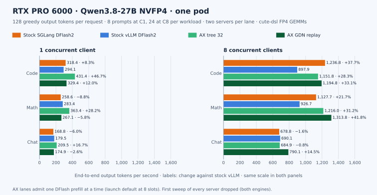

# RTX PRO 6000 · Qwen3.8-27B NVFP4: prefill CUDA graphs and stock vLLM on one pod (2026-11-27)

Qwen3.8-27B NVFP4 (ModelOpt mixed precision) with the DFlash2 drafter on one RTX PRO 6000 Blackwell
**Workstation** Edition (SM120, 97,887 MiB, 600 W, driver 595.112.07). SGLang 0.5.23, torch 2.14.1,
FlashInfer 0.7.2, ax-engine-sglang 0.5.1 at 58f7d63 plus this change, FlashInfer cute-dsl FP4 GEMMs
(the add-on's SM12x default). Stock vLLM 0.34.0rc1.dev1105+g2f170a0fe (the cross-engine build; torch
2.14.0, FlashInfer 0.7.4). Earlier PRO 6000 reports used the Server Edition, so compare lanes within
this report.

Workload: the 128-token retest of `results/rtx_pro_6000_retest` (B300 prompt file, SHA-256
`7f5953285f237f81…`), chat-templated token IDs with thinking off, greedy, exactly 128 output tokens,
the first 8 prompts per workload at one client and 24 at eight, one- and eight-request warm-ups,
two sweeps per server. Each lane ran on two servers; eager and prefill-graph servers alternated route by
route. Cells pool every sweep except the first sweep of each lane's first server, where kernels compile on first use (SGLang
stock width 8 eager, code at eight clients: 601.9 tok/s in that sweep, 1,080-1,098 afterwards).

## Why

The 27B harnesses (`bench_27b_nvfp4.py`, and `hopper_tree_sweep.py` through it, and
`tree_width_study.py`) passed `--disable-prefill-cuda-graph`, as the Flash Next harness did
(`results/b200x2_flash_next_prefill_graph`). With it, every prefill runs eagerly and stops the decode
batch that is running.

## Results

Output tok/s, code / math / chat. First-token time is the median over the cell's requests.

| Route | Clients | Eager prefill | Prefill graphs | Change | First token (eager → graphs) |
|---|---:|---:|---:|---:|---:|
| Stock DFlash2 width 8 | 1 | 299.8 / 248.5 / 165.6 | 337.5 / 273.6 / 177.9 | +12.6 / +10.1 / +7.4% | 0.086 → 0.039 s |
| Stock DFlash2 width 8 | 8 | 1,080.9 / 977.7 / 624.4 | 1,310.4 / 1,226.2 / 725.7 | +21.2 / +25.4 / +16.2% | 0.165 → 0.072 s |
| AX tree 32 | 1 | 401.2 / 340.1 / 204.8 | **464.8 / 389.5 / 222.0** | +15.9 / +14.5 / +8.4% | 0.088 → 0.041 s |
| AX tree 32 | 8 | 1,097.4 / 980.7 / 602.7 | 1,349.4 / 1,281.5 / 714.5 | +23.0 / +30.7 / +18.5% | 0.170 → 0.079 s |
| AX GDN replay 8 | 1 | 311.8 / 257.3 / 172.3 | 349.9 / 284.6 / 184.8 | +12.2 / +10.6 / +7.3% | 0.084 → 0.038 s |
| AX GDN replay 8 | 8 | 1,130.4 / 1,038.0 / 699.7 | **1,464.4 / 1,389.7 / 835.2** | +29.5 / +33.9 / +19.4% | 0.168 → 0.071 s |

| Stock vLLM DFlash2 (7 speculative tokens) | Clients | Output tok/s | Tokens per verify | First token |
|---|---:|---:|---:|---:|
| | 1 | 317.2 / 292.0 / 182.9 | 6.51 / 5.72 / 3.37 | 0.041 s |
| | 8 | 1,144.9 / 1,157.5 / 775.5 | 5.67 / 5.73 / 3.15 | 0.122 s |

- **Prefill graphs.** Tokens per verify were unchanged (stock width 8 at one client: 6.87 / 5.36 / 3.38
  in both modes), so the whole gain is prefill time: first-token time fell by more than half, and at
  eight clients each request waits through fewer stalled decode rounds. The prefill graphs took 0.8 GB.
- **Against stock vLLM, same pod.** With eager prefill (the earlier harness) every SGLang route trailed
  vLLM at eight clients on math and chat (−9.8 to −22.3%), as the cross-engine PRO 6000 section reported.
  With prefill graphs, GDN replay led vLLM on all three workloads at eight clients (+27.9 / +20.1 /
  +7.7%), the tree led code and math (+17.9 / +10.7%, chat −7.9%) and stock SGLang led code and math
  (+14.5 / +5.9%, chat −6.4%). At one client the tree led every workload (+46.5 / +33.4 / +21.4%);
  stock SGLang and replay ranged from −6.3% to +10.3% against vLLM.
- **Outputs.** Greedy outputs matched between eager and prefill-graph servers on 72/72 one-client
  requests of the stock and replay routes and 69/72 of the tree; at eight clients 170-178 of 216
  matched (batch composition changes between runs, as with either mode alone).
- **Spread.** Pass-to-pass spread per cell was at most 4.3%, except eager tree 32 (10.2%) and eager
  replay (16.6%) at eight clients.

## Changes

- `bench_27b_nvfp4.py` keeps SGLang's prefill CUDA graphs for speed lanes and passes
  `--disable-prefill-cuda-graph` only for the parity lanes (or with `AX_BENCH_EAGER_PREFILL=1`, to
  reproduce earlier reports). `hopper_tree_sweep.py` inherits this; `tree_width_study.py`'s default
  server arguments drop the flag.
- ax-engine-sglang notes, for any speculative launch outside the parity path (`AX_NVFP4_VERIFY_PARITY`,
  `AX_QUALITY_PROFILE=verified`) that passes `--disable-prefill-cuda-graph`, that eager prefills
  stall the decode batch. The verified profile still sets the flag: its exact-output lanes were
  measured that way.
- 27B SGLang and AX numbers in reports before this one were measured with eager prefills; they
  understate SGLang at eight clients on every GPU measured.

## Files

Runners: `benchmarks/sglang/hopper_tree_sweep.py` (`AX_SWEEP_FP4_BACKEND=flashinfer_cutedsl`, lanes
`27b-nvfp4:stock8`, `:tree32`, `:replay8`; the eager lanes ran with `--disable-prefill-cuda-graph`) and
the cross-engine vLLM client (`--max-num-seqs 8`, 4,096-token context, 8,192 batched tokens,
`--gpu-memory-utilization 0.90`, prefix caching off, FP32 Mamba state, `{"method": "dflash",
"num_speculative_tokens": 7}`).
